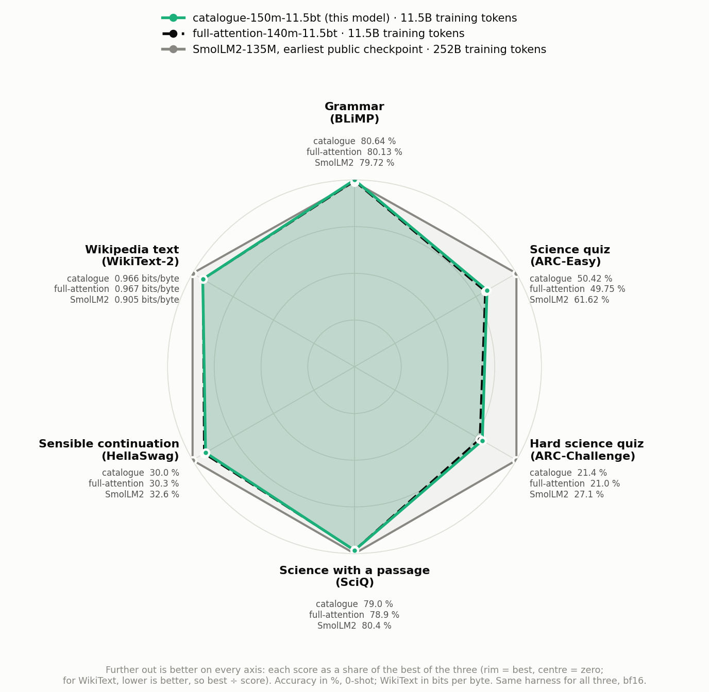
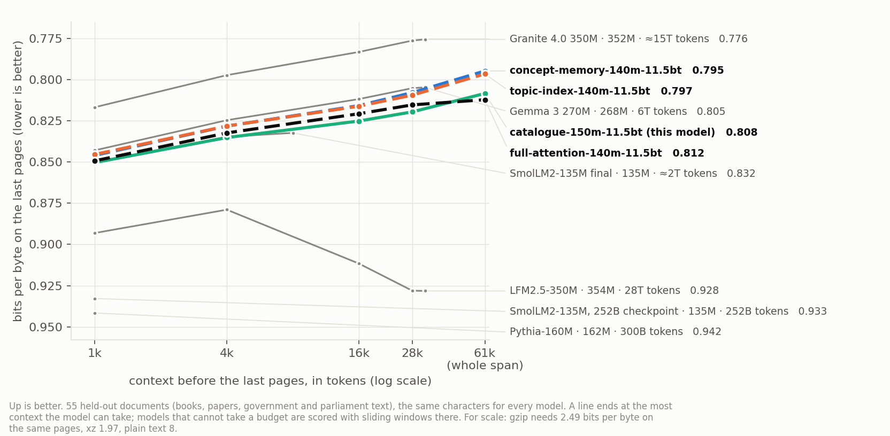
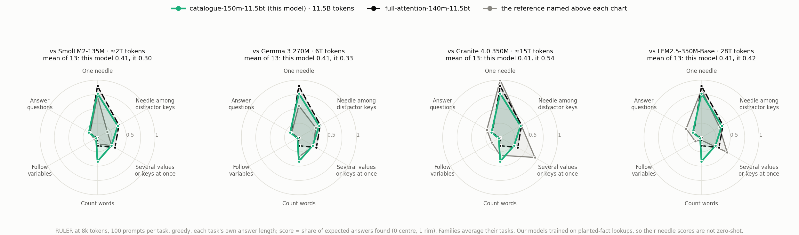
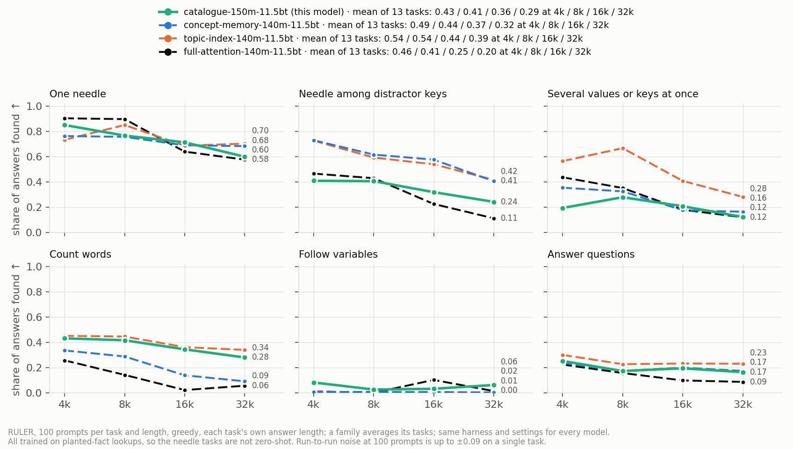
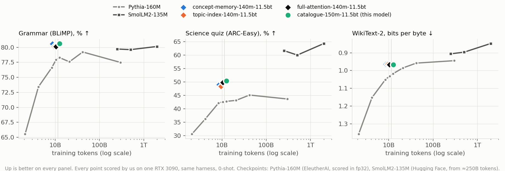

---
language:
  - en
license: apache-2.0
pipeline_tag: text-generation
library_name: transformers
tags:
  - mrcogito
  - meridian21
  - custom_code
  - catalogue
  - size-150m
  - budget-11.5bt
  - long-context
  - base-model
  - research
  - pytorch
  - e38                        # internal experiment code (secondary label)
datasets:
  - nvidia/Nemotron-CC-v2
  - nvidia/Nemotron-CC-Math-v1
  - nvidia/Nemotron-Pretraining-Specialized-v1
  - HuggingFaceTB/dclm-edu
  - common-pile/stackv2_edu_filtered
  - common-pile/project_gutenberg_filtered
  - common-pile/arxiv_papers_filtered
  - common-pile/doab_filtered
  - common-pile/usgpo_filtered
  - common-pile/uk_hansard_filtered
  - allenai/dolma3_longmino_pool
  - HuggingFaceTB/smol-smoltalk
model-index:
  - name: catalogue-150m-11.5bt
    results:
      - task: {type: text-generation, name: Grammar (BLiMP, 67 sets, 0-shot)}
        dataset: {type: blimp, name: BLiMP}
        metrics: [{type: accuracy, value: 80.64, name: accuracy (%)}]
      - task: {type: text-generation, name: Science quiz (ARC-Easy, 0-shot)}
        dataset: {type: allenai/ai2_arc, name: ARC-Easy, config: ARC-Easy, split: test}
        metrics: [{type: accuracy, value: 50.42, name: accuracy (%)}]
      - task: {type: text-generation, name: Language modelling (WikiText-2)}
        dataset: {type: wikitext, name: WikiText-2}
        metrics: [{type: perplexity, value: 1.954, name: byte perplexity (lower is better)}]
---

# catalogue-150m-11.5bt: a small base model that reads 64k tokens through a learned catalogue

**`Meridian21Lab/catalogue-150m-11.5bt`** · [Project page](https://ai.ksopyla.com/projects/concept-reasoning/) ·
[Code](https://github.com/ksopyla/MrCogito/tree/c34ba562) · [Evaluation details](EVALUATION.md) ·
[Training on W&B](https://wandb.ai/ksopyla/MrCogito/runs/perceiver_ar_perceiver_H896L3g1s9N128_20261119_221618_catalogue_reuse_n4_m120t_long) ·
Same data, other reads: [concept-memory-140m-11.5bt](https://huggingface.co/Meridian21Lab/concept-memory-140m-11.5bt) ·
[topic-index-140m-11.5bt](https://huggingface.co/Meridian21Lab/topic-index-140m-11.5bt) ·
[full-attention-140m-11.5bt](https://huggingface.co/Meridian21Lab/full-attention-140m-11.5bt)

A 145.6M-parameter English base language model, trained from scratch on 11.5B tokens of public data for about
$360. Its long-range read is a **catalogue**, our own design: as it reads, a small learned writer files every
256-token page under 64 index cards, about four tokens per card; for every next word the model compares itself with
the cards of all earlier pages, pulls the best ones and rereads their tokens word for word. The cards only decide
what to reread; the model never reads a summary in their place. A separate training signal, the only one the writer
receives, teaches the cards to point where the model's attention actually lands.

It is a public model of [MrCogito](https://ai.ksopyla.com/projects/concept-reasoning/), a project building models that
compress long text into concepts and reason over them. A research release: base model, one training seed, not
instruction-tuned.

Meridian21 trains several models on the same data, in the same order, for the same budget, with the same layers,
and changes only the reading layer, so each card compares them on the same tests. Released so far:
[concept-memory-140m-11.5bt](https://huggingface.co/Meridian21Lab/concept-memory-140m-11.5bt) (a concept memory),
[topic-index-140m-11.5bt](https://huggingface.co/Meridian21Lab/topic-index-140m-11.5bt) (Latent Sparse Attention),
this model, and [full-attention-140m-11.5bt](https://huggingface.co/Meridian21Lab/full-attention-140m-11.5bt), the
same layers with a reading layer that rereads every earlier token (full attention): the reference inside its 64k
training length, which the three memory reads are built to go past. The three memory models tie on the seven standard tasks (mean 46.5, 46.5 and
46.2 %); this model places highest of the three on the Tiny-ML Leaderboard (21st of 101), the other two read long
documents slightly better (0.795–0.797 against 0.808 bits per byte) and find more facts far back (RULER at 8k
0.44–0.54 against 0.41). Inside 64k, where full-attention-140m-11.5bt still fits, the catalogue costs little against
it: level on long documents (0.808 against 0.812 bits per byte), the standard tasks (46.5 against 46.2 %) and RULER
at 8k (0.41 each).

## Highlights

- **The best of our models on the Tiny-ML Leaderboard: 21st of 101.** The board ranks models up to 150M parameters
  on grammar, a science quiz and Wikipedia text, with a bonus for small size. By quality alone it is 13th; on grammar
  alone 8th, with **80.64 %** on BLiMP, above SmolLM2-135M's final model (80.15 %, trained on ≈2T tokens, about 170×
  ours). Of the 55 entries trained on 15B tokens or fewer, two place above it.
- **More from 11.5B tokens than Pythia-160M gets from 300B.** At our budget (10.5B and 12.6B tokens) Pythia-160M is
  2.4–2.7 points behind on grammar and 7.7–7.8 behind on the science quiz (ARC-Easy); at no published checkpoint up
  to its final 300B tokens (26× ours) does it reach this model's 80.64 % and 50.42 %.
- **Reads 64k-token documents, ahead of every same-size model.** On the last pages of 55 held-out 64k-token documents
  it needs **0.808 bits per byte** (lower is better; scale below): ahead of SmolLM2-135M final (0.832) and Pythia-160M
  (0.942), level with Gemma 3 270M (0.805; twice our size, 6T training tokens). It keeps gaining from far context up
  to 61k tokens, where the 32k models stop.
- **Finds facts far back better than SmolLM2-135M and Gemma 3 270M.** RULER, 13 tasks that hide facts in a long text
  and ask for them (score = share of expected answers found, 1 = all), at 8k tokens: **0.41**, ahead of SmolLM2-135M
  (0.30; ≈2T tokens) and Gemma 3 270M (0.33; 6T), level with LFM2.5-350M-Base (0.42; 28T). A single fact hidden in
  filler text is found in 99–100 % of prompts at every length up to 32k.
- **Cheap, open, and one line to load.** ≈45 hours on 4-GPU spot nodes (≈ $360). It loads with
  `AutoModelForCausalLM.from_pretrained(..., trust_remote_code=True)`, generates with 🤗 `generate` over a cached
  decoder and scores a whole 64k-token document in one pass on a single 24 GB RTX 3090; the leaderboard tests give
  the same scores through that loader as through our own. Every training source is a public Hugging Face dataset,
  every training stage is on public W&B, and every number on this card has its raw result file in this repository.

<p align="center"></p>

*Six standard benchmarks, same harness for all three, each score as a share of the best of the three (rim = best).
This model and full-attention-140m-11.5bt trained on 11.5B tokens each, SmolLM2-135M on 252B at this checkpoint.
Every number, the other models on the same data, Pythia-160M and LFM2.5-350M-Base included, in the table below.*

## Results at a glance

All numbers in this table come from **one harness**, run by us on RTX 3090 cards (2026-11-17/18 for the reference
models, 2026-11-21 for the two models on this card's data): EleutherAI's lm-evaluation-harness 0.4.11, 0-shot, all
test items, max length 2,048; each model in its training precision (our models, SmolLM2 and LFM2.5 in bf16, Pythia
in fp32). Long documents: our cross-model test (below). Accuracy in %, higher is better; best in each row in **bold**.

| Measure | Chance | **catalogue-150m-11.5bt** · 11.5B tokens | full-attention-140m-11.5bt ¹ · 11.5B | SmolLM2-135M · 252B ² | Pythia-160M · 300B ³ | LFM2.5-350M-Base · 28T ⁴ |
|---|---:|---:|---:|---:|---:|---:|
| Grammar (BLiMP, 67 sets) | 50 | **80.64** ± 0.14 | 80.13 | 79.72 | 77.48 | 80.17 |
| Science quiz (ARC-Easy) | 25 | 50.42 ± 1.03 | 49.75 | 61.62 | 43.64 (43.52) | **70.03** |
| Hard science quiz (ARC-Challenge) | 25 | 21.4 | 21.0 | 27.1 | 19.5 (18.8) | **38.2** |
| Sensible continuation (HellaSwag) | 25 | 30.0 | 30.3 | 32.6 | 28.4 | **37.1** |
| Science with a passage (SciQ) | 25 | 79.0 | 78.9 | 80.4 | 75.4 (74.1) | **90.1** |
| Last word of a passage (LAMBADA) | ≈0 | 33.3 | 31.3 | 35.0 | 35.4 (32.8) | **35.8** |
| Physical common sense (PIQA) | 50 | 61.8 | 62.1 | 65.9 | 62.3 (62.7) | **66.6** |
| Pronoun resolution (WinoGrande) | 50 | 50.0 | 50.0 | 50.9 | 51.2 (53.1) | **55.6** |
| **Mean of the 7 tasks above** | 28.6 | 46.5 | 46.2 | 50.5 | 45.1 | **56.2** |
| Wikipedia text (WikiText-2), bits per byte ↓ | — | 0.966 | 0.967 | **0.905** | 0.944 | 1.078 |
| **Long documents**, bits per byte ↓ (most context the model reads) | — | 0.808 (61k) | 0.812 (61k) | 0.933 (2k) | 0.942 (2k) | 0.879 (4k, its best) |
| **Gain from far context**, 1k → most, bits per byte ↑ | 0 | 0.042 | 0.037 | 0 (reads 2k) | 0 (reads 2k) | −0.035 (worse with more) |
| **Finding facts far back** (RULER at 8k, mean of 13) ↑ | ≈0 | 0.41 | 0.41 | — (reads 2k) | — (reads 2k) | 0.42 |
| Tiny-ML Leaderboard place (of 101) ⁵ | | 21st | 23rd | 9th | 44th (over the 150M cap) | 12th (over the 150M cap) |

¹ [full-attention-140m-11.5bt](https://huggingface.co/Meridian21Lab/full-attention-140m-11.5bt), Meridian21's
full-attention model on the same data: same data, order, budget and layers, with a reading layer that rereads every
earlier token (full attention, rotary positions). Inside its 64k training length it is the reference for the memory
reads, which are built for the lengths beyond it; differences inside 64k show what a read costs, not a contest.
² SmolLM2-135M's **earliest public training checkpoint** (step 240,000, ≈252B tokens, 22× ours), the closest to our
budget a reader can check; its final ≈2T-token model is in the leaderboard table below. These early checkpoints read
2,048 tokens; SmolLM2's 8k context came in its last training phase.
³ Pythia-160M's final checkpoint, scored by us in fp32 (it loses ≈6 ARC-Easy points in bf16). In brackets:
EleutherAI's own published zero-shot results (`evals/pythia-v1/pythia-160m` in their GitHub repository, quoted).
⁴ LFM2.5-350M-Base (Liquid AI, March 2026), 2.5× our size; training tokens as its card reports (quoted). Its card
states a 32k context; on these documents it predicts best with 4k and worse with more (checked in fp32 and bf16, two
attention kernels, Transformers 4.57 and 5.23).
⁵ The [Tiny-ML Leaderboard](https://huggingface.co/spaces/Glint-Research/Tiny-ML-Leaderboard) formula reproduced from
its page (snapshot of 2026-11-14), each of our runs placed on its own. WikiText-2 is reported there as byte perplexity:
1.954 for this model (bits per byte = log₂ of it).

**What "bits per byte" means.** The number of bits a model needs, on average, to store each byte (about one
character) of text it has not seen, using its own predictions: 0 would be perfect prediction, 8 is plain text with no
prediction at all, and lower is better. There is no 0-to-1 scale. On the same pages, gzip needs 2.49 bits per byte,
xz 1.97 and bzip2 1.77; this model needs 0.808, so it could store those pages in about a tenth of their size. It
counts bytes rather than tokens, so models with different tokenizers compare fairly. At these values a difference of
0.01 is about 1.2 %.

**Against the other models on the same data** (same tests, documents and settings): level with
topic-index-140m-11.5bt and concept-memory-140m-11.5bt on the seven standard tasks (46.5 % against 46.5 % and
46.2 %), on grammar (80.64 % against 80.11 % and 80.56 %) and on WikiText (0.966 against 0.964 bits per byte); the
science quiz is 1.5–2.0 points higher (50.42 % against 48.40 % and 48.95 %, about 1.5 standard errors); long
documents 0.012–0.014 bits per byte behind (0.808 against 0.797 and 0.795; the other two better on 96–98 % of
documents); RULER 0.02–0.06 below concept-memory-140m-11.5bt and 0.08–0.13 below topic-index-140m-11.5bt. Against
full-attention-140m-11.5bt, the reference inside 64k: level on the seven standard tasks (46.5 % against 46.2 %),
WikiText (0.966 against 0.967 bits per byte), long documents (0.808 against 0.812) and RULER at 8k (0.41 each);
grammar 0.51 points higher (80.64 % against 80.13 %); RULER 0.03 lower at 4k, and at 16k and 32k full attention's
score falls further (0.25 and 0.20 against 0.36 and 0.29). Paired differences with intervals:
[EVALUATION.md](EVALUATION.md#models-on-the-same-data).

## Long documents

<p align="center"></p>

Every model reads the same characters: the last ≈16 KB of each 64k-token span is the target, and the context before
it is cut to the budget on the x-axis (sliding windows past a model's maximum length). Held-out documents from five
public sources (Gutenberg books, arXiv papers, open-access academic books, US government publications, UK
parliamentary debates); our models trained on other documents of these sources, the others may have seen these very
documents. One RTX 3090; reference models 2026-11-18, this model and full-attention-140m-11.5bt 2026-11-21.

| Model | Size | Training tokens | Reads at most | Bits per byte ↓ | Gain, 1k → most ↑ | Another document's far past ↓ |
|---|---:|---:|---:|---:|---:|---:|
| **catalogue-150m-11.5bt** | 145.6M | 11.5B | 64k | 0.808 | 0.042 [0.030, 0.056] | 0.842 |
| full-attention-140m-11.5bt | 141.5M | 11.5B | 64k | 0.812 | 0.037 [0.027, 0.049] | 0.835 |
| topic-index-140m-11.5bt | 141.5M | 11.5B | 64k | 0.797 | 0.049 [0.035, 0.065] | 0.834 |
| concept-memory-140m-11.5bt | 141.5M | 11.5B | 64k | 0.795 | **0.051** [0.037, 0.067] | 0.832 |
| SmolLM2-135M, 252B checkpoint | 134.5M | 252B | 2k | 0.933 | — | 0.932 |
| SmolLM2-135M, final | 134.5M | ≈2T | 8k | 0.832 | 0.018 [0.014, 0.024] | 0.836 |
| Pythia-160M | 162.3M | 300B | 2k | 0.942 | — | 0.941 |
| Gemma 3 270M | 268.1M | 6T | 32k | 0.805 | 0.038 [0.029, 0.049] | 0.827 |
| Granite 4.0 350M base | 352.4M | ≈15T | 32k | **0.776** | 0.041 [0.033, 0.051] | **0.798** |
| LFM2.5-350M-Base | 354.5M | 28T | 32k | 0.879 at 4k; 0.928 at 28k | −0.035 [−0.051, −0.020] | 0.933 |

Training tokens as each card reports them (quoted); 95 % bootstrap intervals over documents. "Another document's
far past": the own last 4k tokens kept, everything older taken from a different document of the same source.

- **Ahead of every same-size model,** on 60 % (SmolLM2-135M final, +0.024) to 98 % (SmolLM2-135M at 252B, +0.124)
  of documents, because it reads 8–30 times further back; level with Gemma 3 270M (0.004 bits per byte apart,
  [−0.010, +0.018]) and ahead of LFM2.5-350M-Base at its best (+0.070 [0.048, 0.092]).
- **It keeps gaining from far context past 32k:** 0.030 bits per byte from 1k to 28k (Gemma 3 270M 0.038, Granite
  4.0 350M 0.041, the 32k models trained on 500–1,300 times more text), then 0.012 more from 28k to 61k.
- **It reads the content.** With another document's far past it scores worse than a plain 4k cut (0.842 against
  0.835), and worse than the real past on all 55 documents.
- **Next to the other models on the same data:** 0.012 bits per byte behind topic-index-140m-11.5bt and 0.014 behind
  concept-memory-140m-11.5bt (they are better on 96 % and 98 % of documents), with a slightly smaller gain from far
  context (0.042 against 0.049–0.051). Level with full-attention-140m-11.5bt, the reference inside 64k (0.808 against
  0.812, difference [−0.009, +0.001]), which gains 0.034 from 1k to 28k and 0.003 more from 28k to 61k.

Our own tests of the read (context cut in our tokens, the far read switched off, 16k and 128k documents) are in
[EVALUATION.md](EVALUATION.md#our-own-long-context-tests). In short: switching the far read off costs 0.28 nats per
token at 64k, on every document; past 64k, the training length, extra context no longer helps, so feed the last
≈64k tokens; past 64k this model loses the least of the three memory models (at 128k the whole document is 0.020
nats per token worse than its last 61k, against 0.031 for topic-index-140m-11.5bt and 0.060 for
concept-memory-140m-11.5bt).

## Finding facts far back (RULER)

The standard long-context suite: 13 tasks, 100 prompts per task and length, greedy decoding, each task's own answer
length; score = share of the expected answers found in the reply (0 to 1, higher is better). Every model runs through
the same harness, its prompts sized in its own tokens; RTX 3090 cards, 2026-11-18 (reference models) and 2026-11-21
(this model and full-attention-140m-11.5bt). Not zero-shot for our models: two training stages included planted-fact
lookups of a similar shape.

<p align="center"></p>

| RULER at 8k, by task family | **catalogue-150m-11.5bt** | full-attention-140m-11.5bt | topic-index-140m-11.5bt | concept-memory-140m-11.5bt | SmolLM2-135M | Gemma 3 270M | Granite 4.0 350M | LFM2.5-350M-Base |
|---|---:|---:|---:|---:|---:|---:|---:|---:|
| One needle | 0.77 | 0.90 | 0.85 | 0.76 | 0.72 | 0.55 | **1.00** | 0.83 |
| Needle among distractor keys | 0.41 | 0.43 | 0.59 | **0.62** | 0.20 | 0.34 | 0.42 | 0.36 |
| Several values or keys at once | 0.28 | 0.35 | 0.67 | 0.33 | 0.28 | 0.29 | **0.70** | 0.51 |
| Count words | 0.42 | 0.14 | **0.45** | 0.29 | 0.11 | 0.34 | 0.31 | 0.05 |
| Follow variables | 0.03 | 0.00 | 0.00 | 0.01 | 0.06 | 0.00 | **0.17** | 0.13 |
| Answer questions | 0.17 | 0.16 | 0.23 | 0.17 | 0.15 | 0.15 | 0.27 | **0.31** |
| **Mean of the 13 tasks, 8k** | 0.41 | 0.41 | **0.54** | 0.44 | 0.30 | 0.33 | **0.54** | 0.42 |
| Mean of the 13 tasks, 4k | 0.43 | 0.46 | 0.54 | 0.49 | 0.40 | 0.48 | **0.62** | 0.47 |
| Mean of the 13 tasks, 16k | 0.36 | 0.25 | **0.44** | 0.37 | — | — | — | — |
| Mean of the 13 tasks, 32k | 0.29 | 0.20 | **0.39** | 0.32 | — | — | — | — |

- **Ahead of SmolLM2-135M and Gemma 3 270M at 8k** (0.41 against 0.30 and 0.33) and level with LFM2.5-350M-Base
  (0.42; 2.5× our size, ≈2,400× our training text); Granite 4.0 350M leads (0.54). At 4k Gemma 3 270M (0.48) and
  LFM2.5 (0.47) are ahead and SmolLM2-135M behind (0.40); the order changes at 8k, where the references fall.
- **Where it is strong:** counting words (0.42 at 8k; the references 0.05–0.34), and the needle in noise filler,
  found in 99–100 % of prompts from 4k to 32k. **Where it is weak:** needles among distractor keys and several facts
  at once (0.41 and 0.28), and IDs written as 32-character UUIDs (0.00–0.57).
- **Next to the other models on the same data:** below concept-memory-140m-11.5bt by 0.06 [0.04, 0.08], 0.03 [0.01,
  0.05], 0.02 [−0.003, 0.036] and 0.03 [0.01, 0.05] at 4k, 8k, 16k and 32k, and below topic-index-140m-11.5bt by 0.08
  to 0.13 at every length (95 % bootstrap over prompts); both lead on distractor keys, and the topic index on several
  facts at once; this model counts words as well as the topic index. Against full-attention-140m-11.5bt (the no-harm
  check inside 64k): 0.03 lower at 4k (−0.026 [−0.047, −0.004]), level at 8k; at 16k and 32k full attention's score
  falls further (0.25 and 0.20). Every task at every length:
  [EVALUATION.md](EVALUATION.md#ruler).

<p align="center"></p>

*RULER by task family, 4k to 32k tokens: this model (aqua) and the other models on the same data (dashed), same
harness and settings, 100 prompts per task and length.*

## Tiny-ML Leaderboard

The board ranks models up to 150M parameters on grammar (BLiMP), the easy science quiz (ARC-Easy) and Wikipedia text
(WikiText-2 byte perplexity, lower is better), with a bonus of up to 50 % for small size. Board entries are the
board's own runs (quoted, snapshot 2026-11-14); rows in *italics* are our runs of other models, each placed on its own.

| Place | Model | Size | Training tokens | BLiMP % ↑ | ARC-Easy % ↑ | WikiText-2 byte ppl ↓ | Quality ⁶ | Board score |
|---:|---|---:|---:|---:|---:|---:|---:|---:|
| 1 | Tiny Chick 10M V3 | 9.6M | 24.6B | 77.76 | 59.60 | 2.335 | 77.8 | 87.7 |
| 2 | Tiny Chick 10M V2.1 | 9.6M | 16.3B | 76.79 | 53.79 | 2.342 | 75.5 | 85.2 |
| 3 | Tiny Chick 10M V2 | 9.6M | 16.3B | 76.99 | 50.21 | 2.364 | 74.3 | 83.8 |
| 4 | Slayer139 1.02 | 139.3M | 24.0B | 79.22 | 65.91 | 1.862 | 81.7 | 83.4 |
| *(4)* | *SmolLM2-135M, final* | *134.5M* | *≈2T* | *80.15* | *64.27* | *1.799* | *81.5* | *83.2* |
| 5 | Boris-2-Think | 143.7M | 200B | 82.09 | 63.93 | 1.967 | 81.7 | 83.2 |
| 6 | Slayer149-ARC | 149.3M | 31B | 78.38 | 66.58 | 1.907 | 81.5 | 82.9 |
| 7 | Tiny Chick 10M | 9.6M | 8.3B | 75.12 | 48.53 | 2.287 | 73.3 | 82.7 |
| 8 | Slayer139 1.01 | 139.3M | 23.7B | 79.13 | 63.09 | 1.878 | 80.7 | 82.3 |
| *(9)* | *SmolLM2-135M, 252B checkpoint* | *134.5M* | *252B* | *79.72* | *61.62* | *1.873* | *80.4* | *82.1* |
| 9 | Glint-2 | 1.1M | ≈300B | 74.54 | 36.20 | 3.127 | 67.2 | 81.7 |
| 10 | Boris-2 | 143.7M | 200B | 81.13 | 59.76 | 1.895 | 80.2 | 81.7 |
| … | | | | | | | | |
| 19 | GoLLeM-v5 128M | 122.8M | 24.9B | 79.09 | 53.24 | 2.254 | 76.3 | 78.2 |
| 20 | Glint-1.3 (merged) | 982K | 100B | 68.70 | 32.50 | 3.080 | 64.1 | 78.2 |
| **21** | **catalogue-150m-11.5bt** | **145.6M** | **11.5B** | **80.64** | **50.42** | **1.954** | **76.7** | **78.1** |
| 22 | Ivme-Conversate-v3-Base | 24.8M | ≈15B | 78.49 | 39.02 | 2.136 | 71.7 | 78.1 |
| 23 | Supra-50M-Base | 51.8M | 20B | 76.30 | 46.00 | 2.040 | 73.5 | 78.0 |
| *(23)* | *full-attention-140m-11.5bt* | *141.5M* | *11.5B* | *80.13* | *49.75* | *1.955* | *76.3* | *77.8* |
| *(24)* | *concept-memory-140m-11.5bt* | *141.5M* | *11.5B* | *80.56* | *48.95* | *1.950* | *76.2* | *77.7* |
| *(26)* | *topic-index-140m-11.5bt* | *141.5M* | *11.5B* | *80.11* | *48.40* | *1.950* | *75.9* | *77.4* |
| … | | | | | | | | |
| *(44)* | *Pythia-160M (over the 150M cap)* | *162.3M* | *300B* | *77.48* | *43.64* | *1.924* | *73.5* | *74.5* |

⁶ Quality: the mean of BLiMP, ARC-Easy and the board's WikiText score, before the size bonus. By quality alone the
model is 13th of 101; on grammar alone, 8th. Of the 55 board entries that report 15B training tokens or fewer, two
place above it (Tiny Chick 10M at 8.3B tokens, JugnuLM-53M at 12B). Full board with our rows:
[EVALUATION.md](EVALUATION.md#tiny-ml-leaderboard).

## Data efficiency

"Data-efficient" here means a better score from the same number of training tokens, measured against the published
training checkpoints of Pythia-160M (one every 2.1B tokens) and SmolLM2-135M (from 252B tokens), all scored by us
with the same harness.

<p align="center"></p>

- **Same budget:** against Pythia-160M at 10.5B and 12.6B tokens, this model is ahead on every test: +2.4 to +2.7
  points of grammar, +7.7 to +7.8 on the science quiz, +3.3 to +4.5 on the 7-task mean, and 0.07–0.09 lower WikiText
  byte perplexity.
- **Tokens to match:** Pythia-160M does not reach this model's grammar or science-quiz score at any checkpoint up to
  300B tokens (26× ours); it reaches its WikiText score after ≈34B tokens (3×). SmolLM2-135M stays below its grammar
  score at every public checkpoint up to its final ≈2T tokens (79.72 %, 79.62 % and 80.15 % at 252B, 503B and ≈2T);
  it is ahead on the knowledge tests from its first checkpoint.
- **What it does not separate:** architecture from data. Part of the gap to Pythia is newer, cleaner data:
  full-attention-140m-11.5bt, on the same data and order, lands within 0.7 points on grammar, the science quiz and
  the 7-task mean (80.13 %, 49.75 %, 46.2 %) and level on WikiText (1.955), so on these tests the gap comes from the
  data and the shared training recipe, not from the read.

## What its text looks like

Nucleus sampling (temperature 0.7, top-p 0.9, repetition penalty 1.1), 60 new tokens, seed 0, not picked; prompt in
bold, unedited, cut at a sentence end (…). More seeds and beam-search outputs: `samples/samples_ours.json`.

> **The capital of France is** Paris, the largest city in Europe. It is the capital of France and the most populous
> city in the world. The French are a modern civilization that has been growing since ancient times. …
>
> **In 1905, Albert Einstein published** his famous theory of general relativity, which states that light travels at
> a speed faster than light. However, the theory was not yet fully understood by many physicists. …
>
> **def fibonacci(n):**
> ```python
>  return fibonacci(n-1) + fibonacci(n-2) for n in range(1, 30)
> def fibonacci(n): return fibonacci(n-1) + fibonacci(n-2) for n in range(1, 30
> ```

Fluent, on-topic English and code-shaped output; the facts are often wrong (Paris is neither Europe's largest city
nor the world's most populous; 1905 brought special, not general, relativity) and the code does not run, as expected
from a 150M base model at 11.5B tokens. The samples of the other models on the same data read the same.

## How the catalogue works

Think of a student reading a long book for an exam. Rereading every page for every answer is what full attention
does: exact, but the cost grows with the square of the book's length. The catalogue gives the student a **library
card catalogue**: every finished page gets a drawer of index cards, each card listing a few of the page's words, and
for each new question the student flips through the cards, pulls the best ones and rereads the words they point to.

```
 tokens ─► 3 local layers ─► ┌──── looped 4 times, shared weights ────┐ ─► 8 local layers ─► next token
          (last 128 tokens)  │ catalogue reading layer ─► 1 local layer │    (last 128 tokens)
                             └──────────────────────────────────────────┘
 catalogue reading layer, for each new token, one softmax over:
   4 learned empty slots + the last 512 tokens, word for word
   + up to 512 earlier tokens from its best cards (at most 128 cards), word for word
 cards: a 2-layer writer (4.1M parameters) files each closed 256-token page under 64 cards, every token under exactly
        one card, at most 16 per card (balanced filing); a card's key is the mean of its tokens' keys
```

A query scores every card of the pages before its own by cosine similarity (its best-matching head counts), keeps
the 128 best and takes their tokens, best card first, until it holds 512; each of the four passes chooses again. The
writer learns the filing only through an **index loss** that asks each card's score to predict how much of the
read's attention its tokens receive once opened: choosing which cards to open passes no gradient, so the next-token
loss does not reach the writer. The design differences from the two other memory
reads on the same data: concept-memory-140m-11.5bt also reads a one-line summary of every group it did not open, and
topic-index-140m-11.5bt builds its groups without gradients from the keys alone (Latent Sparse Attention, Kubicek et
al.); this model learns its filing. Per token, the read sees at most 1,028 positions word for word, plus one key per
card to score: a quarter of the earlier tokens, so the search still grows with length. A two-level search (pages
first, then the cards inside the best pages), the route past a million tokens, is built and switched off in this
release.

## Training

| | |
|---|---|
| **Parameters** | 145,607,265 (input and output share one token table, counted once); 126.7M without the 49,152 × 384 table, of which 4.1M are the card writer |
| **Shape** | width 896; 13 distinct layers; one catalogue reading layer; local layers see the last 128 tokens |
| **Tokenizer** | SmolLM2's (`HuggingFaceTB/SmolLM2-135M`), 49,152 tokens; every document starts with `<|endoftext|>` |
| **Budget** | 11.5B tokens in three length stages: 8.0B at 4k-token rows → 3.0B at 16k → 0.5B at 64k |
| **Optimizer** | Muon (peak 0.01) for the weight matrices, AdamW for the rest; bf16; seed 42 |
| **Machine** | AWS spot nodes with 4 × NVIDIA L40S (48 GB); restarted from checkpoints twice (a spot interruption, and a crash on 16k rows packed with thousands of tiny documents, fixed in the code) |
| **Time and cost** | ≈45 hours of node time (≈180 GPU-hours): 23.5 h, 12.9 h and 7.5 h for the three stages, ≈0.7 h of tests, the rest start-up and work redone after the restarts; ≈ $360 at ≈ $8/h spot; energy not measured |
| **Finished** | 2026-11-20 05:47 UTC |

**Data (`m21mix_v2`), all public Hugging Face datasets**, the same shards in the same order as every model on the
same data. Shares are of each stage's tokens.

| Stage | Tokens | What it reads |
|---|---:|---|
| 1. Main, 4k rows, documents packed | 8.0B | [Nemotron-CC v2](https://huggingface.co/datasets/nvidia/Nemotron-CC-v2) high-quality web 30 % and its Diverse-QA rewrites 22 %, [DCLM-Edu](https://huggingface.co/datasets/HuggingFaceTB/dclm-edu) (score ≥ 3) 12 %, educational code ([Stack v2 Edu](https://huggingface.co/datasets/common-pile/stackv2_edu_filtered)) 10 %, [Nemotron](https://huggingface.co/datasets/nvidia/Nemotron-Pretraining-Specialized-v1) Wikipedia rewrites 8 %, [Nemotron-CC-Math](https://huggingface.co/datasets/nvidia/Nemotron-CC-Math-v1) (4+) 8 %, Nemotron reading-comprehension QA 6 %, Nemotron math textbooks 4 % |
| 2. Decay, 16k rows, one document each | 3.0B | **long documents 60 %**: science PDFs ([Dolma 3 Longmino](https://huggingface.co/datasets/allenai/dolma3_longmino_pool)) 22 %, [Gutenberg](https://huggingface.co/datasets/common-pile/project_gutenberg_filtered) books 12 %, code packed per repository 12 %, [arXiv](https://huggingface.co/datasets/common-pile/arxiv_papers_filtered) 5 %, open-access books ([DOAB](https://huggingface.co/datasets/common-pile/doab_filtered)) 3 %, [US government documents](https://huggingface.co/datasets/common-pile/usgpo_filtered) 3 %, [UK Hansard](https://huggingface.co/datasets/common-pile/uk_hansard_filtered) 3 %; web replay 20 %; Nemotron InfiniByte reasoning 7 %; multi-hop "libraries" 6 %; planted-fact lookups 3 %; chat ([smol-smoltalk](https://huggingface.co/datasets/HuggingFaceTB/smol-smoltalk)) 4 % |
| 3. Long, 64k rows, one document each | 0.5B | science PDFs 30 %, books 25 %, code repositories 15 %, multi-hop libraries 10 %, lookups 5 %, web replay 5 %, arXiv 4 %, DOAB 3 %, US GPO 3 % |

The two constructed row types (about 3 % of all tokens): *multi-hop libraries*, the paragraphs of 20–160
2WikiMultihopQA training questions shuffled, with the questions and answers at the end; and *lookups*, 4–24 invented
facts planted in a real book passage and asked at the end. The test sets on this card (BLiMP, ARC, WikiText,
HotpotQA, SQuAD, the held-out long documents) are not in the training data. Stage-by-stage settings and losses:
[EVALUATION.md](EVALUATION.md#training-procedure).

## Scope and trade-offs

- **Base model.** No instruction or preference tuning; about 1 % of training text was chat transcripts rendered as
  plain text (the tokenizer folder carries a ChatML template for that reason). English, plus code.
- **Knowledge tests** (ARC, SciQ, HellaSwag, LAMBADA) are below SmolLM2-135M, which trained on 22× (at 252B) to
  ≈170× (final) more text, and LFM2.5-350M-Base (2.5× our size, ≈2,400× our text); at this size these tests track
  training tokens closely.
- **Next to the other memory models on the same data:** level on the standard tests; long documents 0.012–0.014 bits
  per byte behind; RULER 0.02–0.13 lower, mostly on needles among distractor keys and several facts at once; past
  64k it loses the least of the three.
- **Next to full-attention-140m-11.5bt** (inside 64k, where full attention is the reference): level on 64k documents
  and on RULER at 8k; 0.03 lower on RULER at 4k; 0.009 nats per token behind on 16k documents (0.4 %). At 128k,
  past both models' training length, full attention is 0.021 nats per token ahead on the whole document.
- **Speed of the read:** the 64k training stage (0.5B tokens) took 7.5 hours, against 1.7 hours for
  full-attention-140m-11.5bt on the same tokens, and scoring one 64k-token text takes about 10 s against 1.2 s (one
  RTX 3090); the read scores one card per four earlier tokens, so its search still grows with length.
- **Context:** trained and tested to 64k tokens. Past 64k, extra context no longer improves predictions (at 128k, the
  whole document is 0.020 nats per token worse than its last 61k, on 14 of 15 documents); feed the last ≈64k.
- **Hard RULER tasks:** variable tracking stays at 0.03–0.08 at every length, the UUID tasks at 0.00–0.57, and most
  tasks fall with length.
- **One training seed;** differences of a point or two between the models on the same data are within what a second
  seed could move.
- **Facts and safety:** it makes things up, and has no safety tuning or output filtering; not for high-stakes or
  user-facing use.

## What's next

- **Past 64k:** the lengths the memory reads are built for and full attention cannot afford. The two-level search
  (pages first, then the cards inside the best pages) is built and switched off in this release.
- **Longer budgets and larger models** with the best of the reads on the same data.
- **Reasoning over concepts** (built, switched off in all releases so far).

## How to use

Needs `torch` and `transformers` (tested with 4.57.6 and 5.23.0). The modeling code ships in this repository, so
loading takes `trust_remote_code=True`. Runs on one CUDA GPU in bf16.

```python
import torch
from transformers import AutoModelForCausalLM, AutoTokenizer

repo = "Meridian21Lab/catalogue-150m-11.5bt"
tok = AutoTokenizer.from_pretrained(repo, trust_remote_code=True)
model = AutoModelForCausalLM.from_pretrained(repo, trust_remote_code=True, dtype=torch.bfloat16).to("cuda")

inputs = tok("The capital of France is", return_tensors="pt").to("cuda")
out = model.generate(**inputs, max_new_tokens=40, do_sample=True, temperature=0.7, top_p=0.9,
                     repetition_penalty=1.1)
print(tok.decode(out[0], skip_special_tokens=True))

# scoring: mean next-token loss in nats per token
loss = model(**inputs, labels=inputs["input_ids"]).loss
```

- `generate` is 🤗 Transformers' own (sampling, greedy, beam search), running over the model's cached decoder, which
  reproduces the catalogue read step by step (greedy outputs with and without the cache are identical). This is a
  base model, not a chat model.
- **Long documents** (up to the 64k training length): add `attn_backend="flex"` to `from_pretrained` (PyTorch flex
  attention on CUDA). The default, `sdpa`, builds a dense attention mask and suits short inputs. To score a long
  document, pass `labels` and `logits_to_keep=1`: the loss is computed in chunks, and a whole 64k-token document
  takes one pass, about 10 s and 4 GB of GPU memory on an RTX 3090 (the logits of all 64k positions alone would
  take 12 GB).
- For exact scores, batch prompts of one length or score them one at a time: left padding moves the page edges and
  changes scores slightly.
- `modeling_perceiver_ar.py` is generated from the MrCogito source (`export_manifest.json` names the commit) and holds
  only MrCogito code. Evaluation code: [`6726dd47`](https://github.com/ksopyla/MrCogito/tree/6726dd47); training:
  [`c34ba562`](https://github.com/ksopyla/MrCogito/tree/c34ba562).

## Citation

```bibtex
@misc{sopyla2026catalogue150m,
  author       = {Sopyła, Krzysztof},
  title        = {catalogue-150m-11.5bt: a small base language model with a learned catalogue for long context},
  year         = {2026},
  publisher    = {Hugging Face},
  howpublished = {\url{https://huggingface.co/Meridian21Lab/catalogue-150m-11.5bt}},
  note         = {Meridian21 Lab, MrCogito project. Code: \url{https://github.com/ksopyla/MrCogito}}
}

@online{sopyla2026mrcogito,
  author  = {Sopyła, Krzysztof},
  title   = {MrCogito: Concept Reasoning Model},
  year    = {2026},
  url     = {https://ai.ksopyla.com/projects/concept-reasoning/},
  urldate = {2026-11-21}
}
```

## Licence

Weights, card and code: **Apache License 2.0** (text in `LICENSE`). The training data come from public Hub datasets
under their own licences: DCLM-Edu (CC BY 4.0), Dolma 3 Longmino (ODC-By), smol-smoltalk (Apache-2.0), the openly
licensed Common Pile sources, Nemotron-Pretraining-Specialized (CC BY 4.0, CC BY-SA 4.0, GFDL and NVIDIA terms per
subset), and NVIDIA's Nemotron-CC-v2 and Nemotron-CC-Math-v1 (gated on the Hub under NVIDIA's terms; about 45 % of
the training tokens). See each dataset's card for its terms.

## Changelog and contact

- 2026-11-21: first release (weights, modeling code, card, evaluation page, raw results, figures), together with
  full-attention-140m-11.5bt and the aligned cards of concept-memory-140m-11.5bt and topic-index-140m-11.5bt.

Krzysztof Sopyła · [ai.ksopyla.com](https://ai.ksopyla.com) · [Meridian21 Lab](https://huggingface.co/Meridian21Lab)
· questions and errors: open a discussion on this page.
