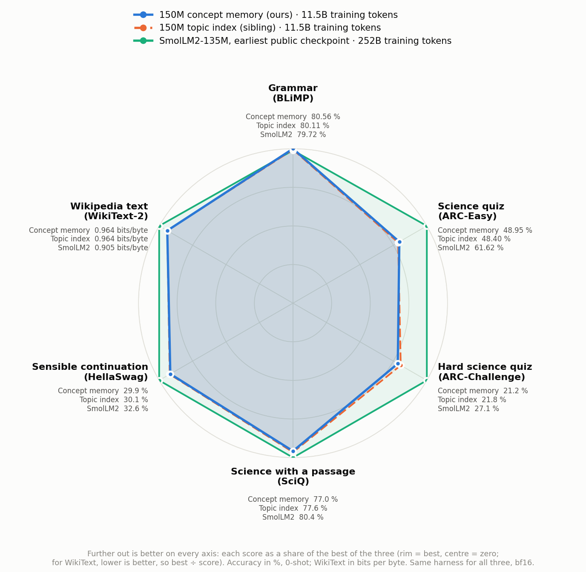
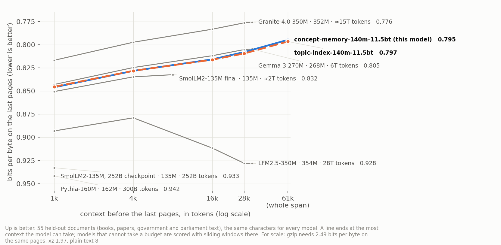

---
language:
  - en
license: apache-2.0
pipeline_tag: text-generation
library_name: transformers
tags:
  - mrcogito
  - meridian21
  - custom_code
  - concept-memory
  - size-140m
  - budget-11.5bt
  - long-context
  - base-model
  - research
  - pytorch
  - e38                        # internal experiment code (secondary label)
datasets:
  - nvidia/Nemotron-CC-v2
  - nvidia/Nemotron-CC-Math-v1
  - nvidia/Nemotron-Pretraining-Specialized-v1
  - HuggingFaceTB/dclm-edu
  - common-pile/stackv2_edu_filtered
  - common-pile/project_gutenberg_filtered
  - common-pile/arxiv_papers_filtered
  - common-pile/doab_filtered
  - common-pile/usgpo_filtered
  - common-pile/uk_hansard_filtered
  - allenai/dolma3_longmino_pool
  - HuggingFaceTB/smol-smoltalk
model-index:
  - name: concept-memory-140m-11.5bt
    results:
      - task: {type: text-generation, name: Grammar (BLiMP, 67 sets, 0-shot)}
        dataset: {type: blimp, name: BLiMP}
        metrics: [{type: accuracy, value: 80.56, name: accuracy (%)}]
      - task: {type: text-generation, name: Science quiz (ARC-Easy, 0-shot)}
        dataset: {type: allenai/ai2_arc, name: ARC-Easy, config: ARC-Easy, split: test}
        metrics: [{type: accuracy, value: 48.95, name: accuracy (%)}]
      - task: {type: text-generation, name: Language modelling (WikiText-2)}
        dataset: {type: wikitext, name: WikiText-2}
        metrics: [{type: perplexity, value: 1.950, name: byte perplexity (lower is better)}]
---

# 150M concept memory: a small base model that reads 64k tokens

**`Meridian21Lab/concept-memory-140m-11.5bt`** ·
[Project page](https://ai.ksopyla.com/projects/concept-reasoning/) ·
[Code](https://github.com/ksopyla/MrCogito/tree/1fddc505) · [Evaluation details](EVALUATION.md) ·
[Training on W&B](https://wandb.ai/ksopyla/MrCogito/reports/150M-concept-memory-vs-earlier-100M-runs--VmlldzoxODMxMjMwMw)

A 141.5M-parameter English base language model, trained from scratch on 11.5B tokens of public data for about
$320. Its new part is a **concept memory**: while it reads, it groups the text it has already seen into small
clusters of related tokens ("concepts", about 8 tokens each) and keeps a summary of each; for every next word it
rereads the few clusters that matter most word for word and glances at the summaries of all the others. Each of its
local layers sees only the last 128 tokens, yet the model uses up to 64k tokens of a document (about 50,000 words, a
short novel).

It is the first public model of [MrCogito](https://ai.ksopyla.com/projects/concept-reasoning/), a project building
models that compress long text into concepts and reason over them. A research release: base model, one training
seed, not instruction-tuned.

## Highlights

- **The best long-document prediction among models of its size.** On 55 held-out 64k-token documents (books,
  papers, government reports) it predicts the last pages at **0.795 bits per byte** (lower is better; scale below).
  Same-size models: SmolLM2-135M 0.832 (it reads 8k tokens), Pythia-160M 0.942 (2k). Larger ones: level with
  Gemma 3 270M (0.805; twice our size, 520× our training text), ahead of LFM2.5-350M-Base (0.879 at its best
  context), behind Granite 4.0 350M (0.776).
- **It uses the whole 61k-token past, and it reads it.** Its predictions keep improving as the context grows to 61k
  tokens (0.051 bits per byte from 1k to 61k): as much as Gemma 3 270M gains up to its 32k limit, and then further.
  Replace the far past with another document and the gain disappears, on 55 of 55 documents.
- **Strong for its training budget.** Grammar (BLiMP) 80.56 %: higher than SmolLM2-135M after 252B tokens (79.72 %)
  and than LFM2.5-350M-Base (80.17 %; 2.5× our size, 28T tokens), level with SmolLM2's final ≈2T-token model
  (80.15 %). Against Pythia-160M at our budget (10.5–12.6B tokens) it is ahead on every test; Pythia does not reach
  our grammar or science-quiz score at any checkpoint up to 300B tokens.
- **Finds a planted fact far back.** RULER's needle in real essays: 1.00 up to 16k tokens and 0.98 at
  32k (after training on similar lookups).
- **Cheap and open.** ≈40 hours on one 4-GPU node (≈ $320). A whole 64k document is scored in one pass on a single
  24 GB RTX 3090. Every training source is a public Hugging Face dataset, every training stage is on public W&B,
  and every number on this card comes with its raw result file in this repository.

<p align="center"></p>

*Six standard benchmarks, same harness for all three, each score as a share of the best of the three (rim = best).
Ours trained on 11.5B tokens, SmolLM2-135M on 252B at this checkpoint, Pythia-160M on 300B. All numbers in the
table below.*

## Results at a glance

All numbers in this table come from **one harness**, run by us on one RTX 3090 on 2026-11-17/18: EleutherAI's
lm-evaluation-harness 0.4.11, 0-shot, all test items, max length 2,048; each model in its training precision (ours,
SmolLM2 and LFM2.5 in bf16, Pythia in fp32). Long documents: our cross-model test (next section). Accuracy in %,
higher is better; best in each row in **bold**.

| Measure | Chance | **150M concept memory** · 11.5B tokens | SmolLM2-135M · 252B ¹ | Pythia-160M · 300B ² | LFM2.5-350M-Base · 28T ³ |
|---|---:|---:|---:|---:|---:|
| Grammar (BLiMP, 67 sets) | 50 | **80.56** ± 0.14 | 79.72 | 77.48 | 80.17 |
| Science quiz (ARC-Easy) | 25 | 48.95 ± 1.03 | 61.62 | 43.64 (43.52) | **70.03** |
| Hard science quiz (ARC-Challenge) | 25 | 21.2 | 27.1 | 19.5 (18.8) | **38.2** |
| Sensible continuation (HellaSwag) | 25 | 29.9 | 32.6 | 28.4 | **37.1** |
| Science with a passage (SciQ) | 25 | 77.0 | 80.4 | 75.4 (74.1) | **90.1** |
| Last word of a passage (LAMBADA) | ≈0 | 33.2 | 35.0 | 35.4 (32.8) | **35.8** |
| Physical common sense (PIQA) | 50 | 62.8 | 65.9 | 62.3 (62.7) | **66.6** |
| Pronoun resolution (WinoGrande) | 50 | 50.4 | 50.9 | 51.2 (53.1) | **55.6** |
| **Mean of the 7 tasks above** | 28.6 | 46.2 | 50.5 | 45.1 | **56.2** |
| Wikipedia text (WikiText-2), bits per byte ↓ | — | 0.964 | **0.905** | 0.944 | 1.078 |
| **Long documents**, bits per byte ↓ (most context the model reads) | — | **0.795** (61k) | 0.933 (2k) | 0.942 (2k) | 0.879 (4k, its best) |
| **Gain from far context**, 1k → most, bits per byte ↑ | 0 | **0.051** | 0 (reads 2k) | 0 (reads 2k) | −0.035 (worse with more) |
| Tiny-ML Leaderboard place (of 101) ⁴ | | 24th | 9th | 44th (over the 150M cap) | 12th (over the 150M cap) |

¹ SmolLM2-135M's **earliest public training checkpoint** (step 240,000, ≈252B tokens, 22× ours), the closest to
our budget a reader can check; its final ≈2T-token model is in the leaderboard table below. These early checkpoints
read 2,048 tokens; SmolLM2's 8k context came in its last training phase.
² Pythia-160M's final checkpoint, scored by us in fp32 (it loses ≈6 ARC-Easy points in bf16). In brackets:
EleutherAI's own published zero-shot results (`evals/pythia-v1/pythia-160m` in their GitHub repository, quoted).
³ LFM2.5-350M-Base (Liquid AI, March 2026), 2.5× our size; training tokens as its card reports (quoted). Its card
states a 32k context; on these documents it predicts best with 4k and worse with more (checked in fp32 and bf16,
two attention kernels, Transformers 4.57 and 5.23).
⁴ The [Tiny-ML Leaderboard](https://huggingface.co/spaces/Glint-Research/Tiny-ML-Leaderboard) formula reproduced
from its page (snapshot of 2026-11-14), each of our runs placed on its own. WikiText-2 is reported there as byte
perplexity: 1.950 for ours (bits per byte = log₂ of it).

**What "bits per byte" means.** The number of bits a model needs, on average, to store each byte (about one
character) of text it has not seen, using its own predictions: 0 would be perfect prediction, 8 is plain text with
no prediction at all, and lower is better. There is no 0-to-1 scale. On the same pages, gzip needs 2.49 bits per
byte, xz 1.97 and bzip2 1.77; our model needs 0.795, so it could store those pages in about a tenth of their size.
It counts bytes rather than tokens, so models with different tokenizers compare fairly. At these values a
difference of 0.01 is about 1.2 %.

## Long documents

<p align="center"></p>

Every model reads the same characters: the last ≈16 KB of each 64k-token span is the target, and the context
before it is cut to the budget on the x-axis (sliding windows past a model's maximum length). Held-out documents from
five public sources (Gutenberg books, arXiv papers, open-access academic books, US government publications, UK
parliamentary debates); ours trained on other documents of these sources, the others may have seen these very
documents. One RTX 3090, 2026-11-18.

| Model | Size | Training tokens | Reads at most | Bits per byte ↓ | Gain, 1k → most ↑ | Another document's far past ↓ |
|---|---:|---:|---:|---:|---:|---:|
| **150M concept memory** | 141.5M | 11.5B | 64k | **0.795** | **0.051** [0.037, 0.067] | 0.832 |
| SmolLM2-135M, 252B checkpoint | 134.5M | 252B | 2k | 0.933 | — | 0.932 |
| SmolLM2-135M, final | 134.5M | ≈2T | 8k | 0.832 | 0.018 [0.014, 0.024] | 0.836 |
| Pythia-160M | 162.3M | 300B | 2k | 0.942 | — | 0.941 |
| Gemma 3 270M | 268.1M | 6T | 32k | 0.805 | 0.038 [0.029, 0.049] | 0.827 |
| Granite 4.0 350M base | 352.4M | ≈15T | 32k | 0.776 | 0.041 [0.033, 0.051] | 0.798 |
| LFM2.5-350M-Base | 354.5M | 28T | 32k | 0.879 at 4k; 0.928 at 28k | −0.035 [−0.051, −0.020] | 0.933 |

Training tokens as each card reports them (quoted); 95 % bootstrap intervals over documents. "Another document's
far past": the own last 4k tokens kept, everything older taken from a different document of the same source.

- **Ours predicts long documents better than every same-size model,** on 75 % (SmolLM2-135M final) to 98 %
  (SmolLM2-135M at 252B) of documents, because it reads 8–30 times further back.
- **It gains from far context like the 32k models trained on 500–1,300 times more text, and keeps going:** 0.038
  bits per byte from 1k to 28k (Gemma 3 270M 0.038, Granite 4.0 350M 0.041), then 0.013 more from 28k to 61k.
- **It reads the content.** With another document's far past it scores like a plain 4k cut, worse than the real
  past on 55 of 55 documents.

Our own tests of the memory (context cut in our tokens, the memory or only its summaries switched off, 16k and 128k
documents) are in [EVALUATION.md](EVALUATION.md#our-own-long-context-tests). In short: switching the far read off
costs 0.29 nats per token at 64k; past 64k, the training length, extra context no longer helps, so feed the last
≈64k tokens.

## Tiny-ML Leaderboard

The board ranks models up to 150M parameters on grammar (BLiMP), the easy science quiz (ARC-Easy) and Wikipedia
text (WikiText-2 byte perplexity, lower is better), with a bonus of up to 50 % for small size. Board entries are the
board's own runs (quoted, snapshot 2026-11-14); rows in *italics* are our runs, placed one at a time.

| Place | Model | Size | Training tokens | BLiMP % ↑ | ARC-Easy % ↑ | WikiText-2 byte ppl ↓ | Quality ⁵ | Board score |
|---:|---|---:|---:|---:|---:|---:|---:|---:|
| 1 | Tiny Chick 10M V3 | 9.6M | 24.6B | 77.76 | 59.60 | 2.335 | 77.8 | 87.7 |
| 2 | Tiny Chick 10M V2.1 | 9.6M | 16.3B | 76.79 | 53.79 | 2.342 | 75.5 | 85.2 |
| 3 | Tiny Chick 10M V2 | 9.6M | 16.3B | 76.99 | 50.21 | 2.364 | 74.3 | 83.8 |
| 4 | Slayer139 1.02 | 139.3M | 24.0B | 79.22 | 65.91 | 1.862 | 81.7 | 83.4 |
| *(4)* | *SmolLM2-135M, final* | *134.5M* | *≈2T* | *80.15* | *64.27* | *1.799* | *81.5* | *83.2* |
| 5 | Boris-2-Think | 143.7M | 200B | 82.09 | 63.93 | 1.967 | 81.7 | 83.2 |
| 6 | Slayer149-ARC | 149.3M | 31B | 78.38 | 66.58 | 1.907 | 81.5 | 82.9 |
| 7 | Tiny Chick 10M | 9.6M | 8.3B | 75.12 | 48.53 | 2.287 | 73.3 | 82.7 |
| 8 | Slayer139 1.01 | 139.3M | 23.7B | 79.13 | 63.09 | 1.878 | 80.7 | 82.3 |
| *(9)* | *SmolLM2-135M, 252B checkpoint* | *134.5M* | *252B* | *79.72* | *61.62* | *1.873* | *80.4* | *82.1* |
| 9 | Glint-2 | 1.1M | ≈300B | 74.54 | 36.20 | 3.127 | 67.2 | 81.7 |
| 10 | Boris-2 | 143.7M | 200B | 81.13 | 59.76 | 1.895 | 80.2 | 81.7 |
| … | | | | | | | | |
| 23 | GPT-S-5M | 5.2M | 25B | 72.27 | 35.69 | 2.570 | 67.4 | 77.7 |
| **24** | **150M concept memory** | **141.5M** | **11.5B** | **80.56** | **48.95** | **1.950** | **76.2** | **77.7** |
| 25 | Glint-2.3 | 1.7M | 10B | 67.30 | 36.00 | 3.051 | 64.8 | 77.6 |
| 26 | Zedev-134M-Fudas | 134M | 20.7B | 81.69 | 46.38 | 1.880 | 76.0 | 77.6 |
| … | | | | | | | | |
| *(44)* | *Pythia-160M (over the 150M cap)* | *162.3M* | *300B* | *77.48* | *43.64* | *1.924* | *73.5* | *74.5* |

⁵ Quality: the mean of BLiMP, ARC-Easy and the board's WikiText score, before the size bonus. By quality alone the
model is 14th of 101; on grammar alone, 8th. Of the 55 entries that report 15B training tokens or fewer, it places
4th. Full board with our rows: [EVALUATION.md](EVALUATION.md#tiny-ml-leaderboard).

## Data efficiency

"Data-efficient" here means a better score from the same number of training tokens, measured against the published
training checkpoints of Pythia-160M (one every 2.1B tokens) and SmolLM2-135M (from 252B tokens), all scored by us
with the same harness.

<p align="center"></p>

- **Same budget:** against Pythia-160M at 10.5B and 12.6B tokens, ours is ahead on every test: +2.3 to +2.6
  points of grammar, +6.2 to +6.4 on the science quiz, +3 to +4 on the 7-task mean, and 0.07–0.09 lower WikiText
  byte perplexity.
- **Tokens to match:** Pythia-160M does not reach our grammar or science-quiz score at any checkpoint up to 300B
  tokens (26× ours); it reaches our WikiText score after ≈36B tokens (3.1×). SmolLM2-135M stays below our grammar
  score at 252B and 503B tokens and passes it at ≈2T; it is ahead on the knowledge tests from its first checkpoint.
- **What it does not separate:** the model as trained (architecture and data together). Part of the gap to Pythia is
  newer, cleaner data; a standard transformer of the same size on our exact data and budget will measure the
  architecture's share (queued).

## RULER

The standard long-context suite: 13 tasks, 100 prompts per task and length, greedy decoding, each task's own answer
length; score = share of the expected answers found in the reply (higher is better). One RTX 3090 per run, 2026-11-18. The needle
tasks are not zero-shot for this model: two training stages included planted-fact lookups of a similar shape.

| RULER | 4k | 8k | 16k | 32k |
|---|---:|---:|---:|---:|
| One number hidden in real essays | 1.00 | 1.00 | 1.00 | 0.98 |
| One number among distractor keys | 0.99 | 0.90 | 0.91 | 0.77 |
| One 32-character ID (UUID) hidden in essays | 0.29 | 0.27 | 0.07 | 0.07 |
| Several values of one key | 0.31 | 0.34 | 0.24 | 0.24 |
| Several keys asked at once | 0.40 | 0.32 | 0.11 | 0.09 |
| **Mean of the 13 tasks** | **0.49** | **0.44** | **0.37** | **0.32** |

All 13 tasks, and why an earlier run that cut answers at 32 tokens scored lower: [EVALUATION.md](EVALUATION.md#ruler).

## What its text looks like

Nucleus sampling (temperature 0.7, top-p 0.9, repetition penalty 1.1), 60 new tokens, seed 0, not picked; prompt
in bold, unedited, cut at a sentence end (…). More seeds and beam-search outputs: `samples/samples_ours.json`.

> **The capital of France is** Paris, the second largest city in the world, with a population of 7.5 million
> people. It is known for its rich history and culture, as well as its iconic landmarks such as the Eiffel Tower,
> Louvre Museum, and Notre-Dame Cathedral. …
>
> **In 1905, Albert Einstein published** his famous theory of general relativity, which was later later developed
> by Wolfgang Pauli. …
>
> **def fibonacci(n):**
> ```python
>     """Returns the nth Fibonacci number"""
>     if len(fibonacci) == 0:
>         return 0
> ```

Fluent, on-topic English and code-shaped output; the facts are often wrong (Paris has ≈2.1 million people; the 1905
paper was special relativity), as expected from a 140M base model at 11.5B tokens.

## How the concept memory works

Think of a student reading a long book for an exam. Rereading every page for every answer is what full attention
does: exact, but the cost grows with the square of the book's length. Our student keeps a **notebook** instead.

```
 tokens ─► 3 local layers ─► ┌──── looped 4 times, shared weights ────┐ ─► 8 local layers ─► next token
          (last 128 tokens)  │ memory-reading layer ─► 1 local layer  │    (last 128 tokens)
                             └────────────────────────────────────────┘
 memory-reading layer, for each new token, one softmax over:
   the document's first 4 tokens + the current and previous 512-token block, word for word
   + up to 512 tokens from the concepts that matter most, word for word ("opened")
   + one summary entry for every other concept (64 concepts per closed 512-token block)
```

Concepts are clusters of similar keys in each closed 512-token block (a balanced k-means, no learned parameters),
kept with a count, mean key, mean value and spread. From those, each new token estimates which clusters matter, opens
them and reads the rest as summaries, so every past token counts exactly once. The design's small "reasoner" over the
concepts is switched off in this release, which tests the memory only.

## Training

| | |
|---|---|
| **Parameters** | 141,506,208 (input and output share one token table, counted once); 122.6M without the 49,152 × 384 table |
| **Shape** | width 896; 13 distinct layers; one memory-reading layer; local layers see the last 128 tokens |
| **Tokenizer** | SmolLM2's (`HuggingFaceTB/SmolLM2-135M`), 49,152 tokens; every document starts with `<|endoftext|>` |
| **Budget** | 11.5B tokens in three length stages: 8.0B at 4k-token rows → 3.0B at 16k → 0.5B at 64k |
| **Optimizer** | Muon (peak 0.01) for the weight matrices, AdamW for the rest; bf16; seed 42 |
| **Machine** | one AWS spot node with 4 × NVIDIA L40S (48 GB) |
| **Time and cost** | ≈40 hours (≈160 GPU-hours) including ≈1 h of tests; ≈ $320 at ≈ $8/h spot, plus $15 for an optimizer test; energy not measured |
| **Finished** | 2026-11-16 23:16 UTC |

**Data (`m21mix_v2`), all public Hugging Face datasets.** Shares are of each stage's tokens.

| Stage | Tokens | What it reads |
|---|---:|---|
| 1. Main, 4k rows, documents packed | 8.0B | [Nemotron-CC v2](https://huggingface.co/datasets/nvidia/Nemotron-CC-v2) high-quality web 30 % and its Diverse-QA rewrites 22 %, [DCLM-Edu](https://huggingface.co/datasets/HuggingFaceTB/dclm-edu) (score ≥ 3) 12 %, educational code ([Stack v2 Edu](https://huggingface.co/datasets/common-pile/stackv2_edu_filtered)) 10 %, [Nemotron](https://huggingface.co/datasets/nvidia/Nemotron-Pretraining-Specialized-v1) Wikipedia rewrites 8 %, [Nemotron-CC-Math](https://huggingface.co/datasets/nvidia/Nemotron-CC-Math-v1) (4+) 8 %, Nemotron reading-comprehension QA 6 %, Nemotron math textbooks 4 % |
| 2. Decay, 16k rows, one document each | 3.0B | **long documents 60 %**: science PDFs ([Dolma 3 Longmino](https://huggingface.co/datasets/allenai/dolma3_longmino_pool)) 22 %, [Gutenberg](https://huggingface.co/datasets/common-pile/project_gutenberg_filtered) books 12 %, code packed per repository 12 %, [arXiv](https://huggingface.co/datasets/common-pile/arxiv_papers_filtered) 5 %, open-access books ([DOAB](https://huggingface.co/datasets/common-pile/doab_filtered)) 3 %, [US government documents](https://huggingface.co/datasets/common-pile/usgpo_filtered) 3 %, [UK Hansard](https://huggingface.co/datasets/common-pile/uk_hansard_filtered) 3 %; web replay 20 %; Nemotron InfiniByte reasoning 7 %; multi-hop "libraries" 6 %; planted-fact lookups 3 %; chat ([smol-smoltalk](https://huggingface.co/datasets/HuggingFaceTB/smol-smoltalk)) 4 % |
| 3. Long, 64k rows, one document each | 0.5B | science PDFs 30 %, books 25 %, code repositories 15 %, multi-hop libraries 10 %, lookups 5 %, web replay 5 %, arXiv 4 %, DOAB 3 %, US GPO 3 % |

The two constructed row types (about 3 % of all tokens): *multi-hop libraries*, the paragraphs of 20–160
2WikiMultihopQA training questions shuffled, with the questions and answers at the end; and *lookups*, 4–24 invented
facts planted in a real book passage and asked at the end. The test sets on this card (BLiMP, ARC, WikiText,
HotpotQA, SQuAD, the held-out long documents) are not in the training data. Stage-by-stage settings and losses:
[EVALUATION.md](EVALUATION.md#training-procedure).

## Scope and trade-offs

- **Base model.** No instruction or preference tuning; about 1 % of training text was chat transcripts rendered as
  plain text (the tokenizer folder carries a ChatML template for that reason). English, plus code.
- **Knowledge tests** (ARC, SciQ, HellaSwag, LAMBADA) are below SmolLM2-135M, which trained on 22× (at 252B) to
  ≈170× (final) more text, and LFM2.5-350M-Base (2.5× our size, ≈2,400× our text); at this size these tests track
  training tokens closely.
- **Context:** trained and tested to 64k tokens. Past 64k, extra context no longer improves predictions (at 128k,
  the whole document is 0.06 nats per token worse than its last 61k on 15 of 15 documents); feed the last ≈64k.
- **Several facts at once:** tasks that need many values or keys at once score lower than single lookups and fall
  with length (RULER table).
- **Controls not run yet:** one seed; no full-attention model of the same size on the same data, so the share of
  the architecture in any result is not separated from the data.
- **Facts and safety:** it makes things up, and has no safety tuning or output filtering; not for high-stakes or
  user-facing use.

## What's next

- **A standard transformer of the same size on the same data and budget** (queued), to measure how much of the
  long-document gain is the memory's.
- **Longer budgets and larger models** with the same memory, and a second memory design on the same data.
- **Reasoning over concepts:** the reasoner is built and tested, and switched off in this release.

## How to use

Needs `torch` and `transformers` (tested with 4.57.6 and 5.23.0). The modeling code ships in this repository, so
loading takes `trust_remote_code=True`. Runs on one CUDA GPU in bf16.

```python
import torch
from transformers import AutoModelForCausalLM, AutoTokenizer

repo = "Meridian21Lab/concept-memory-140m-11.5bt"
tok = AutoTokenizer.from_pretrained(repo, trust_remote_code=True)
model = AutoModelForCausalLM.from_pretrained(repo, trust_remote_code=True, dtype=torch.bfloat16).to("cuda")

inputs = tok("The capital of France is", return_tensors="pt").to("cuda")
out = model.generate(**inputs, max_new_tokens=40, do_sample=True, temperature=0.7, top_p=0.9,
                     repetition_penalty=1.1)
print(tok.decode(out[0], skip_special_tokens=True))

# scoring: mean next-token loss in nats per token
loss = model(**inputs, labels=inputs["input_ids"]).loss
```

- `generate` is 🤗 Transformers' own (sampling, greedy, beam search), running over the model's cached decoder. This
  is a base model, not a chat model.
- **Long documents** (up to the 64k training length): add `attn_backend="flex"` to `from_pretrained` (PyTorch flex
  attention on CUDA). The default, `sdpa`, builds a dense attention mask and suits short inputs.
- For exact scores, batch prompts of one length or score them one at a time: left padding moves the memory's block
  edges and changes scores slightly.
- `modeling_perceiver_ar.py` is generated from the MrCogito source by `scripts/export_hub_model.py`;
  `export_manifest.json` names the source commit. Our lm-eval adapter, the long-document scripts in `long_context/`
  and the sampling script that wrote `samples/` run from the MrCogito code at
  [`1fddc505`](https://github.com/ksopyla/MrCogito/tree/1fddc505).

## Citation

```bibtex
@misc{sopyla2026conceptmemory150m,
  author       = {Sopyła, Krzysztof},
  title        = {150M Concept Memory: a small base language model with a long-context concept memory},
  year         = {2026},
  publisher    = {Hugging Face},
  howpublished = {\url{https://huggingface.co/Meridian21Lab/concept-memory-140m-11.5bt}},
  note         = {Meridian21 Lab, MrCogito project. Code: \url{https://github.com/ksopyla/MrCogito}}
}

@online{sopyla2026mrcogito,
  author  = {Sopyła, Krzysztof},
  title   = {MrCogito: Concept Reasoning Model},
  year    = {2026},
  url     = {https://ai.ksopyla.com/projects/concept-reasoning/},
  urldate = {2026-11-18}
}
```

## Licence

Weights and card: **Apache License 2.0**. The training data come from public Hub datasets under their own licences:
DCLM-Edu (CC BY 4.0), Dolma 3 Longmino (ODC-By), smol-smoltalk (Apache-2.0), the openly licensed Common Pile
sources, Nemotron-Pretraining-Specialized (CC BY 4.0, CC BY-SA 4.0, GFDL and NVIDIA terms per subset), and NVIDIA's
Nemotron-CC-v2 and Nemotron-CC-Math-v1 (gated on the Hub under NVIDIA's terms; about 45 % of the training tokens).
See each dataset's card for its terms.

## Changelog and contact

- 2026-11-18: first public release (weights, card, evaluation page, raw results, figures).
- 2026-11-18: loads with 🤗 Transformers `from_pretrained` (modeling code, `generation_config.json` and `export_manifest.json` added; `config.json` gains `auto_map`).

Krzysztof Sopyła · [ai.ksopyla.com](https://ai.ksopyla.com) · [Meridian21 Lab](https://huggingface.co/Meridian21Lab)
· questions and errors: open a discussion on this page.
