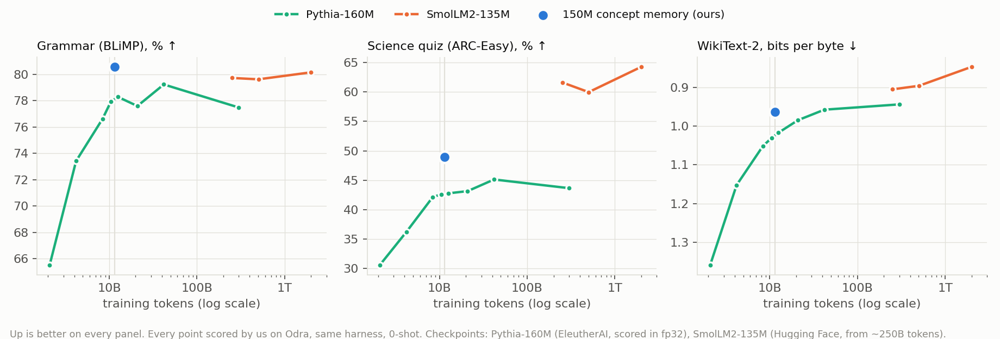

---
language:
  - en
license: apache-2.0
pipeline_tag: text-generation
# library_name is left out on purpose: the weights do not load with 🤗 Transformers alone yet (see "How to use").
# Add `library_name: transformers` and the `custom_code` tag once the repository ships its modeling code.
tags:
  - mrcogito
  - meridian21
  - concept-memory
  - size-140m
  - budget-11.5bt
  - long-context
  - base-model
  - research
  - pytorch
  - e38                        # internal experiment code (secondary label)
datasets:
  - nvidia/Nemotron-CC-v2
  - nvidia/Nemotron-CC-Math-v1
  - nvidia/Nemotron-Pretraining-Specialized-v1
  - HuggingFaceTB/dclm-edu
  - common-pile/stackv2_edu_filtered
  - common-pile/project_gutenberg_filtered
  - common-pile/arxiv_papers_filtered
  - common-pile/doab_filtered
  - common-pile/usgpo_filtered
  - common-pile/uk_hansard_filtered
  - allenai/dolma3_longmino_pool
  - HuggingFaceTB/smol-smoltalk
model-index:
  - name: concept-memory-140m-11.5bt
    results:
      - task: {type: text-generation, name: Grammar (BLiMP, 67 sets, 0-shot)}
        dataset: {type: blimp, name: BLiMP}
        metrics: [{type: accuracy, value: 80.56, name: accuracy (%)}]
      - task: {type: text-generation, name: Science quiz (ARC-Easy, 0-shot)}
        dataset: {type: allenai/ai2_arc, name: ARC-Easy, config: ARC-Easy, split: test}
        metrics: [{type: accuracy, value: 48.95, name: accuracy (%)}]
      - task: {type: text-generation, name: Language modelling (WikiText-2)}
        dataset: {type: wikitext, name: WikiText-2}
        metrics: [{type: perplexity, value: 1.950, name: byte perplexity (lower is better)}]
---

# 150M concept memory — a small base model with a long-context memory

**Hub id:** `Meridian21Lab/concept-memory-140m-11.5bt` · [Code](https://github.com/ksopyla/MrCogito/tree/1fddc505) ·
[W&B report](https://wandb.ai/ksopyla/MrCogito/reports/150M-concept-memory-vs-earlier-100M-runs--VmlldzoxODMxMjMwMw) ·
[Blog](https://ai.ksopyla.com) · internal labels: experiment E38, run `e33n_m120t_e37a_muon0.01_tok8.0e9_seed42`, arm
`e37a`

A 141.5M-parameter English base language model trained from scratch on 11.5B tokens of public data. Its one unusual
part is a **concept memory**: while it reads, it groups the text it has already seen into small clusters of related
tokens ("concepts", about 8 tokens each), keeps a short summary of every cluster, and when it predicts the next word
it rereads the few clusters that matter most word for word and glances at the summaries of all the others. That is
how it reaches back 64k tokens (about 50,000 words, a short novel) while each of its local layers only looks at the
last 128 tokens.

This is our first community release. It is a research checkpoint: a base model, not instruction-tuned, not a chat
model, one training seed. We publish it with its weak spots measured, because we would rather be checked than
believed.

> **Claim level.** On held-out long documents the model predicts text better when it can see more of the document,
> up to its 64k training length, and it does so from *that document's* content, not from generic "more text". On the
> same documents and text it predicts long documents better than SmolLM2-135M and Pythia-160M, which read at most 8k
> and 2k tokens, and as well as Gemma 3 270M (see [Long context](#long-context)). Past 64k, extra context makes it
> slightly worse. It retrieves a single planted fact 32k tokens back almost always, after training on similar lookup
> rows. It does **not** yet track several facts at once, it is far behind SmolLM2-135M on knowledge, and we have
> **not** compared it with a full-attention model of the same size on the same data, so no result here separates the
> architecture from the data. No claim here is about chat, safety or downstream tasks.

## Why try it

- **The best long-document predictor of its size we could test.** On 55 held-out 64k-token documents (books, papers,
  government reports), with as much of each document as each model can take, it predicts the last pages at **0.795
  bits per byte** (lower is better). SmolLM2-135M reaches 0.832 (it reads at most 8k tokens) and Pythia-160M 0.942
  (2k). Gemma 3 270M, twice our size and trained on ~520× more text, is level (0.805); Granite 4.0 350M, 2.5× our
  size on ~1,300× more text, is ahead (0.776). Same text and the same unit for every model.
- **It gains from far context as much as models trained on 500–1,300× more text, and keeps going.** From 1k to 28k
  tokens of context it saves 0.038 bits per byte, as Gemma 3 270M does (0.038) and close to Granite 4.0 350M (0.041);
  those stop at 32k, ours goes on to 61k for 0.051 in all. SmolLM2-135M saves 0.018 up to its 8k. Each local layer
  sees only the last 128 tokens: the reach is the memory's work.
- **It reads the document, not just "more text".** Put another document of the same kind in the far past and the
  gain disappears: it scores like a plain cut to 4k, and worse than the real past on 55 of 55 documents.
- **Data-efficient against a same-size model at the same budget.** At 11.5B training tokens it beats Pythia-160M at
  the same budget on every test we ran, and Pythia does not reach our grammar or science-quiz scores at any
  checkpoint up to 300B tokens (26×). On grammar it is level with SmolLM2-135M's final ~2T checkpoint and ahead of
  its ~250B one. How we measure this, and what it cannot separate, is in [Data efficiency](#data-efficiency).
- **Small, cheap and open.** A whole 64k-token document is scored in one pass on a single 24 GB RTX 3090. Two
  switches turn the far read, or only its summaries, off at inference. The test scripts, every per-document result,
  the code, the all-public data recipe and every training stage on W&B are public; the whole run cost ~$320. It
  shares SmolLM2's tokenizer.

**Where it is weak:** knowledge and reasoning (ARC-Easy 48.95 % against SmolLM2-135M's 64.27 %), several facts at
once, and anything past 64k tokens. Details in [Strengths and limitations](#strengths-and-limitations).

<p align="center"></p>

*Six measures, same harness for all three models, further out is better on every axis (centre: chance, 1.5 bits per
byte, or no gain; rim: the best of the three). The numbers are in [Evaluation](#evaluation).*

## Contents
1. [Why try it](#why-try-it) · [At a glance](#at-a-glance)
2. [How the concept memory works](#how-the-concept-memory-works)
3. [Uses](#uses)
4. [How to use](#how-to-use)
5. [Evaluation](#evaluation): [standard benchmarks](#standard-benchmarks) · [data efficiency](#data-efficiency) ·
   [long context](#long-context)
6. [Training](#training)
7. [Checkpoints and reproducibility](#checkpoints-and-reproducibility)
8. [Strengths and limitations](#strengths-and-limitations)
9. [Licence](#licence) · [Citation](#citation) · [Changelog and contact](#changelog-and-contact)

---

## At a glance

| | |
|---|---|
| **Parameters** | 141,506,208 unique (input and output share one token table, counted once); 122.6M without the 49,152 × 384 token table |
| **Shape** | width 896; 13 distinct layers; one memory-reading layer; local layers see the last 128 tokens |
| **Tokenizer** | SmolLM2's (`HuggingFaceTB/SmolLM2-135M`), 49,152 tokens |
| **Training data** | 11.5B tokens, all from public datasets on the Hub (details in [Training](#training)) |
| **Length stages** | 8.0B tokens at 4k-token rows → 3.0B at 16k → 0.5B at 64k |
| **Optimizer / seed** | Muon (peak 0.01) for the weight matrices, AdamW for the rest · seed 42 only |
| **Compute and cost** | ~40 machine hours on one 4 × NVIDIA L40S spot node (AWS g6e.12xlarge), ~$320 |
| **Finished** | 2026-11-16 23:16 UTC (training and AWS tests) |
| **Tiny-ML Leaderboard tests** | grammar 80.56 %, easy science quiz 48.95 %, WikiText-2 byte perplexity 1.950 → would place **24th of 101** (snapshot 2026-11-14) |
| **Context** | trained to 65,536 tokens and uses all of it; at 131,072, context beyond 64k makes predictions slightly worse |
| **Long documents** | 0.795 bits per byte on the last pages of 64k-token held-out documents (SmolLM2-135M 0.832, Gemma 3 270M 0.805; lower is better) |
| **Developed by** | Krzysztof Sopyła ([ai.ksopyla.com](https://ai.ksopyla.com)), [Meridian21 Lab](https://huggingface.co/Meridian21Lab) |
| **Code** | [github.com/ksopyla/MrCogito](https://github.com/ksopyla/MrCogito), commit [`1fddc505`](https://github.com/ksopyla/MrCogito/tree/1fddc505) (branch `eng-100m`) |
| **Licence** | Apache-2.0 |

---

## How the concept memory works

Think of a student reading a long book for an exam. Rereading every page for every answer is what full attention
does: exact, but the cost grows with the square of the book's length. Our student keeps a **notebook** instead.

```
 tokens ─► 3 local layers ─► ┌──────────── looped 4 times, shared weights ────────────┐ ─► 8 local layers ─► next token
          (last 128 tokens)  │ memory-reading layer ──► 1 local layer                  │    (last 128 tokens)
                             └─────────────────────────────────────────────────────────┘

 memory-reading layer, for each new token:
   every closed 512-token block ─► grouped by content into 64 concepts (~8 tokens each)
   one softmax over:  the document's first 4 tokens
                      + the current and previous 512-token block, word for word
                      + up to 512 tokens from the concepts that matter most, word for word ("opened")
                      + one summary entry for every other concept of the document
```

- **Writing the notebook.** Each finished block of 512 tokens is split into 64 clusters of similar keys (a balanced
  k-means, no learned parameters). A cluster keeps links to its tokens and a few running statistics: count, mean key,
  mean value, spread.
- **Reading it.** A new token estimates, from those statistics, how much attention each cluster would get. The
  largest are opened and read exactly; every other cluster enters as a single summary entry whose weight is that
  estimate. Every past token of the document is represented exactly once: in the recent window, opened, or inside one
  summary.
- **Past the training length** a length scale keeps the summaries' total weight from swamping the read as the
  document grows (set at 16,384 tokens).
- The design also has a small "reasoner" that thinks over the concepts; **it is switched off in this model**. This
  release tests the memory only, not reasoning over it.

---

## Uses

**Direct use (research).**
- Studying long-context language modelling at small scale: how much a model gains from far context on real
  documents, and from which part of its memory.
- A base for fine-tuning experiments (retrieval over long documents, summarisation of long inputs) where a 140M model
  that reads 64k tokens is useful.
- A reference entry for small-model comparisons such as the Tiny-ML Leaderboard.

**Out of scope.**
- **Chat or instructions.** It is a base model. About 1 % of its training text was chat transcripts rendered as plain
  text, and the tokenizer folder carries a ChatML template for that reason, but there was no instruction tuning and
  no preference training. It will not follow instructions reliably.
- **Facts you need to be true.** At this size and data budget it makes things up; it has no safety tuning and no
  output filtering.
- **Anything high-stakes or user-facing**, and languages other than English (code is in the mix; other languages are
  not).
- **Production long-document question answering.** It finds one planted fact well; it fails at several facts at once
  (see [Long context](#long-context)).
- **Inputs longer than 64k tokens.** Past its training length more context makes it slightly worse; feed the last
  ~64k tokens instead.

---

## How to use

**Status: the weights do not load from the Hub with 🤗 Transformers alone yet.** `perceiver_ar` is our own
architecture, the `config.json` has no `auto_map`, and the repository does not ship modeling code, so
`AutoModelForCausalLM.from_pretrained(..., trust_remote_code=True)` has nothing to run. Until that is added, load it
with the MrCogito code (tested on CUDA with PyTorch ≥ 2.10 and Transformers 4.57):

```bash
git clone https://github.com/ksopyla/MrCogito.git && cd MrCogito
git checkout 1fddc505       # the code this release was trained and tested with (branch eng-100m)
uv sync
```

```python
import torch
from huggingface_hub import snapshot_download
from transformers import AutoTokenizer
from evaluation.lm_eval_perceiver_ar import load_perceiver_ar_for_eval

path = snapshot_download("Meridian21Lab/concept-memory-140m-11.5bt")
tok = AutoTokenizer.from_pretrained(path)
# bf16 on CUDA, the flex-attention path; the loader turns off training-only kernels (Liger)
model = load_perceiver_ar_for_eval(path, device="cuda", attn_backend="flex")

# score text: per-token loss in nats (lower is better)
ids = tok("The quick brown fox jumps over the lazy dog.", return_tensors="pt").input_ids.cuda()
out, per_token, valid = model(input_ids=ids, labels=ids, return_per_token_loss=True)

# greedy continuation (a simple uncached loop: fine for short prompts, slow for long ones)
gen = model.generate(ids, max_new_tokens=40)
print(tok.decode(gen[0]))
```

Tested on 2026-11-17 on one RTX 3090 from the local checkpoint folder (not yet from the Hub). In training every
document starts with `<|endoftext|>` (id 0); prepending it to a prompt matches what the model saw.

**What its text looks like** (greedy, 40 new tokens, unedited; prompt in bold):

> **The capital of France is** the city of Paris. The capital of France is the city of Paris. The capital of France
> is the city of Paris. …
>
> **In 1905, Albert Einstein published** his famous theory of general relativity. The theory of general relativity
> is a mathematical formulation of the general relativity theory. …
>
> **def fibonacci(n):** `return fibonacci(n) - fibonacci(n-1)` … "This function is a simple and efficient way to
> calculate the Fibonacci sequence …"

Fluent and on topic, but greedy decoding loops, the 1905 paper was special relativity, not general, and the code is
wrong. This is a base model at 11.5B tokens: for prose, sample (`model.generate(ids, temperature=0.8, top_k=50)`;
our loop has no repetition penalty), and do not trust its facts.

For long prompts use the cached decoder in `nn/incremental.py` (reads the prompt once, then one position per new
token); it is what our RULER tests used. Benchmarks: `evaluation/run_lm_eval_suite.py --tier leaderboard` runs the
board's three tests through our lm-eval adapter (`--model perceiver_ar`), not lm-eval's stock `hf` model.

Still missing for a one-line `from_pretrained`: self-contained modeling files in this repository with an `auto_map`
in `config.json`, a cached `generate` that follows 🤗 Transformers' interface, and a fast CPU path (the CPU reference
attention builds a full length × length mask, so it suits short inputs only).

---

## Evaluation

All numbers in a comparison table come from **one harness**: EleutherAI's lm-evaluation-harness 0.4.11, 0-shot, all
test items, max length 2,048, run by us on Odra (one RTX 3090) on 2026-11-17 and 2026-11-18. Our model runs through
our adapter (`evaluation/lm_eval_perceiver_ar.py`) in bf16; SmolLM2-135M runs in bf16, its training precision;
Pythia-160M runs in **fp32**: it was trained in fp16 and loses about 6 points of ARC-Easy in bf16 (37.5 % against
43.6 %). Numbers from elsewhere are marked **quoted**.

### Standard benchmarks

References chosen before any of them was run: SmolLM2-135M, the strongest open base model of this size, and
Pythia-160M, the standard research model of this size with public training checkpoints. Accuracy in %, higher is
better, unless marked; best of the three in **bold**.

| Benchmark | What it measures | Chance | **150M concept memory** (11.5B tokens) | SmolLM2-135M (~2T) | Pythia-160M (300B) | Pythia-160M, EleutherAI's own run (quoted) |
|---|---|---:|---:|---:|---:|---:|
| BLiMP, 67 sets | picks the grammatical sentence of a minimal pair | 50 | **80.56** ± 0.14 | 80.15 ± 0.14 | 77.48 | — |
| ARC-Easy | grade-school science, 4 choices | 25 | 48.95 ± 1.03 | **64.27** ± 0.98 | 43.64 | 43.52 |
| ARC-Challenge | hard grade-school science | 25 | 21.2 | **28.0** | 19.5 | 18.8 |
| HellaSwag | picks a sensible continuation | 25 | 29.9 | **35.5** | 28.4 | — |
| LAMBADA (OpenAI) | the last word of a passage | ~0 | 33.2 | **43.0** | 35.4 | 32.8 |
| PIQA | physical common sense | 50 | 62.8 | **68.6** | 62.3 | 62.7 |
| SciQ | science questions with a passage | 25 | 77.0 | **84.1** | 75.4 | 74.1 |
| WinoGrande | who a pronoun refers to | 50 | 50.4 | **53.6** | 51.2 | 53.1 |
| **Mean of the 7 above** (ARC-Easy from this run: 49.0) | | 28.6 | 46.2 | **53.9** | 45.1 | — |
| WikiText-2, byte perplexity ↓ | predicting Wikipedia text | — | 1.950 | **1.799** | 1.924 | — |
| Long documents, bits per byte ↓ | the last pages of 55 held-out 64k documents, most context each model takes | — | **0.795** | 0.832 | 0.942 | — |

- **Grammar** is level with SmolLM2-135M and above Pythia-160M. **Knowledge** (ARC, SciQ, HellaSwag, LAMBADA) is
  well below SmolLM2-135M and a little above Pythia-160M; ARC-Challenge, HellaSwag and WinoGrande are near chance for
  all three. **Long documents** is where the memory shows (see [Long context](#long-context)).
- Our Pythia-160M numbers agree with EleutherAI's published zero-shot results (`evals/pythia-v1/pythia-160m` in
  their GitHub repository, step 143000) to within 1–2.5 points; the remaining gaps fit the change of harness version.
- **Tiny-ML Leaderboard formula** (BLiMP, ARC-Easy and WikiText, reproduced from the board's page; five entries
  match to two decimals): this model would rank **24th of 101** (snapshot 2026-11-14), 14th without the board's bonus
  for being small; SmolLM2-135M would be 4th and Pythia-160M 44th. The board's tests are short, so they do not see
  the memory. ARC-Easy is our weak test: at 51.4 % the model would rank 19th, at 60 % 12th.
- The previous generation (our 100M concept memory on 3.4B tokens, GPT-2 tokenizer) had a 7-task mean of 41.6 %.
**Quoted for context:** Tiny-ML Leaderboard entries of similar size, as listed on the board's snapshot of
2026-11-14 (the board's own runs, not ours; treat small differences with care):

| Model (as listed) | Params | Training tokens (reported) | BLiMP % ↑ | ARC-Easy % ↑ | WikiText-2 byte ppl ↓ |
|---|---:|---:|---:|---:|---:|
| JugnuLM-53M (the board's 12B-token reference) | 53M | 12B | 78.14 | 51.43 | 2.040 |
| Hydrion-v1-Base | 114.1M | ~2.5B | 80.08 | 47.26 | 2.040 |
| Zedev-134M-Fudas | 134M | 20.7B | 81.69 | 46.38 | 1.880 |
| Slayer139 base | 139.3M | 23.7B | 79.41 | 57.58 | 1.875 |
| JugnuLM-110M-R2+ | 110M | 25B | 82.52 | 55.13 | 1.874 |
| GPT-X2-125M | 125M | 75B | 81.28 | 57.07 | 1.860 |
| Boris-2 | 143.7M | 200B | 81.13 | 59.76 | 1.895 |
| Median of the 21 entries of 100–150M | — | 20–200B for the 11 above us | 79.41 | 53.24 | 1.944 |

Of the 55 entries that report 15B training tokens or fewer, three rank above this model.

### Data efficiency

**How we measure it.** "Data-efficient" means a better score from the same number of training tokens. Three
measures, strongest first:
1. **Same budget.** Pythia-160M publishes a checkpoint every 2.1B tokens, so it can be scored at our budget (10.5B
   and 12.6B tokens bracket our 11.5B), with the same harness.
2. **Tokens to match.** From Pythia-160M's checkpoints (2.1B to 300B tokens), the number of tokens it needs to reach
   our score, as a multiple of ours. SmolLM2-135M's public checkpoints start at ~250B tokens, which places it on the
   same curve but cannot be matched at 11.5B.
3. **Against the field (quoted).** Our board score against the training tokens other entries report.

<p align="center"></p>

| Test | **Ours** at 11.5B | Pythia-160M at 10.5B | at 12.6B | at 300B (final) | SmolLM2-135M at ~250B | at ~2T (final) |
|---|---:|---:|---:|---:|---:|---:|
| Grammar (BLiMP) % ↑ | **80.56** | 77.94 | 78.28 | 77.48 | 79.72 | 80.15 |
| Science quiz (ARC-Easy) % ↑ | 48.95 | 42.59 | 42.80 | 43.64 | 61.62 | **64.27** |
| WikiText-2 byte perplexity ↓ | 1.950 | 2.044 | 2.024 | 1.924 | 1.873 | **1.799** |
| Mean of 7 core tasks % ↑ | 46.2 | 42.1 | 43.2 | 45.1 | — | **53.9** |

- **Same budget: better on every test.** Against Pythia-160M at 10.5–12.6B tokens: +2.3–2.6 points of grammar,
  +6.2–6.4 of science quiz, 0.07–0.09 lower WikiText byte perplexity, +3–4 points on the 7-task mean.
- **Tokens to match:** Pythia-160M does not reach our grammar or science-quiz score at any checkpoint we scored, up
  to its final 300B tokens (more than 26× our budget; its best are 79.23 % and 45.12 %, both at 42B). It reaches our
  WikiText-2 score after about 36B tokens (3.1× ours); WikiText is Wikipedia text, which the Pile includes.
- **SmolLM2-135M** stays below our grammar score at its first two public checkpoints (79.72 % at ~252B tokens and
  79.62 % at ~503B, 22× and 44× our budget) and reaches 80.15 % only at ~2T. On the science quiz (61.62 % at 252B) and WikiText-2 (1.873) it is
  already far ahead; its checkpoints start too late to say how many tokens it needs to pass us there.
- **Against the field (quoted):** of the 55 Tiny-ML Leaderboard entries that report 15B training tokens or fewer
  (ours included), it would be 4th.

**What this does and does not show.** The model *as trained* (architecture and data together) is more
data-efficient than Pythia-160M on every test, at least as efficient as SmolLM2-135M on grammar (ahead of its 252B
checkpoint), and far less efficient than SmolLM2-135M on knowledge. It does **not** show that
the concept memory is the cause: most of the gap to Pythia-160M is probably the data (Pythia read the Pile, assembled
in 2020; we read 2024–2025 filtered web and educational text). Grammar also levels off early (Pythia-160M wanders between
77.5 % and 79.2 % from 10B to 300B tokens), so it is weak evidence on its own. Separating the architecture's share needs a
standard transformer of the same size trained on our exact data and token budget; that run is queued.

### Long context

The question we care about: **does the model actually use the far past of a real document**, and how does that
compare with other small models? Two kinds of test on held-out real documents, then the standard RULER suite.

**Documents.** Held-out documents from five public sources: Project Gutenberg books, arXiv papers, open-access
academic books (DOAB), US government publications (GPO) and UK parliamentary debates (Hansard), the LongDocs-lite
validation sets from Common Pile. Up to 16 documents per source at 64k (55 in all), 24 per source at 16k (120). Our
model never trained on these documents; it did train on *other* documents from the same five sources. The reference
models may have trained on these very documents (Gutenberg and arXiv are in most web-scale corpora; Pythia's Pile
includes both).

#### Against other small models: same documents, same text

Every model reads exactly the same characters: the last ~16 KB of each 64k-token span is the target (the last 4,096
tokens in our tokenizer), and the context before it is cut to the budget in the column (counted in our tokens, so
every model sees the same text). Scores are **bits per byte** of the target text, lower is better, so tokenizers do
not matter. A model that cannot take the input is scored with sliding windows of its own maximum length ("limit").
Each input starts the way the model's own tokenizer starts a text (Gemma adds `<bos>`; SmolLM2, Pythia and Granite
add nothing; ours starts with `<|endoftext|>`, as in training). Run on Odra on 2026-11-18, 06:26–06:56 UTC
(`long_context/long_context_compare.py`).

| Model | Params | Training tokens (quoted) | Reads at most | 1k | 4k | 16k | 28k | whole span (61k) | Saved, 1k → most context |
|---|---:|---:|---:|---:|---:|---:|---:|---:|---:|
| **150M concept memory** | 141.5M | 11.5B | 64k | 0.846 | 0.828 | 0.816 | 0.808 | **0.795** | **0.051** [0.037, 0.067] |
| SmolLM2-135M | 134.5M | ~2T | 8k | 0.851 | 0.835 | 0.832 (limit) | — | — | 0.018 [0.014, 0.024] |
| Pythia-160M (fp32) | 162.3M | 300B | 2k | 0.942 (limit) | — | — | — | — | 0.000 |
| Gemma 3 270M | 268.1M | 6T | 32k | 0.843 | 0.825 | 0.812 | 0.805 | 0.805 (limit) | 0.038 [0.029, 0.049] |
| Granite 4.0 350M base | 352.4M | ~15T | 32k | **0.817** | **0.797** | **0.783** | **0.776** | 0.776 (limit) | 0.041 [0.033, 0.051] |

Head to head, each model with the most of the document it can take against ours with the whole span (difference in
bits per byte, + = ours better, 95 % interval by bootstrap over documents):

| Against | Difference | Documents where ours is better |
|---|---:|---:|
| SmolLM2-135M | **+0.038** [+0.020, +0.058] | 75 % |
| Pythia-160M | **+0.147** [+0.125, +0.171] | 96 % |
| Gemma 3 270M | +0.010 [−0.006, +0.025]: a tie | 55 % |
| Granite 4.0 350M base | −0.019 [−0.034, −0.003]: Granite better | 29 % |

**What this shows.**
- **Same size: ours predicts long documents best,** because it reads 8–30 times further back than SmolLM2-135M and
  Pythia-160M. At the same 4k of context it is also slightly ahead of SmolLM2-135M (0.828 against 0.835), which
  may reflect our training on other documents of these sources.
- **Ours gains as much from context as the 32k models, then keeps going.** Up to 28k, its gain (0.038 bits per byte from 1k) equals Gemma 3 270M's
  (0.038) and nearly Granite 4.0 350M's (0.041), models trained on 500–1,300 times more text; from 28k to 61k it
  gains another 0.013, which the 32k models cannot read.
- **Bigger models still predict better at equal context:** Granite 4.0 350M is ahead at every budget it can read.
- **Another document's far past is worth nothing to any of them** (ours 0.832, Gemma 0.827, Granite 0.798, each
  within 0.004 of its own 4k cut): every model that reads far is reading the content.
- The "saved" column compares each model with itself, so it is the measure least affected by which model has seen
  more of these sources.

Two settings decided whether a reference model worked at all, and both are fixed in our script: Granite 4.0 350M with
a leading `<|end_of_text|>` scored 2.12 bits per byte on a book at 19.8k tokens and 1.07 without it, and Pythia-160M
in bf16 loses about 6 points of ARC-Easy. LFM2-350M was left out: its released weights are post-trained for chat (SFT
and DPO), not a base model.

#### Does it use the far past? Our own tests in nats per token

The same 64k documents in our own tokens, with switches no other model has (`long_context/long_context_use.py`, Odra
2026-11-17, 19:58–20:11 UTC). Always the same target, the **last 4,096 tokens** of a 16k, 64k or 128k span:
1. **Context cut.** Predict the target after 1k, 4k, 16k … or all of the document before it. If the far past is
   used, the loss keeps falling as the context grows.
2. **Swapped far past.** Keep the document's own nearest 4k tokens, but replace everything older with text from a
   *different* document of the same source. Same length, wrong book.
3. **Memory off.** Switch the memory-reading layer to its recent window only (the last 512–1,024 tokens), or remove
   only the coarse summaries and keep the word-for-word reads.

**Results at 64k** (55 documents; loss in nats per token on the last 4,096 tokens, lower is better; 95 % intervals
by bootstrap over documents):

| Context before the target | Loss | Worse than full context by | Documents worse |
|---|---:|---:|---:|
| **the whole document before it (61,439 tokens)** | **2.293** (0.791 bits per byte) | — | — |
| last 16,384 tokens only | 2.354 | +0.061 [0.036, 0.088] | 84 % |
| last 4,096 tokens only | 2.390 | +0.097 [0.065, 0.133] | 91 % |
| last 1,024 tokens only | 2.441 | +0.148 [0.109, 0.193] | 96 % |
| own last 4,096 + **another document's** 57k before them | 2.399 | +0.106 [0.078, 0.139] | 100 % |
| whole document, **summaries off** (word-for-word reads kept) | 2.361 | +0.068 [0.062, 0.073] | 100 % |
| whole document, **memory off** (recent window only) | 2.580 | +0.287 [0.220, 0.364] | 100 % |

**Results at 16k** (120 documents, the same test with 12,287 tokens of full context): full context 2.126; cut to
4k +0.042 [0.034, 0.050]; cut to 1k +0.094 [0.080, 0.110] (99 % of documents worse); another document's far past
+0.052 [0.043, 0.060]; summaries off +0.023; memory off +0.271.

**Results at 128k, twice the training length** (15 documents: 4 books, 8 DOAB, 2 US GPO, 1 arXiv; no Hansard
debate is that long; Odra 20:05–20:35 UTC):

| Context before the last 4,096 tokens | Loss | Compared with the whole document | Documents worse than whole |
|---|---:|---:|---:|
| the whole document before it (126,975 tokens) | 2.451 | — | — |
| last 61,440 tokens only | 2.391 | **−0.060** [−0.077, −0.045]: better | 0 % |
| last 16,384 tokens only | 2.409 | −0.042: better | 13 % |
| last 4,096 tokens only | 2.441 | −0.010 [−0.047, +0.031]: a tie | 40 % |
| own last 4,096 + another document's 123k before them | 2.533 | +0.082 [0.050, 0.115] | 93 % (of 14; no donor for the arXiv paper) |
| whole document, memory off | 2.645 | +0.194 | 100 % |

**Past its training length, more context hurts.** Feeding the whole 127k is worse than feeding only the last 61k
on all 15 documents, and no better than the last 4k. The length scale keeps the read from collapsing (switching the
memory off is still far worse), but the model does not turn text beyond 64k into better predictions, and a long
wrong past distracts it more than at 64k. **In practice: give it at most the last ~64k tokens.**

**What this shows.**
- **The far past is used.** Even 16k tokens back is not enough: the last 45k tokens of a 64k document still lower
  the loss on its final pages, on 84 % of documents. From 1k of context to all of it, the gain is 0.15 nats per token
  (about 7 % fewer bits per byte).
- **It is the document's content.** Another document's text in the far slot is worth nothing: it scores like
  cutting the context to 4k (+0.106 vs +0.097), and worse than the real past on all 55 documents.
- **Both halves of the memory work.** Removing only the coarse summaries costs 0.068 at 64k, three times its cost at
  16k (0.023): the summaries matter more as the document grows. Most of the gain comes from the word-for-word
  reads.
- **How much depends on the text.** The gain is largest where documents repeat their own terms: US government
  documents 2.021 → 1.642 nats per token from 1k to full context, arXiv papers 1.221 → 0.930. It is small for
  parliamentary debates (2.593 → 2.533) and books (2.987 → 2.916).
- **The "memory off" numbers overstate the memory's value.** The model never trained without its memory, so
  switching it off also breaks what it expects; the context cut is the cleaner measure. As a check against the
  bar we set before training (switching the far read off should cost at least 0.10 nats on positions past 2k at
  16k), the cost is 0.255: met.

**From the AWS tests (2026-11-16):** the 64k training stage lowered the loss on the second half of 64k documents
(tokens 32k–64k) by 0.11–0.16 nats per token on all seven long-document sources, against the model before that
stage. Loss on positions past 2k, in bits per byte (lower is better), was 0.785 at 4k, 0.750 at 16k, 0.737 at 32k,
0.717 at 64k and 0.663 at 128k. But each length uses different documents, 8 per source. At 128k there was one
arXiv paper and two PDFs; without that arXiv paper the other four sources are flat from 64k to 128k (0.735 →
0.733). That comparison uses different documents at each length; the direct test above, on the same documents,
shows that past 64k the extra context hurts slightly.

#### Standard long-context test: RULER

**RULER**, 13 tasks, 100 prompts per task and length, greedy cached decoding (AWS, 2026-11-16). Score = share of
prompts answered exactly (higher is better). **Not zero-shot:** stages 2 and 3 trained on planted-fact lookup rows of a
similar shape (different wording).

| RULER task | What it asks | 4k | 8k | 16k | 32k |
|---|---|---:|---:|---:|---:|
| single needle, noise filler | one number hidden in repeated filler | 1.00 | 1.00 | 1.00 | 1.00 |
| **single needle, essays** | one number hidden in real essays | **1.00** | **1.00** | **1.00** | **0.97** |
| single needle, UUID value | one 32-character ID hidden in essays | 0.02 | 0.02 | 0.00 | 0.00 |
| multi-key 1 | one number among distractor keys | 0.98 | 0.93 | 0.85 | 0.80 |
| multi-key 2 | the haystack is all similar needles | 0.92 | 0.85 | 0.67 | 0.42 |
| multi-key 3 | as 2, with UUID keys and values | 0.00 | 0.01 | 0.01 | 0.00 |
| multi-value | all values of one key | 0.29 | 0.31 | 0.20 | 0.22 |
| multi-query | several keys asked at once | 0.33 | 0.30 | 0.11 | 0.07 |
| variable tracking | follow a chain of assignments | 0.01 | 0.01 | 0.00 | 0.01 |
| common words | list the most common words | 0.43 | 0.24 | 0.11 | 0.05 |
| frequent words | list the most frequent words | 0.15 | 0.15 | 0.09 | 0.05 |
| QA (SQuAD) | answer from one of many paragraphs | 0.34 | 0.19 | 0.21 | 0.22 |
| QA (HotpotQA) | two-hop answer from many paragraphs | 0.16 | 0.15 | 0.16 | 0.14 |
| **Mean of 13** | | **0.43** | **0.40** | **0.34** | **0.30** |

Previous generation (100M, same harness, no lookup training): mean 0.185 at 4k and 0.136 at 16k; the essay needle
0.58 at 4k and 0.14 at 16k.

#### What we have not measured

- **A full-attention model of the same size on the same data.** Without it we cannot say how much of the far-context
  gain full attention would get, so there is no "matches full attention" claim here. (In the previous generation, at
  100M on 3.4B tokens, this read kept 99 % of the gap between a window-only model and a full-attention model at
  16k; that control had no position code in its reading layer, and a fairer one is queued.)
- **Several facts at once.** Multi-key with UUIDs, UUID values, and variable tracking are at or near zero at every
  length; multi-query falls from 0.33 to 0.07 by 32k. The memory finds one thing well; it does not yet hold many.
- **Beyond 128k tokens**, and needle tests past 32k.
- **Long-document benchmarks with real questions** (LongBench, BABILong). At 140M we expect low scores, and we have not run
  them.
- **A second seed.** Every number on this card is seed 42.

---

## Training

### Data — `m21mix_v2`, 11.5B tokens, all public Hub datasets

Every document starts with `<|endoftext|>`. Shares are of each stage's tokens.

| Stage | Rows | Tokens | What it reads |
|---|---|---:|---|
| 1. Main | 4,096 tokens, documents packed | 8.0B | Nemotron-CC High-Quality web pages 30 %, their Diverse-QA rewrites 22 %, DCLM-Edu (score ≥ 3) 12 %, educational code files (Stack v2 Edu) 10 %, Nemotron Wiki rewrites 8 %, Nemotron-CC-Math (4+) 8 %, Nemotron reading-comprehension QA 6 %, Nemotron math textbooks 4 % |
| 2. Decay | 16,384 tokens, one document per row | 3.0B | **long documents 60 %**: science PDFs (Dolma 3 Longmino) 22 %, Gutenberg books 12 %, code packed per repository 12 %, arXiv 5 %, open-access books (DOAB) 3 %, US government documents 3 %, UK Hansard 3 %; web replay 20 %; Nemotron InfiniByte reasoning 7 %; multi-hop "libraries" 6 %; planted-fact lookups 3 %; chat 4 % |
| 3. Long | 65,536 tokens, one document per row | 0.5B | science PDFs 30 %, books 25 %, code repositories 15 %, multi-hop libraries 10 %, lookups 5 %, web replay 5 %, arXiv 4 %, DOAB 3 %, US GPO 3 % |

- **Long documents** are whole documents of at least 16,384 tokens; the five Common Pile long-document sources keep
  a held-out set (the LongDocs-lite validation documents), which our long-context tests read.
- **Multi-hop libraries** (constructed): the paragraphs of 20–160 2WikiMultihopQA training questions, shuffled, then
  all the questions with their evidence chains and answers at the end, so an answer needs text thousands of tokens
  back.
- **Lookups** (constructed): 4–24 invented facts planted in a real book passage and asked at the end; 15 % ask for a
  fact that was never stated, 15 % of facts are revised later. Together the constructed rows are about 3 % of all
  tokens. They make the RULER needle tests **not zero-shot** for this model.
- **Not in the training data:** the Tiny-ML Leaderboard's tests (BLiMP, ARC, WikiText), HotpotQA, MuSiQue, SQuAD and
  BABILong.

### Procedure

| | Stage 1 (main) | Stage 2 (decay) | Stage 3 (long) |
|---|---|---|---|
| Row length | 4,096 | 16,384 | 65,536 |
| Steps × rows per step | 15,259 × 128 | 5,722 × 32 | 954 × 8 |
| Tokens per step | 524,288 | 524,288 | 524,288 |
| Learning rate | Muon peak 0.01, constant after 1 % warm-up | fresh optimizer, 3 % warm-up, 1 − √ decay to 0.1 × | a tenth of the peak, decaying |
| Held-out loss (nats per token, lower is better) | 2.732 → 2.134 (4k web rows) | 2.295 → 1.996 (16k long-document rows) | 1.960 → 1.936 (64k rows) |
| Speed | 105.6k tokens/s | 69.7k tokens/s | 21.6k tokens/s (activations recomputed) |
| Wall time | 21.2 h | 12.2 h | 6.5 h (+ ~1 h lost to a spot interruption) |

Muon updates the weight matrices; norms, embeddings and other vector parameters use AdamW (betas 0.9 / 0.95, weight
decay 0.1). Gradient clipping at 1.0, bf16, flex attention. A paid two-arm test (2,000 steps each, $15) chose Muon
over AdamW before the run: held-out loss 2.283 vs 2.323 at step 2,000 (lower is better; the pass mark was 0.03).

### Compute

| | |
|---|---|
| Hardware | 1 × AWS g6e.12xlarge spot (4 × NVIDIA L40S, 48 GB), us-east-1 |
| Wall time | ~40 machine hours (~160 GPU-hours), including ~1 h of tests |
| Cost | ~$320 at ~$8 / h spot, plus $15 for the optimizer test |
| Energy | not measured |

---

## Checkpoints and reproducibility

- **W&B (public project `ksopyla/MrCogito`):**
  [stage 1](https://wandb.ai/ksopyla/MrCogito/runs/perceiver_ar_perceiver_H896L3g1s9N128_20261115_052641_e37a_m120t_trunk) ·
  [stage 2](https://wandb.ai/ksopyla/MrCogito/runs/perceiver_ar_perceiver_H896L3g1s9N128_20261116_024010_e37a_m120t_decay) ·
  [stage 3](https://wandb.ai/ksopyla/MrCogito/runs/perceiver_ar_perceiver_H896L3g1s9N128_20261116_155301_e37a_m120t_long) ·
  report [150M concept memory vs earlier 100M runs](https://wandb.ai/ksopyla/MrCogito/reports/150M-concept-memory-vs-earlier-100M-runs--VmlldzoxODMxMjMwMw)
- **This repository holds every number on this card:**
  - `eval_results/`: the full lm-eval outputs behind the benchmark and data-efficiency tables, for this model,
    SmolLM2-135M (final and intermediate checkpoints) and Pythia-160M (eight checkpoints, fp32).
  - `long_context/`: both long-document test scripts (run from a MrCogito checkout), the raw per-document results
    (`real_docs_*.json` for our own tests, `compare_*.json` for the cross-model test, including the variants with
    and without a start token), and the summarisers `summarise.py` and `summarise_compare.py`.
  - `figures/make_figures.py`: draws both figures from those files.
- **Intermediate checkpoints of this model** are not published yet (only the final weights).
- **Experiment spec:** `docs/experiments_specs/ahead/E38_long_budget_mix.md` (hypothesis and the pass marks set
  before training). All MrCogito paths here are at commit `1fddc505`.
- **Data recipe:** `data/mix_recipes/m21_mix_v2.json`; builders `scripts/build_m21_mix.py`, `scripts/build_reasoning_rows.py`.
- **Training:** `scripts/run_e33n.py` (size `m120t`, arm `e37a`), job `infra/aws/jobs/e38_board.sh`.
- **Benchmarks:** `evaluation/run_lm_eval_suite.py`, `evaluation/tiny_ml_board.py`, `evaluation/long_doc_loss.py`.
- **Architecture:** `nn/perceiver_ar_lm.py`, `nn/concept_memory.py`.

## Strengths and limitations

**Strengths**
- **Long documents.** Of the five models we tested, only Granite 4.0 350M (2.5× our size, ~1,300× our data)
  predicts the last pages of 64k-token documents better; ours is level with Gemma 3 270M, ahead of SmolLM2-135M and
  Pythia-160M, and keeps gaining from context up to 61k (0.051 bits per byte from 1k), past the bigger models'
  32k limit.
- **Uses the content of the far past.** Another document's text in the far slot is worth nothing; the real past is
  better on 55 of 55 documents.
- **Data efficiency.** Better than Pythia-160M at the same 10.5–12.6B-token budget on every test; Pythia-160M does not
  reach our grammar or science-quiz score at any checkpoint up to 300B tokens.
- **Grammar.** BLiMP 80.56 %, 8th of 101 on the board, level with SmolLM2-135M (80.15 %) on our harness.
- **Finds one fact far back.** The essay needle is 1.00 to 16k and 0.97 at 32k, up from 0.14 at 16k in the previous
  generation.
- **Cheap and documented.** ~$320 of spot compute, all training data from public Hub datasets (two of them gated),
  every stage logged on public W&B, every number on this card backed by a raw file here.

**Limitations**
- **Weak knowledge and reasoning.** ARC-Easy 48.95 % against SmolLM2-135M's 64.27 %; the 7-task mean is 46.2 %
  against its 53.9 %. ARC-Challenge, HellaSwag and WinoGrande are at chance. The likely cause is the data budget:
  11.5B tokens against ~2T for SmolLM2-135M.
- **Bigger models predict long documents better at equal context.** Granite 4.0 350M is ahead at every context
  length it can read; Gemma 3 270M is level.
- **The needle score is not zero-shot.** The 1.00 / 0.97 needle results come after training on planted-fact lookups;
  read them as "learned the skill", not as transfer.
- **RULER falls with length**: the mean drops from 0.43 at 4k to 0.30 at 32k, and several-fact tasks are near zero.
- **No gain past the training length.** At 128k, feeding the whole document is worse than feeding the last 61k on
  all 15 test documents (by 0.06 nats per token), and a long wrong past distracts it.
- **No same-data control and one seed.** Without a standard transformer trained on our data we cannot say how much
  of any result is the architecture; differences of a point or two are not established.
- **Domain.** Our long-document tests use held-out documents from sources the model trained on; a general long-text
  benchmark from other sources has not been run.
- **A research model.** Custom code (not loadable with Transformers alone yet), no chat or safety tuning, English
  only, may produce false or offensive text.

## Licence

The weights and this card are released under the **Apache License 2.0**.

The training data come from public Hub datasets under their own licences: DCLM-Edu (CC BY 4.0), Dolma 3 Longmino
(ODC-By), smol-smoltalk (Apache-2.0), the openly licensed Common Pile sources (Stack v2 Edu, Gutenberg, arXiv,
DOAB, US GPO, UK Hansard), Nemotron-Pretraining-Specialized (CC BY 4.0, CC BY-SA 4.0, GFDL and NVIDIA terms per
subset), and NVIDIA's Nemotron-CC-v2 and Nemotron-CC-Math-v1 (gated on the Hub under NVIDIA's own terms; together
about 45 % of the training tokens). We thank their authors; see each dataset's card for its terms.

## Citation

```bibtex
@misc{sopyla2026conceptmemory150m,
  author       = {Sopyła, Krzysztof},
  title        = {150M concept memory: a small base model with a long-context concept memory},
  year         = {2026},
  publisher    = {Hugging Face},
  howpublished = {\url{https://huggingface.co/Meridian21Lab/concept-memory-140m-11.5bt}},
  note         = {MrCogito / meridian21, experiment E38. Code: https://github.com/ksopyla/MrCogito}
}
```

## Changelog and contact

- 2026-11-18: first public release (weights, card, raw results, figures).

Krzysztof Sopyła · [ai.ksopyla.com](https://ai.ksopyla.com) · [github.com/ksopyla](https://github.com/ksopyla) ·
errors in this card: open a discussion on this page.
