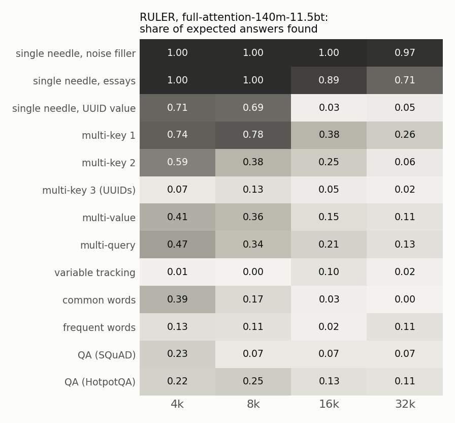
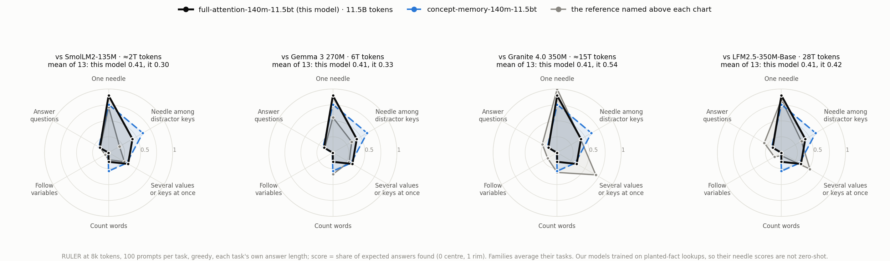

# full-attention-140m-11.5bt: evaluation details

The method and the full tables behind the [model card](README.md). Every number here has its raw file in this
repository (`eval_results/`, `long_context/`, `ruler/`, `samples/`), and `figures/make_figures.py` draws the card's
figures from those files. The protocol is the one of the
[concept-memory-140m-11.5bt card](https://huggingface.co/Meridian21Lab/concept-memory-140m-11.5bt/blob/main/EVALUATION.md):
same scripts, settings, documents, prompts and reference runs. The results of the memory models on the same data are
copied here with a prefix, so every head-to-head can be recomputed from this repository alone:
concept-memory-140m-11.5bt `cm_` (`e38_mem150m_` in `eval_results/`, `compare_concept_memory.json` in
`long_context/`), topic-index-140m-11.5bt `ti_` (`e38_lsa150m_`, `compare_topic_index.json`) and
catalogue-150m-11.5bt `ca_` (`e38_cat150m_`, `compare_catalogue.json`).

## Contents
1. [Harness and settings](#harness-and-settings)
2. [Models on the same data](#models-on-the-same-data)
3. [Standard benchmarks](#standard-benchmarks)
4. [Tiny-ML Leaderboard](#tiny-ml-leaderboard)
5. [Data efficiency](#data-efficiency)
6. [Long documents across models](#long-documents-across-models)
7. [Our own long-context tests](#our-own-long-context-tests)
8. [RULER](#ruler)
9. [Loading with from_pretrained](#loading-with-from_pretrained)
10. [Text samples](#text-samples)
11. [What we have not measured](#what-we-have-not-measured)
12. [Training procedure](#training-procedure)
13. [Reproducibility](#reproducibility)

## Harness and settings

- **Machine:** one NVIDIA RTX 3090 (24 GB) per job, three cards sharing one queue: this model 2026-11-21 16:35–17:12
  UTC (the `from_pretrained` board run 17:38–17:44 UTC), catalogue-150m-11.5bt 14:52–16:35 UTC the same day;
  topic-index-140m-11.5bt, concept-memory-140m-11.5bt and the reference models on the same cards between 2026-11-17
  19:58 UTC and 2026-11-18 16:24 UTC.
- **Benchmarks:** EleutherAI lm-evaluation-harness 0.4.11, 0-shot, all test items, max length 2,048, `acc` for
  every task. Our models through our adapter (`evaluation/lm_eval_perceiver_ar.py`, `--model perceiver_ar`), the
  others through lm-eval's stock `hf` model (`evaluation/run_lm_eval_suite.py`). Section 9 repeats the board tests
  on this model through the stock `hf` model too, loaded with `from_pretrained` from the release folder.
- **Precision:** each model in its training precision. Ours, SmolLM2-135M, Gemma 3 270M, Granite 4.0 350M and
  LFM2.5-350M-Base in bf16; Pythia-160M (trained in fp16) in fp32, because bf16 costs it about 6 points of ARC-Easy.
- **Start of each input:** the way each model's own tokenizer starts a text; ours starts with `<|endoftext|>`, as
  every training document did.
- **The whole run** is `scripts/release_evals.sh` (one checkpoint, a shared queue over three cards).
- **Excluded references, as on the concept-memory-140m-11.5bt card:** LFM2-350M (post-trained for chat),
  MobileLLM-R1-140M-base (gated), state-space models without their CUDA kernels.

## Models on the same data

Meridian21 trains several models on the same data, in the same order, for the same budget, with the same layers,
and changes only the reading layer; every model released from this set gets a column here. The four read the same
shards in the same order (identical data manifests in all three stages), with the same seed, budget, optimizer,
schedule and layer stack; only the reading layer differs. This model rereads every earlier token (full attention
with rotary positions); the three memory reads use no position code and reread only what they choose. Inside the
64k training length this model is their reference: the comparison measures what each memory read costs, or gains,
where full attention still fits.

| Test | Unit, direction | **full-attention-140m-11.5bt** | concept-memory-140m-11.5bt | topic-index-140m-11.5bt | catalogue-150m-11.5bt |
|---|---|---:|---:|---:|---:|
| RULER at 4k, mean of 13 | share found ↑ | 0.459 | 0.488 | 0.541 | 0.433 |
| RULER at 8k | share found ↑ | 0.407 | 0.439 | 0.540 | 0.407 |
| RULER at 16k | share found ↑ | 0.255 | 0.373 | 0.439 | 0.356 |
| RULER at 32k | share found ↑ | 0.202 | 0.319 | 0.390 | 0.287 |
| Long documents, 61k context, cross-model test | bits per byte ↓ | 0.812 | 0.795 | 0.797 | 0.808 |
| Same, our tokens, 64k spans (55 documents) | nats per token ↓ | 2.344 | 2.293 | 2.299 | 2.333 |
| Our tokens, 16k spans (120 documents) | nats per token ↓ | 2.139 | 2.126 | 2.129 | 2.147 |
| Our tokens, 128k spans, whole document (15) | nats per token ↓ | 2.421 | 2.451 | 2.426 | 2.441 |
| Gain from far context, 1k → 61k, cross-model test | bits per byte ↑ | 0.037 | 0.051 | 0.049 | 0.042 |
| Grammar (BLiMP) | % ↑ | 80.13 ± 0.14 | 80.56 ± 0.14 | 80.11 ± 0.14 | 80.64 ± 0.14 |
| Mean of 7 core tasks | % ↑ | 46.21 | 46.22 | 46.46 | 46.54 |
| ARC-Easy (board run) | % ↑ | 49.75 ± 1.03 | 48.95 ± 1.03 | 48.40 ± 1.03 | 50.42 ± 1.03 |
| WikiText-2 | byte perplexity ↓ | 1.955 | 1.950 | 1.950 | 1.954 |
| Held-out training loss, end of stages 1 / 2 / 3 | nats per token ↓ | 2.138 / 2.003 / 1.961 | 2.134 / 1.996 / 1.936 | 2.137 / 1.999 / 1.941 | 2.145 / 2.015 / 1.965 |

**Paired differences, this model minus each memory model** (95 % bootstrap over the test items: documents for long
text, prompts for RULER; paired wherever both models saw the same items; + means this model is higher):

| Test | Unit, direction | − concept memory | − topic index | − catalogue |
|---|---|---:|---:|---:|
| RULER at 4k | share found ↑ | −0.029 [−0.050, −0.009] | −0.082 [−0.101, −0.063] | +0.026 [+0.005, +0.048] |
| RULER at 8k | share found ↑ | −0.032 [−0.054, −0.011] | −0.133 [−0.153, −0.112] | 0.000 [−0.020, +0.020] |
| RULER at 16k | share found ↑ | −0.118 [−0.137, −0.100] | −0.184 [−0.203, −0.165] | −0.102 [−0.122, −0.081] |
| RULER at 32k ¹ | share found ↑ | −0.117 [−0.136, −0.098] | −0.189 [−0.207, −0.169] | −0.086 [−0.104, −0.068] |
| Long documents, 61k, cross-model test | bits per byte ↓ | +0.017 [+0.011, +0.024] | +0.016 [+0.010, +0.022] | +0.004 [−0.001, +0.009] |
| Our tokens, 64k spans, whole span | nats per token ↓ | +0.050 [+0.033, +0.070] | +0.045 [+0.027, +0.065] | +0.011 [−0.002, +0.027] |
| Our tokens, 16k spans, whole span | nats per token ↓ | +0.013 [+0.010, +0.016] | +0.009 [+0.007, +0.012] | −0.009 [−0.012, −0.006] |
| Our tokens, 128k spans, whole document | nats per token ↓ | −0.031 [−0.050, −0.009] | −0.005 [−0.023, +0.013] | −0.021 [−0.036, −0.006] |

¹ At 32k, this model, topic-index-140m-11.5bt and catalogue-150m-11.5bt drew the same prompts for all 13 tasks
(paired); concept-memory-140m-11.5bt's 32k run drew different needles for 8 of the 13 tasks (see the
topic-index-140m-11.5bt card), so those 8 are compared unpaired, each model's prompts resampled on their own.

**Reading it.** On short text the four tie. On long documents the memory reads cost nothing against full attention
up to the training length: the concept memory and the topic index need 2 % fewer bits on 64k documents, the
catalogue is level. On retrieval this model finds single needles best of the four at 4k and 8k (0.90, including the
UUID needle at 0.71 and 0.69), but from 16k on it falls further than all three memory models, most on needles among
distractor keys and on counting words, although 16k and 32k are inside its training length. Past 64k (128k) this
model holds up better than concept-memory-140m-11.5bt and catalogue-150m-11.5bt and level with the topic index. This
is one seed of each model.

## Standard benchmarks

Accuracy in %, higher is better, ± standard error from the harness. In brackets: EleutherAI's own published
zero-shot results for Pythia-160M (quoted). The memory models on the same data are in the table of section 2.

| Benchmark | Chance | **Full attention** · 11.5B | SmolLM2-135M · 252B | SmolLM2-135M · ≈2T (final) | Pythia-160M · 300B | LFM2.5-350M-Base · 28T |
|---|---:|---:|---:|---:|---:|---:|
| BLiMP, 67 sets | 50 | 80.13 ± 0.14 | 79.72 ± 0.14 | 80.15 ± 0.14 | 77.48 | **80.17** |
| ARC-Easy | 25 | 49.75 ± 1.03 | 61.62 ± 1.0 | 64.27 ± 0.98 | 43.64 ± 1.0 (43.52) | **70.03** ± 0.9 |
| ARC-Challenge | 25 | 21.0 ± 1.2 | 27.1 ± 1.3 | 28.0 ± 1.3 | 19.5 ± 1.2 (18.8) | **38.2** ± 1.4 |
| HellaSwag | 25 | 30.3 ± 0.5 | 32.6 ± 0.5 | 35.5 ± 0.5 | 28.4 ± 0.4 | **37.1** ± 0.5 |
| LAMBADA (OpenAI) | ≈0 | 31.3 ± 0.6 | 35.0 ± 0.7 | **43.0** ± 0.7 | 35.4 ± 0.7 (32.8) | 35.8 ± 0.7 |
| PIQA | 50 | 62.1 ± 1.1 | 65.9 ± 1.1 | **68.6** ± 1.1 | 62.3 ± 1.1 (62.7) | 66.6 ± 1.1 |
| SciQ | 25 | 78.9 ± 1.3 | 80.4 ± 1.3 | 84.1 ± 1.2 | 75.4 ± 1.4 (74.1) | **90.1** ± 0.9 |
| WinoGrande | 50 | 50.0 ± 1.4 | 50.9 ± 1.4 | 53.6 ± 1.4 | 51.2 ± 1.4 (53.1) | **55.6** ± 1.4 |
| **Mean of the 7 above** | 28.6 | 46.2 | 50.5 | 53.9 | 45.1 | **56.2** |
| WikiText-2 byte perplexity ↓ | — | 1.955 | 1.873 | **1.799** | 1.924 | 2.112 |
| WikiText-2 bits per byte ↓ | — | 0.967 | 0.905 | **0.847** | 0.944 | 1.078 |

The 7-task mean uses ARC-Easy from the 7-task run (49.75 %, the same as the board run).

## Tiny-ML Leaderboard

The [board](https://huggingface.co/spaces/Glint-Research/Tiny-ML-Leaderboard) ranks by `quality × (1 + 0.5 · t)`,
where quality is the mean of BLiMP, ARC-Easy and a WikiText score normalised over the board, and t is a size bonus
from 0 (the largest entry) to 1 (the smallest). `evaluation/tiny_ml_board.py` reproduces the formula on the snapshot
of 2026-11-14 (`evaluation/leaderboards/tiny_ml_board_20261114.json`); each of our rows is placed on its own.

| Place | Model | Organisation | Size | Training tokens | BLiMP % ↑ | ARC-Easy % ↑ | WikiText-2 byte ppl ↓ | Quality | Board score |
|---:|---|---|---:|---:|---:|---:|---:|---:|---:|
| 1 | Tiny Chick 10M V3 | kurcontko.dev | 9.6M | 24.6B | 77.76 | 59.60 | 2.335 | 77.8 | 87.7 |
| 2 | Tiny Chick 10M V2.1 | kurcontko.dev | 9.6M | 16.3B | 76.79 | 53.79 | 2.342 | 75.5 | 85.2 |
| 3 | Tiny Chick 10M V2 | kurcontko.dev | 9.6M | 16.3B | 76.99 | 50.21 | 2.364 | 74.3 | 83.8 |
| 4 | Slayer139 1.02 | Fabryka AI | 139.3M | 24.0B | 79.22 | 65.91 | 1.862 | 81.7 | 83.4 |
| (4) | *SmolLM2-135M, final (our run)* | | 134.5M | ≈2T | 80.15 | 64.27 | 1.799 | 81.5 | 83.2 |
| 5 | Boris-2-Think | opencerebral | 143.7M | 200B | 82.09 | 63.93 | 1.967 | 81.7 | 83.2 |
| 6 | Slayer149-ARC | Fabryka AI | 149.3M | 31B | 78.38 | 66.58 | 1.907 | 81.5 | 82.9 |
| 7 | Tiny Chick 10M | kurcontko.dev | 9.6M | 8.3B | 75.12 | 48.53 | 2.287 | 73.3 | 82.7 |
| 8 | Slayer139 1.01 | Fabryka AI | 139.3M | 23.7B | 79.13 | 63.09 | 1.878 | 80.7 | 82.3 |
| (9) | *SmolLM2-135M, 252B checkpoint (our run)* | | 134.5M | 252B | 79.72 | 61.62 | 1.873 | 80.4 | 82.1 |
| 9 | Glint-2 | glintresearch | 1.1M | ≈300B | 74.54 | 36.20 | 3.127 | 67.2 | 81.7 |
| 10 | Boris-2 | opencerebral | 143.7M | 200B | 81.13 | 59.76 | 1.895 | 80.2 | 81.7 |
| (11) | *SmolLM2-135M, 503B checkpoint (our run)* | | 134.5M | 503B | 79.62 | 59.97 | 1.861 | 79.9 | 81.6 |
| 11 | JugnuLM-110M-R2+ | altslate | 110.0M | 25B | 82.52 | 55.13 | 1.873 | 79.2 | 81.5 |
| 12 | GPT-X2-125M | axiomiclabs | 125.0M | 75B | 81.28 | 57.07 | 1.860 | 79.5 | 81.4 |
| 13 | Haidass-143M-v1 | DALab | 143.0M | 100B | 79.05 | 60.23 | 1.889 | 79.7 | 81.2 |
| 14 | Slayer149 Balanced ARC-E fine-tune | Fabryka AI | 149.3M | — | 79.98 | 59.34 | 1.897 | 79.7 | 81.0 |
| 15 | Slayer139 base | Fabryka AI | 139.3M | 23.7B | 79.41 | 57.58 | 1.875 | 78.9 | 80.5 |
| 16 | JugnuLM-53M | altslate | 53.0M | 12B | 78.14 | 51.43 | 2.040 | 76.0 | 80.5 |
| 17 | Supra2.1-Ultra-Preview-001 | supralabs | 230.0M | 40.4B | 82.24 | 57.11 | 1.930 | 79.6 | 79.6 |
| 18 | Supra-50M-Instruct | supralabs | 51.8M | 20B | 76.30 | 52.20 | 2.560 | 74.3 | 78.7 |
| 19 | GoLLeM-v5 128M | Fabryka AI | 122.8M | 24.9B | 79.09 | 53.24 | 2.254 | 76.3 | 78.2 |
| 20 | Glint-1.3 (merged) | glintresearch | 982K | 100B | 68.70 | 32.50 | 3.080 | 64.1 | 78.2 |
| (21) | *catalogue-150m-11.5bt* | | 145.6M | 11.5B | 80.64 | 50.42 | 1.954 | 76.7 | 78.1 |
| 21 | Ivme-Conversate-v3-Base | ivmelabs | 24.8M | ≈15B | 78.49 | 39.02 | 2.136 | 71.7 | 78.1 |
| 22 | Supra-50M-Base | supralabs | 51.8M | 20B | 76.30 | 46.00 | 2.040 | 73.5 | 78.0 |
| **23** | **full-attention-140m-11.5bt (this model)** | **Meridian21 Lab** | **141.5M** | **11.5B** | **80.13** | **49.75** | **1.955** | **76.3** | **77.8** |
| 24 | GPT-S-5M | axiomiclabs | 5.2M | 25B | 72.27 | 35.69 | 2.570 | 67.4 | 77.7 |
| (24) | *concept-memory-140m-11.5bt* | | 141.5M | 11.5B | 80.56 | 48.95 | 1.950 | 76.2 | 77.7 |
| 25 | Glint-2.3 | glintresearch | 1.7M | 10B | 67.30 | 36.00 | 3.051 | 64.8 | 77.6 |
| 26 | Zedev-134M-Fudas | meridianmrm | 134.0M | 20.7B | 81.69 | 46.38 | 1.880 | 76.0 | 77.6 |
| (26) | *topic-index-140m-11.5bt* | | 141.5M | 11.5B | 80.11 | 48.40 | 1.950 | 75.9 | 77.4 |
| 27 | Hydrion-v1-Base | opengcm | 114.1M | ≈2.5B | 80.08 | 47.26 | 2.040 | 75.2 | 77.4 |
| 28 | GoLLeM-v5 64M | Fabryka AI | 62.9M | 24.9B | 76.16 | 48.19 | 2.347 | 73.4 | 77.2 |
| 29 | Ivme-Conversate-v2-Base | ivmelabs | 23.9M | ≈12.85B | 75.09 | 39.98 | 2.225 | 70.6 | 77.1 |
| 30 | GoLLeM-v5 64M (v1 recipe) | Fabryka AI | 62.9M | 13.1B | 75.83 | 47.94 | 2.372 | 73.1 | 77.0 |
| 31 | Pollock 1.5 Mini LM 128M | Fabryka AI | 127.4M | 21.50B | 78.50 | 47.73 | 1.944 | 75.1 | 76.9 |
| 32 | Glint-2.3-Mini | glintresearch | 1.1M | 10B | 62.27 | 36.20 | 3.122 | 63.1 | 76.8 |
| 33 | Qielbas Tiny 6M | labqoat | 6.1M | 3B | 73.25 | 36.24 | 3.069 | 66.8 | 76.6 |
| 34 | Hummingbird-V2 | juinron | 9.6M | 10B | 72.90 | 38.85 | 2.955 | 67.8 | 76.5 |
| 35 | TextModel-v1 | benchlabs | 122.7M | 1.64B | 80.31 | 49.71 | 2.628 | 74.6 | 76.5 |
| 36 | GoLLeM-v5 32M | Fabryka AI | 31.6M | 16B | 73.48 | 44.44 | 2.539 | 70.8 | 76.5 |
| 37 | Gros-Michel-90m-Base-v2 | finnianx | 95.0M | 9B | 80.20 | 43.18 | 2.080 | 73.8 | 76.4 |
| 38 | Michel-Nano-v2 | finnianx | 9.9M | 6.5B | 72.52 | 35.90 | 2.460 | 67.8 | 76.4 |
| 39 | MicroSupra-1k | supralabs | 1K | — | 58.61 | 26.39 | 11.270 | 50.9 | 76.3 |
| 40 | min-spark | minimalabs | 5.8M | 10B | 69.19 | 37.08 | 2.775 | 66.4 | 76.3 |
| 41 | ObsidianSmall-Base | dreamw | 8.7M | 4B | 71.89 | 33.29 | 2.467 | 66.7 | 75.5 |
| 42 | Gros-Michel-90m-Base | finnianx | 91.1M | 6.5B | 78.35 | 41.50 | 2.070 | 72.6 | 75.4 |
| 43 | GoLLeM-v5 16M | Fabryka AI | 17.4M | 16B | 70.08 | 40.91 | 2.675 | 68.2 | 75.3 |
| 44 | Cagliari-114M | meridianmrm | 114.0M | 5.24B | 80.22 | 38.30 | 1.960 | 72.5 | 74.6 |
| (44) | *Pythia-160M, final (our run, fp32; over the 150M cap)* | | 162.3M | 300B | 77.48 | 43.64 | 1.924 | 73.5 | 74.5 |
| 45 | KeyLM-75M-Instruct | minimalabs | 75.0M | ≈18B | 76.02 | 39.10 | 2.170 | 70.8 | 74.0 |
| 46 | Michel-Micro | finnianx | 28.4M | 2.6B | 69.75 | 38.59 | 2.300 | 68.2 | 73.9 |

The first 46 places of 101 shown (with this model added), plus our runs of other models in brackets and italics, each at the place it gets on its own; the full snapshot is in the file above.

By quality alone (no size bonus) the model is 13th of 101; on grammar alone, 11th. Of the 55 board entries that report
15B training tokens or fewer, three place above it. The memory models on the same data place 21st
(catalogue-150m-11.5bt), 24th (concept-memory-140m-11.5bt) and 26th (topic-index-140m-11.5bt).

## Data efficiency

| Test | **Full attention** at 11.5B | Pythia-160M at 10.5B | at 12.6B | at 300B (final) | SmolLM2-135M at 252B | at 503B | at ≈2T (final) |
|---|---:|---:|---:|---:|---:|---:|---:|
| Grammar (BLiMP) % ↑ | 80.13 | 77.94 | 78.28 | 77.48 | 79.72 | 79.62 | 80.15 |
| Science quiz (ARC-Easy) % ↑ | 49.75 | 42.59 | 42.76 | 43.64 | 61.62 | 59.97 | 64.27 |
| WikiText-2 byte perplexity ↓ | 1.955 | 2.044 | 2.024 | 1.924 | 1.873 | 1.861 | 1.799 |
| Mean of 7 core tasks % ↑ | 46.2 | 42.1 | 43.2 | 45.1 | 50.5 | — | 53.9 |

Pythia-160M checkpoints scored in fp32 (steps 1,000 to 143,000 at 2,097,152 tokens per step, 2.1B to 300B tokens);
SmolLM2-135M from `HuggingFaceTB/SmolLM2-135M-intermediate-checkpoints` (branches `step-240000` and `step-480000`,
1,048,576 tokens per step) and the final model. All of them are the concept-memory-140m-11.5bt card's runs, reused
unchanged.

- **Same budget:** ahead of Pythia-160M at 10.5–12.6B tokens on every test.
- **Tokens to match** (log-linear between Pythia's checkpoints): not reached by 300B tokens for grammar or the science
  quiz; 33.2B tokens (2.9× ours) for WikiText.
- **What it does not separate:** architecture from data. The comparison with Pythia is mostly data (the Pile, 2020,
  against 2024–2025 filtered web and educational text) and the shared training recipe; the three memory models on the
  same data land within 1.4 points of this model on every test here.

## Long documents across models

`evaluation/long_context_compare.py`, the same 55 held-out 64k-token spans as the concept-memory-140m-11.5bt card
(identical files: the same documents and target characters). Target: the last ≈16 KB of each span; the context
before it is cut to each budget, counted in our tokens. Unit: bits per byte of the target. A model that cannot take
a budget is scored with sliding windows of its own maximum length ("limit").

| Model | Params | Max length | 1k | 4k | 16k | 28k | whole document | saved, 1k → most context | docs better with more | another document's far past |
|---|---:|---:|---:|---:|---:|---:|---:|---:|---:|---:|
| full-attention-140m-11.5bt (this model) | 141.5M | 65,536 | 0.849 | 0.832 | 0.821 | 0.815 | 0.812 | 0.037 [0.027, 0.049] | 100 % | 0.835 |
| concept-memory-140m-11.5bt | 141.5M | 65,536 | 0.846 | 0.828 | 0.816 | 0.808 | 0.795 | 0.051 [0.037, 0.067] | 96 % | 0.832 |
| topic-index-140m-11.5bt | 141.5M | 65,536 | 0.845 | 0.828 | 0.816 | 0.809 | 0.797 | 0.049 [0.035, 0.065] | 93 % | 0.834 |
| catalogue-150m-11.5bt | 145.6M | 65,536 | 0.850 | 0.835 | 0.825 | 0.820 | 0.808 | 0.042 [0.030, 0.056] | 93 % | 0.842 |
| SmolLM2-135M at 252B tokens (step 240,000) | 134.5M | 2,048 | 0.933 (limit) | — | — | — | — | 0.000 [0.000, 0.000] | 0 % | 0.932 |
| SmolLM2-135M | 134.5M | 8,192 | 0.851 | 0.835 | 0.832 (limit) | — | — | 0.018 [0.014, 0.024] | 95 % | 0.836 |
| Pythia-160M | 162.3M | 2,048 | 0.942 (limit) | — | — | — | — | 0.000 [0.000, 0.000] | 0 % | 0.941 |
| Gemma 3 270M | 268.1M | 32,768 | 0.843 | 0.825 | 0.812 | 0.805 | 0.805 (limit) | 0.038 [0.029, 0.049] | 96 % | 0.827 |
| Granite 4.0 350M base | 352.4M | 32,768 | 0.817 | 0.797 | 0.783 | 0.776 | 0.776 (limit) | 0.041 [0.033, 0.051] | 100 % | 0.798 |
| LFM2.5-350M-Base | 354.5M | 32,768 | 0.893 | 0.879 | 0.912 | 0.928 | 0.928 (limit) | −0.035 [−0.051, −0.020] | 22 % | 0.933 |

Each model with the most of the document it can take, against full-attention-140m-11.5bt (this model) with the whole document:

| Model | its bits per byte | full-attention-140m-11.5bt (this model) | difference (+ = full-attention-140m-11.5bt (this model) better) | documents where full-attention-140m-11.5bt (this model) is better |
|---|---:|---:|---:|---:|
| concept-memory-140m-11.5bt | 0.795 | 0.812 | −0.017 [−0.024, −0.011] | 9 % |
| topic-index-140m-11.5bt | 0.797 | 0.812 | −0.016 [−0.022, −0.010] | 16 % |
| catalogue-150m-11.5bt | 0.808 | 0.812 | −0.004 [−0.009, +0.001] | 60 % |
| SmolLM2-135M at 252B tokens (step 240,000) | 0.933 | 0.812 | +0.121 [+0.101, +0.142] | 98 % |
| SmolLM2-135M | 0.832 | 0.812 | +0.020 [+0.006, +0.035] | 64 % |
| Pythia-160M | 0.942 | 0.812 | +0.129 [+0.111, +0.149] | 96 % |
| Gemma 3 270M | 0.805 | 0.812 | −0.007 [−0.020, +0.004] | 44 % |
| Granite 4.0 350M base | 0.776 | 0.812 | −0.037 [−0.050, −0.024] | 18 % |
| LFM2.5-350M-Base | 0.928 | 0.812 | +0.116 [+0.094, +0.137] | 93 % |

LFM2.5-350M-Base at its best context (4k, 0.879) against this model with the whole document: +0.067 [0.047, 0.086],
this model better on 87 % of documents. Reference rows are the concept-memory-140m-11.5bt card's runs (same spans,
same script); `long_context/compare_*.json`. Scale: gzip -9 needs 2.49 bits per byte on the same targets, xz -9e
1.97, bzip2 -9 1.77.

## Our own long-context tests

The same 64k documents in our own tokens (`long_context/long_context_use.py`). Always the same target, the **last
4,096 tokens** of a 16k, 64k or 128k span. Loss in nats per token (lower is better; the models on the same data share
one tokenizer, so their nats per token compare directly); 95 % intervals by bootstrap over documents.

1. **Context cut:** predict the target after 1k, 4k, 16k … or all of the document before it.
2. **Swapped far past:** the document's own nearest 4k kept, everything older from a different document of the same
   source.

This model has no separate memory to switch off, so the memory models' "far read off" row has no counterpart here.

**At 64k** (55 documents; the memory models' values from their own runs on the same documents):

| variant | Full attention | worse than its full context by [95 %] | docs worse | Concept memory | Topic index | Catalogue |
|---|---:|---:|---:|---:|---:|---:|
| 1024 (n=55) | 2.451 | +0.107 [+0.080, +0.139] | 100 % | 2.441 | 2.439 | 2.454 |
| 4096 (n=55) | 2.402 | +0.058 [+0.040, +0.078] | 96 % | 2.390 | 2.390 | 2.410 |
| 16384 (n=55) | 2.368 | +0.025 [+0.014, +0.037] | 73 % | 2.354 | 2.355 | 2.381 |
| 61439 (n=55) | 2.344 | — | | 2.293 | 2.299 | 2.333 |
| swap (n=55) | 2.409 | +0.066 [+0.049, +0.084] | 98 % | 2.400 | 2.406 | 2.429 |

**At 16k** (120 documents, 12,287 tokens of full context): full 2.139 nats per token (concept memory 2.126, topic
index 2.129, catalogue 2.147); cut to 4k +0.038 [0.031, 0.046]; cut to 1k +0.089 [0.076, 0.103] (every document
worse); another document's far past +0.044.

**At 128k, twice the training length** (15 documents: 4 books, 8 DOAB, 2 US GPO, 1 arXiv; rotary positions past the
training length):

| variant | Full attention | worse than its full context by [95 %] | docs worse | Concept memory | Topic index | Catalogue |
|---|---:|---:|---:|---:|---:|---:|
| 4096 (n=15) | 2.452 | +0.031 [+0.007, +0.061] | 67 % | 2.441 | 2.440 | 2.459 |
| 16384 (n=15) | 2.420 | 0.000 [−0.012, +0.018] | 33 % | 2.409 | 2.410 | 2.436 |
| 61440 (n=15) | 2.406 | −0.014 [−0.018, −0.011] | 0 % | 2.391 | 2.395 | 2.421 |
| 126975 (n=15) | 2.421 | — | | 2.451 | 2.426 | 2.441 |
| swap (n=14) | 2.613 | +0.046 [+0.027, +0.066] | 86 % | 2.683 | 2.646 | 2.666 |

The arXiv document has no swap row: no other arXiv validation document is long enough to donate 123k tokens.

- **The far past is used:** from 1k of context to all 61k, 0.11 nats per token, worse with less context on every
  document; most of the gain comes by 16k (0.08 of the 0.11).
- **Per source** (64k, nats per token from 1k to full): US government documents 2.034 → 1.792, arXiv 1.222 → 1.037,
  DOAB 2.317 → 2.183, books 2.994 → 2.936, debates 2.599 → 2.558.
- **Past 64k:** the last 61k tokens predict better than the whole 127k (by 0.014 nats per token, on every document),
  so feed the last ≈64k; the drop is smaller than the memory models' (0.020–0.060), and a long wrong past distracts
  it least of the four (2.613 against 2.646–2.683).

## RULER

13 tasks, 100 prompts per task and length, greedy cached decoding, each task's own answer length (lm-eval's RULER
configs, up to 128 tokens), every reply saved (`ruler/*_answers.jsonl`). Score = share of the reference answers found
in the reply (higher is better). **Not zero-shot:** training stages 2 and 3 included planted-fact lookups of a similar
shape (different wording), for all models on the same data.

**This model at every length, concept-memory-140m-11.5bt in brackets** (RTX 3090 cards, 2026-11-21; 4k and 8k, 16k
on one card each; 32k split by task over three cards):

| RULER task | What it asks | 4k | 8k | 16k | 32k |
|---|---|---:|---:|---:|---:|
| single needle, noise filler | one number hidden in repeated filler | 1.00 (1.00) | 1.00 (1.00) | 1.00 (1.00) | 0.97 (1.00) |
| single needle, essays | one number hidden in real essays | 1.00 (1.00) | 1.00 (1.00) | 0.89 (1.00) | 0.71 (0.98) |
| single needle, UUID value | one 32-character ID (UUID) hidden in essays | 0.71 (0.29) | 0.69 (0.27) | 0.03 (0.07) | 0.05 (0.07) |
| multi-key 1 | one number among distractor keys | 0.74 (0.99) | 0.78 (0.90) | 0.38 (0.91) | 0.26 (0.77) |
| multi-key 2 | the haystack is all similar needles | 0.59 (0.92) | 0.38 (0.84) | 0.25 (0.76) | 0.06 (0.41) |
| multi-key 3 (UUIDs) | as 2, with UUID keys and values | 0.07 (0.28) | 0.13 (0.11) | 0.05 (0.06) | 0.02 (0.04) |
| multi-value | all values of one key | 0.41 (0.31) | 0.36 (0.34) | 0.15 (0.24) | 0.11 (0.24) |
| multi-query | several keys asked at once | 0.47 (0.40) | 0.34 (0.32) | 0.21 (0.11) | 0.13 (0.09) |
| variable tracking | follow a chain of assignments | 0.01 (0.01) | 0.00 (0.01) | 0.10 (0.01) | 0.02 (0.01) |
| common words | list the most common words | 0.39 (0.52) | 0.17 (0.42) | 0.03 (0.27) | 0.00 (0.13) |
| frequent words | list the most frequent words | 0.13 (0.15) | 0.11 (0.16) | 0.02 (0.02) | 0.11 (0.06) |
| QA (SQuAD) | answer from one of many paragraphs | 0.23 (0.33) | 0.07 (0.20) | 0.07 (0.21) | 0.07 (0.20) |
| QA (HotpotQA) | two-hop answer from many paragraphs | 0.22 (0.15) | 0.25 (0.15) | 0.13 (0.19) | 0.11 (0.15) |
| **Mean of 13** | | **0.46** (0.49) | **0.41** (0.44) | **0.25** (0.37) | **0.20** (0.32) |

**Against reference models at 8k and 4k.** The references are the concept-memory-140m-11.5bt card's runs
(2026-11-18 14:34–15:22 UTC) through lm-eval's stock `hf` model, each in bf16, its prompts sized with its own
tokenizer, room for prompt and answer (length + 256 positions). Pythia-160M and SmolLM2-135M's 252B checkpoint read
2,048 tokens and cannot take RULER's shortest length. Best in each row in **bold** (ties bolded together).

| RULER task, 8k | **Full attention** | Concept memory | Topic index | Catalogue | SmolLM2-135M | Gemma 3 270M | Granite 4.0 350M | LFM2.5-350M-Base |
|---|---:|---:|---:|---:|---:|---:|---:|---:|
| single needle, noise filler | **1.00** | **1.00** | **1.00** | **1.00** | **1.00** | **1.00** | **1.00** | 0.99 |
| single needle, essays | **1.00** | **1.00** | **1.00** | 0.96 | 0.97 | 0.51 | **1.00** | **1.00** |
| single needle, UUID value | 0.69 | 0.27 | 0.55 | 0.34 | 0.18 | 0.15 | **1.00** | 0.51 |
| multi-key 1 | 0.78 | 0.90 | **0.95** | 0.76 | 0.58 | 0.79 | 0.88 | 0.88 |
| multi-key 2 | 0.38 | **0.84** | 0.77 | 0.44 | 0.00 | 0.22 | 0.33 | 0.15 |
| multi-key 3 (UUIDs) | **0.13** | 0.11 | 0.06 | 0.02 | 0.01 | 0.01 | 0.06 | 0.05 |
| multi-value | 0.36 | 0.34 | 0.64 | 0.21 | 0.36 | 0.22 | **0.69** | 0.41 |
| multi-query | 0.34 | 0.32 | 0.69 | 0.35 | 0.21 | 0.36 | **0.71** | 0.62 |
| variable tracking | 0.00 | 0.01 | 0.00 | 0.03 | 0.06 | 0.00 | **0.17** | 0.13 |
| common words | 0.17 | 0.42 | **0.48** | 0.39 | 0.01 | 0.41 | 0.22 | 0.09 |
| frequent words | 0.11 | 0.16 | 0.42 | **0.44** | 0.21 | 0.27 | 0.40 | 0.01 |
| QA (SQuAD) | 0.07 | 0.20 | 0.21 | 0.13 | 0.08 | 0.10 | 0.26 | **0.37** |
| QA (HotpotQA) | 0.25 | 0.15 | 0.25 | 0.22 | 0.22 | 0.19 | **0.27** | 0.25 |
| **Mean of 13** | 0.41 | 0.44 | **0.54** | 0.41 | 0.30 | 0.33 | **0.54** | 0.42 |

| RULER task, 4k | **Full attention** | Concept memory | Topic index | Catalogue | SmolLM2-135M | Gemma 3 270M | Granite 4.0 350M | LFM2.5-350M-Base |
|---|---:|---:|---:|---:|---:|---:|---:|---:|
| single needle, noise filler | **1.00** | **1.00** | **1.00** | **1.00** | **1.00** | **1.00** | **1.00** | 0.98 |
| single needle, essays | **1.00** | **1.00** | **1.00** | 0.98 | 0.98 | 0.97 | **1.00** | **1.00** |
| single needle, UUID value | 0.71 | 0.29 | 0.20 | 0.57 | 0.28 | 0.75 | **1.00** | 0.53 |
| multi-key 1 | 0.74 | **0.99** | 0.97 | 0.70 | 0.70 | 0.85 | 0.96 | 0.90 |
| multi-key 2 | 0.59 | 0.92 | **0.96** | 0.47 | 0.07 | 0.23 | 0.27 | 0.36 |
| multi-key 3 (UUIDs) | 0.07 | **0.28** | 0.25 | 0.06 | 0.06 | 0.09 | 0.17 | 0.12 |
| multi-value | 0.41 | 0.31 | 0.52 | 0.18 | 0.63 | 0.46 | **0.67** | 0.40 |
| multi-query | 0.47 | 0.40 | 0.61 | 0.21 | 0.29 | 0.46 | **0.82** | 0.71 |
| variable tracking | 0.01 | 0.01 | 0.01 | 0.08 | 0.15 | 0.00 | **0.28** | 0.00 |
| common words | 0.39 | 0.52 | 0.52 | 0.48 | 0.15 | **0.67** | 0.41 | 0.16 |
| frequent words | 0.13 | 0.15 | 0.38 | 0.39 | 0.38 | 0.33 | **0.53** | 0.03 |
| QA (SQuAD) | 0.23 | 0.33 | 0.33 | 0.27 | 0.28 | 0.29 | 0.50 | **0.53** |
| QA (HotpotQA) | 0.22 | 0.15 | 0.27 | 0.24 | 0.27 | 0.16 | **0.39** | 0.34 |
| **Mean of 13** | 0.46 | 0.49 | 0.54 | 0.43 | 0.40 | 0.48 | **0.62** | 0.47 |

**The earlier capped run.** The first RULER run of this model (AWS, 2026-11-19) cut every answer at 32 tokens, which
cuts UUIDs and long lists in the SmolLM2 tokenizer (one digit per token). Its means were 0.384 / 0.341 / 0.248 /
0.187 at 4k / 8k / 16k / 32k. The tables above replace the capped run; its raw file is not shipped.

## Loading with from_pretrained

The release folder is written by `scripts/export_hub_model.py` (modeling code generated from the MrCogito source,
`auto_map`, weights, tokenizer, `export_manifest.json`). Checks on 2026-11-21:

- `tests/test_hub_export.py` with this checkpoint on an RTX 3090: 27 of 27 passed (the export's loss on a fixed text
  equals our evaluation loader's; 🤗 greedy decoding equals our cached decoder token for token; seeded sampling
  repeats; beam search runs; it loads from the folder with `local_files_only`).
- Clean environments with only torch 2.11 and Transformers (`python -I scripts/hub_smoke_test.py <folder> --local`):
  passed on Transformers 4.57.6 and 5.23.0, the same sentence loss (1.9047 nats per token, bf16 on CUDA) and the same
  seed-0 sample on both.
- A whole 64k-token text through `from_pretrained` with `attn_backend="flex"`, `labels` and `logits_to_keep=1`: one
  pass, 1.2 s and 2.5 GB peak GPU memory on an RTX 3090 (bf16; the first call, which compiles, 19 s).
- The board tests through lm-eval's stock `hf` model on the release folder (`from_pretrained`, bf16,
  2026-11-21 17:38–17:44 UTC): BLiMP 80.13 %, ARC-Easy 49.75 %, WikiText-2 byte perplexity 1.95500; through our
  adapter the same three numbers (`eval_results/e38_rope150m_final_hf.json`). A reader running lm-eval on the Hub id
  gets this card's numbers.
- From the Hub id, in the same clean environments (`python -I scripts/hub_smoke_test.py
  Meridian21Lab/full-attention-140m-11.5bt`, the repository still private, 2026-11-21, CPU, fp32): passed on
  Transformers 4.57.6 and 5.23.0, the same sentence loss (1.9132 nats per token) and the same seed-0 sample on both
  (`hub_smoke_test.json`).

## Text samples

`evaluation/sample_text.py`, one RTX 3090, 2026-11-21 17:06 UTC; prompts start with `<|endoftext|>` as in training.
Nucleus sampling: temperature 0.7, top-p 0.9, repetition penalty 1.1 over prompt and reply, seeds 0, 1 and 2. Beam
search: 4 beams, no repeated 3-gram, best by mean log-probability. 60 new tokens. All outputs, unedited:
`samples/samples_ours.json`. The card shows seed 0 for each prompt.

## What we have not measured

- **Lengths past 128k.** Full attention's cost grows with the square of the length; the memory models are built for
  the lengths beyond, and their reach tests are not part of this release.
- **A second seed.** Every number here is seed 42; differences of a point or two between the models on the same data
  are within what a second seed could move.
- **Long-document benchmarks with real questions** (LongBench, BABILong) and needle tests past 32k.
- **Speed beyond one measurement** (section 9) and **energy use**.

## Training procedure

| | Stage 1 (main) | Stage 2 (decay) | Stage 3 (long) |
|---|---|---|---|
| Row length | 4,096 | 16,384 | 65,536 |
| Steps × rows per step | 15,259 × 128 | 5,722 × 32 | 954 × 8 |
| Tokens per step | 524,288 | 524,288 | 524,288 |
| Learning rate | Muon peak 0.01, constant after 1 % warm-up | fresh optimizer, 3 % warm-up, 1 − √ decay to 0.1 × | a tenth of the peak, decaying |
| Held-out loss (nats per token, lower is better) | 2.744 → 2.138 (4k web rows) | 2.312 → 2.003 (16k long-document rows) | 1.993 → 1.961 (64k rows) |
| Speed (row positions per second, 4 × L40S) | ≈132k | ≈122k | ≈82k |
| Wall time | 16.8 h | 6.8 h | 1.7 h |

Muon updates the weight matrices; norms, embeddings and other vector parameters use AdamW (betas 0.9 / 0.95, weight
decay 0.1). Gradient clipping at 1.0, bf16, flex attention. The optimizer choice (Muon over AdamW) was made once, on
concept-memory-140m-11.5bt, before any of these runs. Reading layer: causal attention over every earlier token of the
document, rotary positions, looped four times with the following local layer.

## Reproducibility

- **W&B (public project `ksopyla/MrCogito`):**
  [stage 1](https://wandb.ai/ksopyla/MrCogito/runs/perceiver_ar_perceiver_H896L3g1s9N128_20261118_100636_dense_rope_m120t_trunk) ·
  [stage 2](https://wandb.ai/ksopyla/MrCogito/runs/perceiver_ar_perceiver_H896L3g1s9N128_20261119_025610_dense_rope_m120t_decay) ·
  [stage 3](https://wandb.ai/ksopyla/MrCogito/runs/perceiver_ar_perceiver_H896L3g1s9N128_20261119_094659_dense_rope_m120t_long)
- **In this repository:** `eval_results/` (full lm-eval outputs for every model and checkpoint above),
  `long_context/` (per-document results and the summarisers `summarise.py` and `summarise_compare.py`), `ruler/`
  (scores and every reply, all models on the same data), `samples/`, `figures/make_figures.py`.
- **Code:** training at [commit `1fddc505`](https://github.com/ksopyla/MrCogito/tree/1fddc505) (experiment spec
  `docs/experiments_specs/ahead/E38_long_budget_mix.md`; training `scripts/run_e33n.py`, size `m120t`, arm
  `dense_rope`); evaluation and export at [commit `6726dd47`](https://github.com/ksopyla/MrCogito/tree/6726dd47)
  (`scripts/release_evals.sh`, `scripts/export_hub_model.py`).
