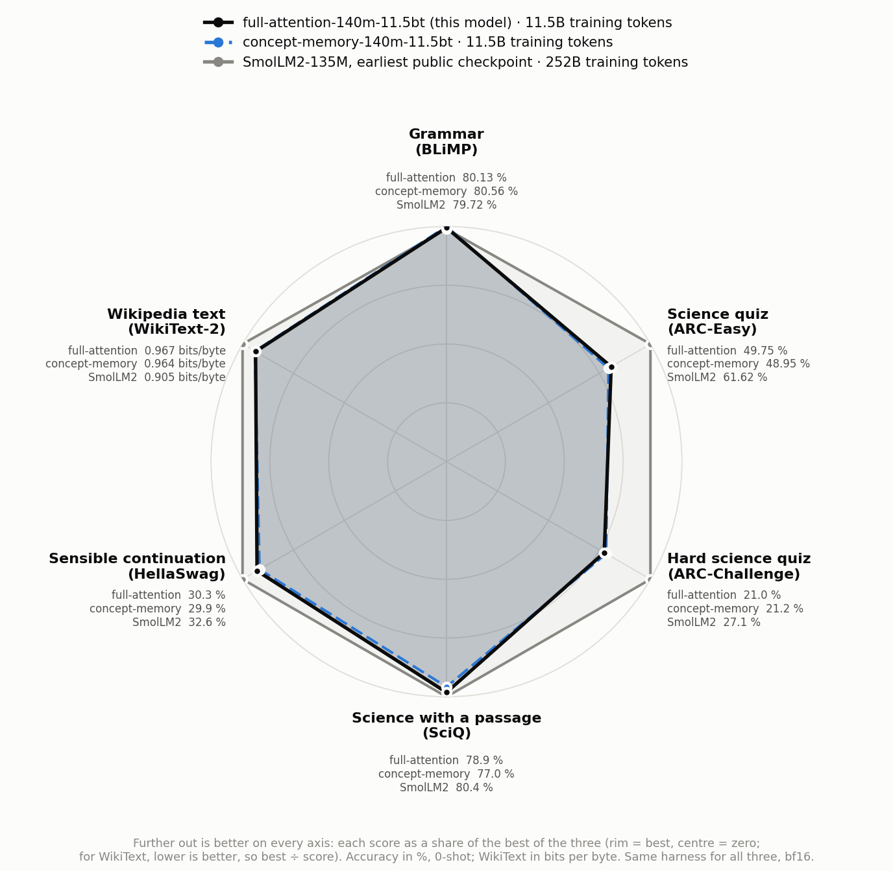
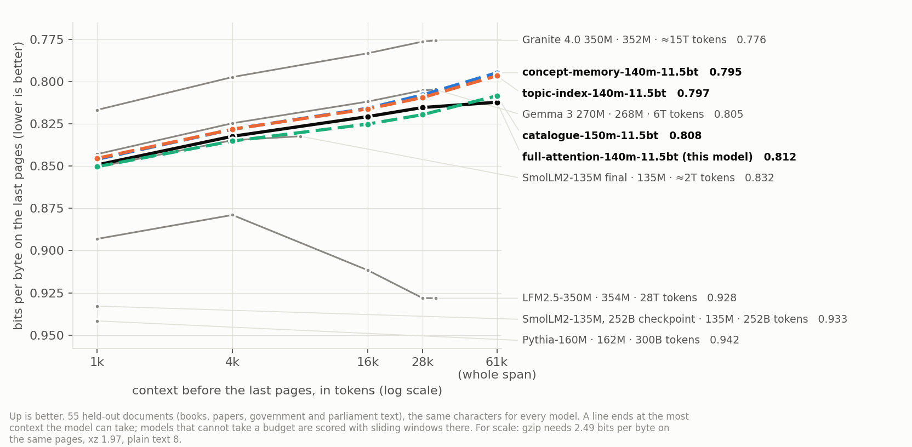
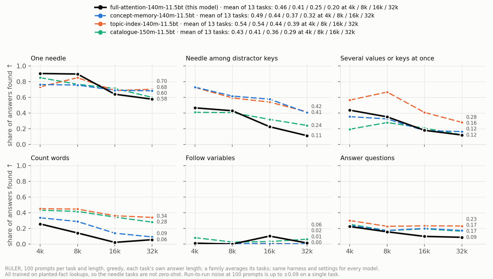
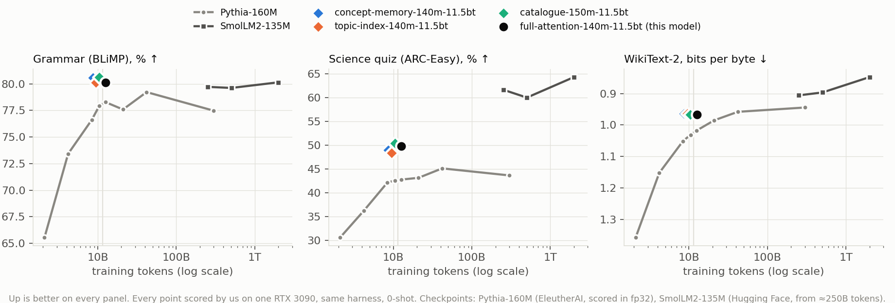

---
language:
  - en
license: apache-2.0
pipeline_tag: text-generation
library_name: transformers
tags:
  - mrcogito
  - meridian21
  - custom_code
  - full-attention
  - size-150m
  - budget-11.5bt
  - long-context
  - base-model
  - research
  - pytorch
  - e38                        # internal experiment code (secondary label)
datasets:
  - nvidia/Nemotron-CC-v2
  - nvidia/Nemotron-CC-Math-v1
  - nvidia/Nemotron-Pretraining-Specialized-v1
  - HuggingFaceTB/dclm-edu
  - common-pile/stackv2_edu_filtered
  - common-pile/project_gutenberg_filtered
  - common-pile/arxiv_papers_filtered
  - common-pile/doab_filtered
  - common-pile/usgpo_filtered
  - common-pile/uk_hansard_filtered
  - allenai/dolma3_longmino_pool
  - HuggingFaceTB/smol-smoltalk
model-index:
  - name: full-attention-140m-11.5bt
    results:
      - task: {type: text-generation, name: Grammar (BLiMP, 67 sets, 0-shot)}
        dataset: {type: blimp, name: BLiMP}
        metrics: [{type: accuracy, value: 80.13, name: accuracy (%)}]
      - task: {type: text-generation, name: Science quiz (ARC-Easy, 0-shot)}
        dataset: {type: allenai/ai2_arc, name: ARC-Easy, config: ARC-Easy, split: test}
        metrics: [{type: accuracy, value: 49.75, name: accuracy (%)}]
      - task: {type: text-generation, name: Language modelling (WikiText-2)}
        dataset: {type: wikitext, name: WikiText-2}
        metrics: [{type: perplexity, value: 1.955, name: byte perplexity (lower is better)}]
---

# full-attention-140m-11.5bt: the full-attention reference for Meridian21's long-context memory models

**`Meridian21Lab/full-attention-140m-11.5bt`** · [Project page](https://ai.ksopyla.com/projects/concept-reasoning/) ·
[Code](https://github.com/ksopyla/MrCogito/tree/1fddc505) · [Evaluation details](EVALUATION.md) ·
[Training on W&B](https://wandb.ai/ksopyla/MrCogito/runs/perceiver_ar_perceiver_H896L3g1s9N128_20261119_094659_dense_rope_m120t_long) ·
Same data, other reads: [concept-memory-140m-11.5bt](https://huggingface.co/Meridian21Lab/concept-memory-140m-11.5bt) ·
[topic-index-140m-11.5bt](https://huggingface.co/Meridian21Lab/topic-index-140m-11.5bt) ·
[catalogue-150m-11.5bt](https://huggingface.co/Meridian21Lab/catalogue-150m-11.5bt)

A 141.5M-parameter English base language model, trained from scratch on 11.5B tokens of public data for about
$200. Its long-range read is plain **full attention**: one reading layer rereads every earlier token of the document,
with rotary positions, up to the 64k-token training length. It is released as the reference for Meridian21's
memory models, which use the same layers and replace only this reading layer with a memory built to reach lengths
full attention cannot afford.

It is a public model of [MrCogito](https://ai.ksopyla.com/projects/concept-reasoning/), a project building models that
compress long text into concepts and reason over them. A research release: base model, one training seed, not
instruction-tuned.

Meridian21 trains several models on the same data, in the same order, for the same budget, with the same layers,
and changes only the reading layer, so each card compares them on the same tests. Released so far:
[concept-memory-140m-11.5bt](https://huggingface.co/Meridian21Lab/concept-memory-140m-11.5bt) (a concept memory),
[topic-index-140m-11.5bt](https://huggingface.co/Meridian21Lab/topic-index-140m-11.5bt) (Latent Sparse Attention),
[catalogue-150m-11.5bt](https://huggingface.co/Meridian21Lab/catalogue-150m-11.5bt) (a learned catalogue), and this
model. On the seven standard tasks all four are level (mean 46.2 to 46.5 %). Inside 64k the memory models cost
nothing against this model on long documents (0.795–0.808 against 0.812 bits per byte), and from 16k on they find
more facts far back (RULER at 16k 0.36–0.44 against 0.25).

## Highlights

- **23rd of 101 on the Tiny-ML Leaderboard** (models up to 150M parameters; grammar, a science quiz and Wikipedia
  text, with a bonus for small size). By quality alone it is 13th; grammar **80.13 %**, level with SmolLM2-135M's
  final model (80.15 %, ≈2T training tokens, about 170× ours).
- **More from 11.5B tokens than Pythia-160M gets from 300B.** At our budget (10.5B and 12.6B tokens) Pythia-160M is
  1.9–2.2 points behind on grammar and 7.0–7.2 behind on the science quiz (ARC-Easy); at no published checkpoint up
  to 300B tokens does it reach this model's 80.13 % and 49.75 %.
- **Reads 64k-token documents, ahead of every same-size model.** On the last pages of 55 held-out 64k-token
  documents it needs **0.812 bits per byte** (lower is better; scale below): ahead of SmolLM2-135M final (0.832) and
  Pythia-160M (0.942), level with Gemma 3 270M (0.805; twice our size, 6T training tokens).
- **Fast and one line to load.** It scores a whole 64k-token document in one pass in about 1.2 s with 2.5 GB of GPU
  memory on one RTX 3090, loads with `AutoModelForCausalLM.from_pretrained(..., trust_remote_code=True)` and gives
  the same leaderboard scores through that loader as through our own. ≈26 hours on one 4-GPU spot node (≈ $200);
  every training source is a public Hugging Face dataset, every number here has its raw result file in this
  repository.

<p align="center"></p>

*Six standard benchmarks, same harness for all three, each score as a share of the best of the three (rim = best).
This model and concept-memory-140m-11.5bt trained on 11.5B tokens each, SmolLM2-135M on 252B at this checkpoint.
Every number, the other models on the same data, Pythia-160M and LFM2.5-350M-Base included, in the table below.*

## Results at a glance

All numbers in this table come from **one harness**, run by us on RTX 3090 cards (2026-11-17/18 for the reference
models and concept-memory-140m-11.5bt, 2026-11-21 for this model): EleutherAI's lm-evaluation-harness 0.4.11, 0-shot,
all test items, max length 2,048; each model in its training precision (our models, SmolLM2 and LFM2.5 in bf16,
Pythia in fp32). Long documents: our cross-model test (below). Accuracy in %, higher is better; best in each row in
**bold**.

| Measure | Chance | **full-attention-140m-11.5bt** · 11.5B tokens | concept-memory-140m-11.5bt ¹ · 11.5B | SmolLM2-135M · 252B ² | Pythia-160M · 300B ³ | LFM2.5-350M-Base · 28T ⁴ |
|---|---:|---:|---:|---:|---:|---:|
| Grammar (BLiMP, 67 sets) | 50 | 80.13 ± 0.14 | **80.56** | 79.72 | 77.48 | 80.17 |
| Science quiz (ARC-Easy) | 25 | 49.75 ± 1.03 | 48.95 | 61.62 | 43.64 (43.52) | **70.03** |
| Hard science quiz (ARC-Challenge) | 25 | 21.0 | 21.2 | 27.1 | 19.5 (18.8) | **38.2** |
| Sensible continuation (HellaSwag) | 25 | 30.3 | 29.9 | 32.6 | 28.4 | **37.1** |
| Science with a passage (SciQ) | 25 | 78.9 | 77.0 | 80.4 | 75.4 (74.1) | **90.1** |
| Last word of a passage (LAMBADA) | ≈0 | 31.3 | 33.2 | 35.0 | 35.4 (32.8) | **35.8** |
| Physical common sense (PIQA) | 50 | 62.1 | 62.8 | 65.9 | 62.3 (62.7) | **66.6** |
| Pronoun resolution (WinoGrande) | 50 | 50.0 | 50.4 | 50.9 | 51.2 (53.1) | **55.6** |
| **Mean of the 7 tasks above** | 28.6 | 46.2 | 46.2 | 50.5 | 45.1 | **56.2** |
| Wikipedia text (WikiText-2), bits per byte ↓ | — | 0.967 | 0.964 | **0.905** | 0.944 | 1.078 |
| **Long documents**, bits per byte ↓ (most context the model reads) | — | 0.812 (61k) | **0.795** (61k) | 0.933 (2k) | 0.942 (2k) | 0.879 (4k, its best) |
| **Gain from far context**, 1k → most, bits per byte ↑ | 0 | 0.037 | **0.051** | 0 (reads 2k) | 0 (reads 2k) | −0.035 (worse with more) |
| **Finding facts far back** (RULER at 8k, mean of 13) ↑ | ≈0 | 0.41 | **0.44** | — (reads 2k) | — (reads 2k) | 0.42 |
| Tiny-ML Leaderboard place (of 101) ⁵ | | 23rd | 24th | 9th | 44th (over the 150M cap) | 12th (over the 150M cap) |

¹ [concept-memory-140m-11.5bt](https://huggingface.co/Meridian21Lab/concept-memory-140m-11.5bt), Meridian21's
model on the same data: same data, order, budget and layers; its reading layer is a concept memory instead of full
attention. The other two memory models are in the paragraph below and in EVALUATION.md.
² SmolLM2-135M's **earliest public training checkpoint** (step 240,000, ≈252B tokens, 22× ours), the closest to our
budget a reader can check; its final ≈2T-token model is in the leaderboard table below. These early checkpoints read
2,048 tokens; SmolLM2's 8k context came in its last training phase.
³ Pythia-160M's final checkpoint, scored by us in fp32 (it loses ≈6 ARC-Easy points in bf16). In brackets:
EleutherAI's own published zero-shot results (`evals/pythia-v1/pythia-160m` in their GitHub repository, quoted).
⁴ LFM2.5-350M-Base (Liquid AI, March 2026), 2.5× our size; training tokens as its card reports (quoted). Its card
states a 32k context; on these documents it predicts best with 4k and worse with more (checked in fp32 and bf16, two
attention kernels, Transformers 4.57 and 5.23).
⁵ The [Tiny-ML Leaderboard](https://huggingface.co/spaces/Glint-Research/Tiny-ML-Leaderboard) formula reproduced from
its page (snapshot of 2026-11-14), each of our runs placed on its own. WikiText-2 is reported there as byte perplexity:
1.955 for this model (bits per byte = log₂ of it).

**What "bits per byte" means.** The number of bits a model needs, on average, to store each byte (about one
character) of text it has not seen, using its own predictions: 0 would be perfect prediction, 8 is plain text with no
prediction at all, and lower is better. There is no 0-to-1 scale. On the same pages, gzip needs 2.49 bits per byte,
xz 1.97 and bzip2 1.77; this model needs 0.812, so it could store those pages in about a tenth of their size. It
counts bytes rather than tokens, so models with different tokenizers compare fairly. At these values a difference of
0.01 is about 1.2 %.

**Against the memory models on the same data** (same tests, documents and settings): all four are level on the seven
standard tasks (46.2 to 46.5 %) and on WikiText (0.964 to 0.967 bits per byte). On long documents the memory models
need 0.004 (catalogue-150m-11.5bt) to 0.017 (concept-memory-140m-11.5bt) bits per byte less than this model. On RULER
this model is 0.03 above catalogue-150m-11.5bt at 4k and level at 8k, 0.03 below concept-memory-140m-11.5bt at 4k and
8k, and 0.08–0.13 below topic-index-140m-11.5bt; from 16k on all three memory models are higher (by 0.09 to 0.19).
Paired differences with intervals: [EVALUATION.md](EVALUATION.md#models-on-the-same-data).

## Long documents

<p align="center"></p>

Every model reads the same characters: the last ≈16 KB of each 64k-token span is the target, and the context before
it is cut to the budget on the x-axis (sliding windows past a model's maximum length). Held-out documents from five
public sources (Gutenberg books, arXiv papers, open-access academic books, US government publications, UK
parliamentary debates); our models trained on other documents of these sources, the others may have seen these very
documents. One RTX 3090; reference models 2026-11-18, this model and catalogue-150m-11.5bt 2026-11-21.

| Model | Size | Training tokens | Reads at most | Bits per byte ↓ | Gain, 1k → most ↑ | Another document's far past ↓ |
|---|---:|---:|---:|---:|---:|---:|
| **full-attention-140m-11.5bt** | 141.5M | 11.5B | 64k | 0.812 | 0.037 [0.027, 0.049] | 0.835 |
| concept-memory-140m-11.5bt | 141.5M | 11.5B | 64k | 0.795 | **0.051** [0.037, 0.067] | 0.832 |
| topic-index-140m-11.5bt | 141.5M | 11.5B | 64k | 0.797 | 0.049 [0.035, 0.065] | 0.834 |
| catalogue-150m-11.5bt | 145.6M | 11.5B | 64k | 0.808 | 0.042 [0.030, 0.056] | 0.842 |
| SmolLM2-135M, 252B checkpoint | 134.5M | 252B | 2k | 0.933 | — | 0.932 |
| SmolLM2-135M, final | 134.5M | ≈2T | 8k | 0.832 | 0.018 [0.014, 0.024] | 0.836 |
| Pythia-160M | 162.3M | 300B | 2k | 0.942 | — | 0.941 |
| Gemma 3 270M | 268.1M | 6T | 32k | 0.805 | 0.038 [0.029, 0.049] | 0.827 |
| Granite 4.0 350M base | 352.4M | ≈15T | 32k | **0.776** | 0.041 [0.033, 0.051] | **0.798** |
| LFM2.5-350M-Base | 354.5M | 28T | 32k | 0.879 at 4k; 0.928 at 28k | −0.035 [−0.051, −0.020] | 0.933 |

Training tokens as each card reports them (quoted); 95 % bootstrap intervals over documents. "Another document's
far past": the own last 4k tokens kept, everything older taken from a different document of the same source.

- **Ahead of every same-size model,** on 64 % (SmolLM2-135M final, +0.020) to 98 % (SmolLM2-135M at 252B, +0.121)
  of documents; level with Gemma 3 270M (0.805 against 0.812, the interval of the difference includes zero) and ahead
  of LFM2.5-350M-Base at its best (+0.067 [0.047, 0.086]).
- **It uses the far past, mostly up to 28k:** 0.034 bits per byte from 1k to 28k (Gemma 3 270M 0.038, Granite 4.0
  350M 0.041), 0.003 more from 28k to 61k; the memory models gain 0.012–0.013 over that last stretch. With another
  document's far past it scores worse than its real past on 54 of 55 documents.
- **Past 64k** (our own test, 15 documents of 128k tokens, rotary positions past the training length): the whole
  document predicts 0.014 nats per token worse than its last 61k, on every document; feed the last ≈64k. Details:
  [EVALUATION.md](EVALUATION.md#our-own-long-context-tests).

## Finding facts far back (RULER)

The standard long-context suite: 13 tasks, 100 prompts per task and length, greedy decoding, each task's own answer
length; score = share of the expected answers found in the reply (0 to 1, higher is better). Every model runs through
the same harness, its prompts sized in its own tokens; RTX 3090 cards, 2026-11-18 (reference models) and 2026-11-21
(this model and catalogue-150m-11.5bt). Not zero-shot for our models: two training stages included planted-fact
lookups of a similar shape.

<p align="center"></p>

| RULER at 8k, by task family | **full-attention-140m-11.5bt** | concept-memory-140m-11.5bt | topic-index-140m-11.5bt | catalogue-150m-11.5bt | SmolLM2-135M | Gemma 3 270M | Granite 4.0 350M | LFM2.5-350M-Base |
|---|---:|---:|---:|---:|---:|---:|---:|---:|
| One needle | 0.90 | 0.76 | 0.85 | 0.77 | 0.72 | 0.55 | **1.00** | 0.83 |
| Needle among distractor keys | 0.43 | **0.62** | 0.59 | 0.41 | 0.20 | 0.34 | 0.42 | 0.36 |
| Several values or keys at once | 0.35 | 0.33 | 0.67 | 0.28 | 0.28 | 0.29 | **0.70** | 0.51 |
| Count words | 0.14 | 0.29 | **0.45** | 0.42 | 0.11 | 0.34 | 0.31 | 0.05 |
| Follow variables | 0.00 | 0.01 | 0.00 | 0.03 | 0.06 | 0.00 | **0.17** | 0.13 |
| Answer questions | 0.16 | 0.17 | 0.23 | 0.17 | 0.15 | 0.15 | 0.27 | **0.31** |
| **Mean of the 13 tasks, 8k** | 0.41 | 0.44 | **0.54** | 0.41 | 0.30 | 0.33 | **0.54** | 0.42 |
| Mean of the 13 tasks, 4k | 0.46 | 0.49 | 0.54 | 0.43 | 0.40 | 0.48 | **0.62** | 0.47 |
| Mean of the 13 tasks, 16k | 0.25 | 0.37 | **0.44** | 0.36 | — | — | — | — |
| Mean of the 13 tasks, 32k | 0.20 | 0.32 | **0.39** | 0.29 | — | — | — | — |

- **Ahead of SmolLM2-135M and Gemma 3 270M at 8k** (0.41 against 0.30 and 0.33), level with LFM2.5-350M-Base (0.42);
  Granite 4.0 350M leads (0.54). Its single needles are the best of the models on the same data at 4k and 8k (0.90),
  including 32-character IDs (0.71 and 0.69).
- **From 16k on it falls further than the memory models** (0.25 and 0.20 at 16k and 32k, against 0.29–0.44), most on
  needles among distractor keys and on counting words; 32k is inside its 64k training length. Every task at every
  length: [EVALUATION.md](EVALUATION.md#ruler).

## Tiny-ML Leaderboard

The board ranks models up to 150M parameters on grammar (BLiMP), the easy science quiz (ARC-Easy) and Wikipedia text
(WikiText-2 byte perplexity, lower is better), with a bonus of up to 50 % for small size. Board entries are the
board's own runs (quoted, snapshot 2026-11-14); rows in *italics* are our runs of other models, each placed on its own.

| Place | Model | Size | Training tokens | BLiMP % ↑ | ARC-Easy % ↑ | WikiText-2 byte ppl ↓ | Quality ⁶ | Board score |
|---:|---|---:|---:|---:|---:|---:|---:|---:|
| 4 | Slayer139 1.02 | 139.3M | 24.0B | 79.22 | 65.91 | 1.862 | 81.7 | 83.4 |
| *(4)* | *SmolLM2-135M, final* | *134.5M* | *≈2T* | *80.15* | *64.27* | *1.799* | *81.5* | *83.2* |
| … | | | | | | | | |
| *(21)* | *catalogue-150m-11.5bt* | *145.6M* | *11.5B* | *80.64* | *50.42* | *1.954* | *76.7* | *78.1* |
| 21 | Ivme-Conversate-v3-Base | 24.8M | ≈15B | 78.49 | 39.02 | 2.136 | 71.7 | 78.1 |
| 22 | Supra-50M-Base | 51.8M | 20B | 76.30 | 46.00 | 2.040 | 73.5 | 78.0 |
| **23** | **full-attention-140m-11.5bt** | **141.5M** | **11.5B** | **80.13** | **49.75** | **1.955** | **76.3** | **77.8** |
| 24 | GPT-S-5M | 5.2M | 25B | 72.27 | 35.69 | 2.570 | 67.4 | 77.7 |
| *(24)* | *concept-memory-140m-11.5bt* | *141.5M* | *11.5B* | *80.56* | *48.95* | *1.950* | *76.2* | *77.7* |
| *(26)* | *topic-index-140m-11.5bt* | *141.5M* | *11.5B* | *80.11* | *48.40* | *1.950* | *75.9* | *77.4* |
| … | | | | | | | | |
| *(44)* | *Pythia-160M (over the 150M cap)* | *162.3M* | *300B* | *77.48* | *43.64* | *1.924* | *73.5* | *74.5* |

⁶ Quality: the mean of BLiMP, ARC-Easy and the board's WikiText score, before the size bonus. By quality alone the
model is 13th of 101; on grammar alone, 11th. Of the 55 board entries that report 15B training tokens or fewer, three
place above it. Full board with our rows: [EVALUATION.md](EVALUATION.md#tiny-ml-leaderboard).

## Data efficiency

<p align="center"></p>

- **Same budget:** against Pythia-160M at 10.5B and 12.6B tokens, ahead on every test: +1.9 to +2.2 points of
  grammar, +7.0 to +7.2 on the science quiz, +3.0 to +4.1 on the 7-task mean, 0.07–0.09 lower WikiText byte
  perplexity. Pythia-160M reaches its WikiText score after ≈33B tokens (2.9×) and its grammar and science-quiz scores
  at no checkpoint up to 300B.
- **What it does not separate:** architecture from data. The three memory models on the same data land within 1.4
  points of this model on these tests, so the gap to Pythia comes from the data and the shared training recipe.

## What its text looks like

Nucleus sampling (temperature 0.7, top-p 0.9, repetition penalty 1.1), 60 new tokens, seed 0, not picked; prompt in
bold, unedited, cut at a sentence end (…). More seeds and beam-search outputs: `samples/samples_ours.json`.

> **The capital of France is** Paris, the largest city in Europe. It is located in the northern part of the country,
> near the border between Italy and Spain. It is one of the most important cities in France, and it has a rich
> history and culture. …
>
> **In 1905, Albert Einstein published** his famous theory of general relativity, which was later disproved by
> experimental observations. …
>
> **def fibonacci(n):**
> ```python
>     """The Fibonacci sequence"""
>     if n == 1:
>         return 0
>     elif n == 2:
>         return 1
>     else:
>         return fibonacci(n-1) + fibonacci(n-2)
> ```

Fluent English and well-formed code (this function runs, with the sequence starting at 1); the facts are often wrong
(Paris lies nowhere near Italy or Spain; 1905 brought special relativity, which was not disproved), as expected from
a 140M base model at 11.5B tokens.

## How it works

The same layers as the three memory models on the same data; only the reading layer differs.

```
 tokens ─► 3 local layers ─► ┌──── looped 4 times, shared weights ────┐ ─► 8 local layers ─► next token
          (last 128 tokens)  │ full-attention reading layer ─► 1 local │    (last 128 tokens)
                             └─────────────────────────────────────────┘
 full-attention reading layer: every earlier token of the document, word for word, rotary positions
```

Rereading everything is exact, but its cost grows with the square of the length, and its memory with the length. The
memory models reread only a bounded number of tokens word for word per token (at most about 1,028 for
topic-index-140m-11.5bt and catalogue-150m-11.5bt) and choose them by scoring compact keys or summaries of earlier
groups: cheaper than rereading everything, though that search still grows with length. Their reading layers use no
position code. This model is their reference inside 64k: what a memory read costs, or
gains, against rereading everything.

## Training

| | |
|---|---|
| **Parameters** | 141,506,208 (input and output share one token table, counted once); 122.6M without the 49,152 × 384 table |
| **Shape** | width 896; 13 distinct layers; one full-attention reading layer; local layers see the last 128 tokens |
| **Tokenizer** | SmolLM2's (`HuggingFaceTB/SmolLM2-135M`), 49,152 tokens; every document starts with `<|endoftext|>` |
| **Budget** | 11.5B tokens in three length stages: 8.0B at 4k-token rows → 3.0B at 16k → 0.5B at 64k |
| **Optimizer** | Muon (peak 0.01) for the weight matrices, AdamW for the rest; bf16; seed 42 |
| **Machine** | one AWS spot node with 4 × NVIDIA L40S (48 GB); no restarts |
| **Time and cost** | ≈26 hours of node time (≈104 GPU-hours): 16.8 h, 6.8 h and 1.7 h for the three stages, ≈0.5 h of tests; ≈ $200 at ≈ $8/h spot; energy not measured |
| **Finished** | 2026-11-19 11:28 UTC |

**Data (`m21mix_v2`), all public Hugging Face datasets**, the same shards in the same order as every model on the
same data. Shares are of each stage's tokens.

| Stage | Tokens | What it reads |
|---|---:|---|
| 1. Main, 4k rows, documents packed | 8.0B | [Nemotron-CC v2](https://huggingface.co/datasets/nvidia/Nemotron-CC-v2) high-quality web 30 % and its Diverse-QA rewrites 22 %, [DCLM-Edu](https://huggingface.co/datasets/HuggingFaceTB/dclm-edu) (score ≥ 3) 12 %, educational code ([Stack v2 Edu](https://huggingface.co/datasets/common-pile/stackv2_edu_filtered)) 10 %, [Nemotron](https://huggingface.co/datasets/nvidia/Nemotron-Pretraining-Specialized-v1) Wikipedia rewrites 8 %, [Nemotron-CC-Math](https://huggingface.co/datasets/nvidia/Nemotron-CC-Math-v1) (4+) 8 %, Nemotron reading-comprehension QA 6 %, Nemotron math textbooks 4 % |
| 2. Decay, 16k rows, one document each | 3.0B | **long documents 60 %**: science PDFs ([Dolma 3 Longmino](https://huggingface.co/datasets/allenai/dolma3_longmino_pool)) 22 %, [Gutenberg](https://huggingface.co/datasets/common-pile/project_gutenberg_filtered) books 12 %, code packed per repository 12 %, [arXiv](https://huggingface.co/datasets/common-pile/arxiv_papers_filtered) 5 %, open-access books ([DOAB](https://huggingface.co/datasets/common-pile/doab_filtered)) 3 %, [US government documents](https://huggingface.co/datasets/common-pile/usgpo_filtered) 3 %, [UK Hansard](https://huggingface.co/datasets/common-pile/uk_hansard_filtered) 3 %; web replay 20 %; Nemotron InfiniByte reasoning 7 %; multi-hop "libraries" 6 %; planted-fact lookups 3 %; chat ([smol-smoltalk](https://huggingface.co/datasets/HuggingFaceTB/smol-smoltalk)) 4 % |
| 3. Long, 64k rows, one document each | 0.5B | science PDFs 30 %, books 25 %, code repositories 15 %, multi-hop libraries 10 %, lookups 5 %, web replay 5 %, arXiv 4 %, DOAB 3 %, US GPO 3 % |

The two constructed row types (about 3 % of all tokens): *multi-hop libraries*, the paragraphs of 20–160
2WikiMultihopQA training questions shuffled, with the questions and answers at the end; and *lookups*, 4–24 invented
facts planted in a real book passage and asked at the end. The test sets on this card (BLiMP, ARC, WikiText,
HotpotQA, SQuAD, the held-out long documents) are not in the training data. Stage-by-stage settings and losses:
[EVALUATION.md](EVALUATION.md#training-procedure).

## Scope and trade-offs

- **Base model.** No instruction or preference tuning; about 1 % of training text was chat transcripts rendered as
  plain text (the tokenizer folder carries a ChatML template for that reason). English, plus code.
- **Knowledge tests** (ARC, SciQ, HellaSwag, LAMBADA) are below SmolLM2-135M, which trained on 22× (at 252B) to
  ≈170× (final) more text, and LFM2.5-350M-Base (2.5× our size, ≈2,400× our text).
- **Length:** trained and tested to 64k tokens; past 64k, extra context makes predictions worse (0.014 nats per token
  at 128k); the cost of the read grows with the square of the length.
- **Hard RULER tasks:** variable tracking stays at 0.00–0.10 and the UUID multi-key task at 0.02–0.13, and every
  family falls with length, fastest past 8k.
- **One training seed;** differences of a point or two between the models on the same data are within what a second
  seed could move.
- **Facts and safety:** it makes things up, and has no safety tuning or output filtering; not for high-stakes or
  user-facing use.

## How to use

Needs `torch` and `transformers` (tested with 4.57.6 and 5.23.0). The modeling code ships in this repository, so
loading takes `trust_remote_code=True`. Runs on one CUDA GPU in bf16.

```python
import torch
from transformers import AutoModelForCausalLM, AutoTokenizer

repo = "Meridian21Lab/full-attention-140m-11.5bt"
tok = AutoTokenizer.from_pretrained(repo, trust_remote_code=True)
model = AutoModelForCausalLM.from_pretrained(repo, trust_remote_code=True, dtype=torch.bfloat16).to("cuda")

inputs = tok("The capital of France is", return_tensors="pt").to("cuda")
out = model.generate(**inputs, max_new_tokens=40, do_sample=True, temperature=0.7, top_p=0.9,
                     repetition_penalty=1.1)
print(tok.decode(out[0], skip_special_tokens=True))

# scoring: mean next-token loss in nats per token
loss = model(**inputs, labels=inputs["input_ids"]).loss
```

- `generate` is 🤗 Transformers' own (sampling, greedy, beam search), running over the model's cached decoder. This
  is a base model, not a chat model.
- **Long documents** (up to the 64k training length): add `attn_backend="flex"` to `from_pretrained` (PyTorch flex
  attention on CUDA). To score a long document, pass `labels` and `logits_to_keep=1`: the loss is computed in chunks,
  and a whole 64k-token document takes one pass (about 1.2 s and 2.5 GB on an RTX 3090; the logits of all 64k
  positions alone would take 12 GB).
- `modeling_perceiver_ar.py` is generated from the MrCogito source (`export_manifest.json` names the commit) and holds
  only MrCogito code. Evaluation code: [`6726dd47`](https://github.com/ksopyla/MrCogito/tree/6726dd47); training:
  [`1fddc505`](https://github.com/ksopyla/MrCogito/tree/1fddc505).

## Citation

```bibtex
@misc{sopyla2026fullattention140m,
  author       = {Sopyła, Krzysztof},
  title        = {full-attention-140m-11.5bt: the full-attention reference for small long-context memory models},
  year         = {2026},
  publisher    = {Hugging Face},
  howpublished = {\url{https://huggingface.co/Meridian21Lab/full-attention-140m-11.5bt}},
  note         = {Meridian21 Lab, MrCogito project. Code: \url{https://github.com/ksopyla/MrCogito}}
}

@online{sopyla2026mrcogito,
  author  = {Sopyła, Krzysztof},
  title   = {MrCogito: Concept Reasoning Model},
  year    = {2026},
  url     = {https://ai.ksopyla.com/projects/concept-reasoning/},
  urldate = {2026-11-21}
}
```

## Licence

Weights, card and code: **Apache License 2.0** (text in `LICENSE`). The training data come from public Hub datasets
under their own licences: DCLM-Edu (CC BY 4.0), Dolma 3 Longmino (ODC-By), smol-smoltalk (Apache-2.0), the openly
licensed Common Pile sources, Nemotron-Pretraining-Specialized (CC BY 4.0, CC BY-SA 4.0, GFDL and NVIDIA terms per
subset), and NVIDIA's Nemotron-CC-v2 and Nemotron-CC-Math-v1 (gated on the Hub under NVIDIA's terms; about 45 % of
the training tokens). See each dataset's card for its terms.

## Changelog and contact

- 2026-11-21: first release (weights, modeling code, card, evaluation page, raw results, figures), together with
  catalogue-150m-11.5bt and the aligned cards of concept-memory-140m-11.5bt and topic-index-140m-11.5bt.

Krzysztof Sopyła · [ai.ksopyla.com](https://ai.ksopyla.com) · [Meridian21 Lab](https://huggingface.co/Meridian21Lab)
· questions and errors: open a discussion on this page.
