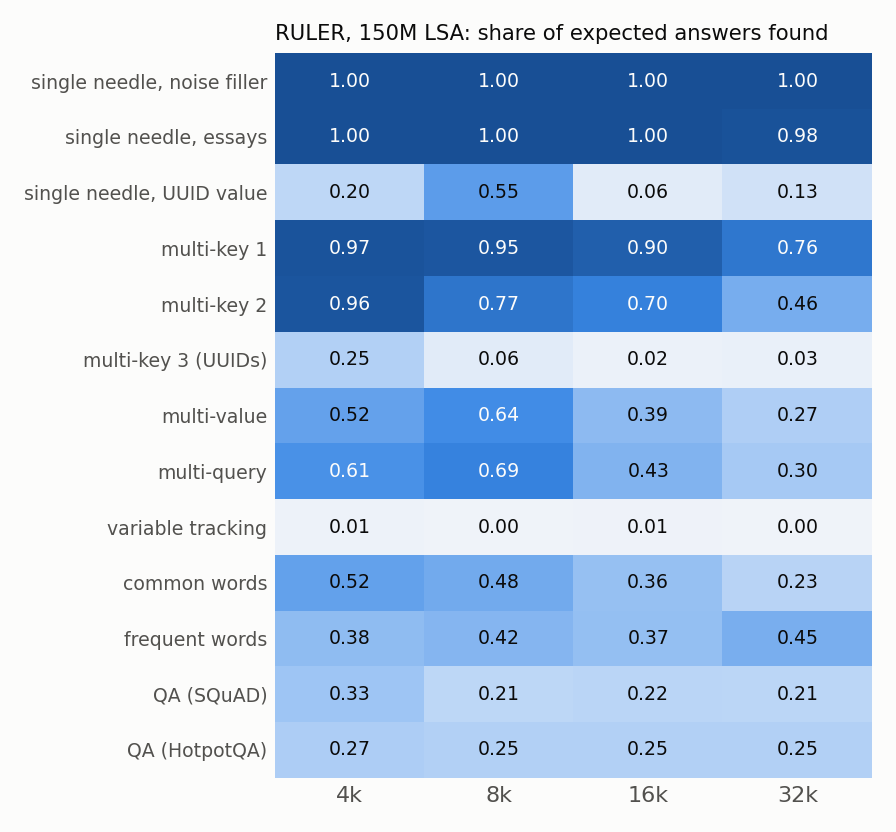

# 150M LSA: evaluation details

The method and the full tables behind the [model card](README.md). Every number here has its raw file in this
repository (`eval_results/`, `long_context/`, `ruler/`, `samples/`), and `figures/make_figures.py` draws the card's
figures from those files. The protocol is the one of the sibling card,
[150M concept memory](https://huggingface.co/Meridian21Lab/concept-memory-140m-11.5bt/blob/main/EVALUATION.md):
same scripts, settings, documents, prompts and reference runs. The sibling's own results are copied here with a
`cm_` prefix (or `e38_mem150m_` in `eval_results/`, `compare_concept_memory.json` in `long_context/`), so every
head-to-head can be recomputed from this repository alone.

## Contents
1. [Harness and settings](#harness-and-settings)
2. [Head to head with the sibling](#head-to-head-with-the-sibling)
3. [Standard benchmarks](#standard-benchmarks)
4. [Tiny-ML Leaderboard](#tiny-ml-leaderboard)
5. [Data efficiency](#data-efficiency)
6. [Long documents across models](#long-documents-across-models)
7. [Our own long-context tests](#our-own-long-context-tests)
8. [RULER](#ruler)
9. [Loading with from_pretrained](#loading-with-from_pretrained)
10. [Text samples](#text-samples)
11. [What we have not measured](#what-we-have-not-measured)
12. [Training procedure](#training-procedure)
13. [Reproducibility](#reproducibility)

## Harness and settings

- **Machine:** one NVIDIA RTX 3090 (24 GB) per job, 2026-11-18 15:08–16:24 UTC (this model); the reference models and the sibling
  ran on the same cards between 2026-11-17 19:58 UTC and 2026-11-18 14:00 UTC. The AWS tests quoted in section 7 ran
  on the training machine (4 × NVIDIA L40S) on 2026-11-18.
- **Benchmarks:** EleutherAI lm-evaluation-harness 0.4.11, 0-shot, all test items, max length 2,048, `acc` for
  every task. Our models through our adapter (`evaluation/lm_eval_perceiver_ar.py`, `--model perceiver_ar`), the
  others through lm-eval's stock `hf` model (`evaluation/run_lm_eval_suite.py`). Section 9 repeats the board tests
  on this model through the stock `hf` model too, loaded with `from_pretrained` from the release folder.
- **Precision:** each model in its training precision. Ours, the sibling, SmolLM2-135M, Gemma 3 270M, Granite 4.0
  350M and LFM2.5-350M-Base in bf16; Pythia-160M (trained in fp16) in fp32, because bf16 costs it about 6 points of
  ARC-Easy.
- **Start of each input:** the way each model's own tokenizer starts a text; ours starts with `<|endoftext|>`, as
  every training document did.
- **The whole run** is `scripts/release_evals.sh` (one checkpoint, a shared queue over three cards).
- **Excluded references, as on the sibling card:** LFM2-350M (post-trained for chat), MobileLLM-R1-140M-base (gated),
  state-space models without their CUDA kernels.

## Head to head with the sibling

The two 150M models read the same shards in the same order (identical data manifests in all three stages), with the
same seed, budget, optimizer, schedule and layers; only the reading layer differs. Differences are LSA minus concept
memory; intervals are 95 % bootstrap over the test items (documents for long text, prompts for RULER, paired, since
both models saw the same ones).

| Test | Unit, direction | LSA | Concept memory | LSA − concept memory [95 %] | Verdict |
|---|---|---:|---:|---:|---|
| RULER at 4k, mean of 13 | share found ↑ | 0.541 | 0.488 | +0.052 [+0.034, +0.071] | LSA ahead |
| RULER at 8k | share found ↑ | 0.540 | 0.439 | +0.101 [+0.081, +0.119] | LSA ahead |
| RULER at 16k | share found ↑ | 0.439 | 0.373 | +0.066 [+0.047, +0.084] | LSA ahead |
| RULER at 32k ¹ | share found ↑ | 0.390 | 0.319 | +0.072 [+0.052, +0.092] | LSA ahead |
| Long documents, 61k context, cross-model test | bits per byte ↓ | 0.797 | 0.795 | +0.002 [+0.001, +0.003] | concept memory ahead by 0.2 % |
| Same, our tokens, 64k spans (55 documents) | nats per token ↓ | 2.299 | 2.293 | +0.005 [+0.002, +0.009] | concept memory ahead by 0.2 % |
| Our tokens, 16k spans (120 documents) | nats per token ↓ | 2.129 | 2.126 | +0.004 [+0.002, +0.006] | concept memory ahead by 0.2 % |
| Our tokens, 128k spans, whole document (15) | nats per token ↓ | 2.426 | 2.451 | −0.025 [−0.034, −0.017] | LSA ahead by 1.0 % |
| Gain from far context, 1k → 61k, cross-model test | bits per byte ↑ | 0.049 | 0.051 | −0.002 | tie |
| Cost of switching the far read off, 64k | nats per token | 0.308 | 0.287 | | both read far |
| Grammar (BLiMP) | % ↑ | 80.11 ± 0.14 | 80.56 ± 0.14 | −0.45 (≈2 standard errors) | concept memory ahead |
| Mean of 7 core tasks | % ↑ | 46.46 | 46.22 | +0.24 | tie |
| ARC-Easy (board run) | % ↑ | 48.40 ± 1.03 | 48.95 ± 1.03 | −0.55 | tie |
| WikiText-2 | byte perplexity ↓ | 1.950 | 1.950 | 0.000 | tie |
| Held-out training loss, end of stages 1 / 2 / 3 | nats per token ↓ | 2.137 / 1.999 / 1.941 | 2.134 / 1.996 / 1.936 | +0.003 / +0.003 / +0.005 | tie |

¹ At 32k the two runs drew different needles for 8 of the 13 tasks (RULER generates them from one random state per
lm-eval call, and the 32k runs split the tasks over calls differently); those tasks are compared unpaired (each model's
prompts resampled on their own). All other lengths and tasks are paired: the expected answers match prompt by prompt.

**Reading it.** The two reads tie on everything that is prediction of ordinary text, with a consistent 0.2 % edge to
the concept memory up to the training length, and LSA degrades less past it. On retrieval LSA is clearly ahead, and
the gain is concentrated: several values or keys at once (+0.12 to +0.34 by length), counting words (+0.11 to +0.25),
questions (+0.03 to +0.06, intervals touching zero at three lengths); single needles and distractor keys tie. A
plausible reading: LSA spends its 512 opened tokens on the best-matching buckets only, while the concept memory spends
part of its read on summaries of every group; when several separate facts must be copied out, opened tokens win. This
is one seed of each model.

## Standard benchmarks

Accuracy in %, higher is better, ± standard error from the harness. In brackets: EleutherAI's own published
zero-shot results for Pythia-160M (quoted).

| Benchmark | Chance | **LSA** · 11.5B | Concept memory · 11.5B | SmolLM2-135M · 252B | SmolLM2-135M · ≈2T (final) | Pythia-160M · 300B | LFM2.5-350M-Base · 28T |
|---|---:|---:|---:|---:|---:|---:|---:|
| BLiMP, 67 sets | 50 | 80.11 ± 0.14 | **80.56** ± 0.14 | 79.72 ± 0.14 | 80.15 ± 0.14 | 77.48 | 80.17 |
| ARC-Easy | 25 | 48.40 ± 1.03 | 48.95 ± 1.03 | 61.62 ± 1.0 | 64.27 ± 0.98 | 43.64 ± 1.0 (43.52) | **70.03** ± 0.9 |
| ARC-Challenge | 25 | 21.8 ± 1.2 | 21.2 ± 1.2 | 27.1 ± 1.3 | 28.0 ± 1.3 | 19.5 ± 1.2 (18.8) | **38.2** ± 1.4 |
| HellaSwag | 25 | 30.1 ± 0.5 | 29.9 ± 0.5 | 32.6 ± 0.5 | 35.5 ± 0.5 | 28.4 ± 0.4 | **37.1** ± 0.5 |
| LAMBADA (OpenAI) | ≈0 | 33.3 ± 0.7 | 33.2 ± 0.7 | 35.0 ± 0.7 | **43.0** ± 0.7 | 35.4 ± 0.7 (32.8) | 35.8 ± 0.7 |
| PIQA | 50 | 63.4 ± 1.1 | 62.8 ± 1.1 | 65.9 ± 1.1 | **68.6** ± 1.1 | 62.3 ± 1.1 (62.7) | 66.6 ± 1.1 |
| SciQ | 25 | 77.6 ± 1.3 | 77.0 ± 1.3 | 80.4 ± 1.3 | 84.1 ± 1.2 | 75.4 ± 1.4 (74.1) | **90.1** ± 0.9 |
| WinoGrande | 50 | 50.7 ± 1.4 | 50.4 ± 1.4 | 50.9 ± 1.4 | 53.6 ± 1.4 | 51.2 ± 1.4 (53.1) | **55.6** ± 1.4 |
| **Mean of the 7 above** | 28.6 | 46.5 | 46.2 | 50.5 | 53.9 | 45.1 | **56.2** |
| WikiText-2 byte perplexity ↓ | — | 1.950 | 1.950 | 1.873 | **1.799** | 1.924 | 2.112 |
| WikiText-2 bits per byte ↓ | — | 0.964 | 0.964 | 0.905 | **0.847** | 0.944 | 1.078 |

The 7-task mean uses ARC-Easy from the 7-task run (48.40 %, the same as the board run). On the training machine
(AWS, 2026-11-18, flex attention) the same 7 tasks gave a mean of 46.48 %, within 0.6 points per task of these.

## Tiny-ML Leaderboard

The [board](https://huggingface.co/spaces/Glint-Research/Tiny-ML-Leaderboard) ranks by `quality × (1 + 0.5 · t)`,
where quality is the mean of BLiMP, ARC-Easy and a WikiText score normalised over the board, and t is a size bonus
from 0 (the largest entry) to 1 (the smallest). `evaluation/tiny_ml_board.py` reproduces the formula on the snapshot
of 2026-11-14; each of our rows is placed on its own.

| Place | Model | Organisation | Size | Training tokens | BLiMP % ↑ | ARC-Easy % ↑ | WikiText-2 byte ppl ↓ | Quality | Board score |
|---:|---|---|---:|---:|---:|---:|---:|---:|---:|
| 1 | Tiny Chick 10M V3 | kurcontko.dev | 9.6M | 24.6B | 77.76 | 59.60 | 2.335 | 77.8 | 87.7 |
| 2 | Tiny Chick 10M V2.1 | kurcontko.dev | 9.6M | 16.3B | 76.79 | 53.79 | 2.342 | 75.5 | 85.2 |
| 3 | Tiny Chick 10M V2 | kurcontko.dev | 9.6M | 16.3B | 76.99 | 50.21 | 2.364 | 74.3 | 83.8 |
| 4 | Slayer139 1.02 | Fabryka AI | 139.3M | 24.0B | 79.22 | 65.91 | 1.862 | 81.7 | 83.4 |
| (4) | *SmolLM2-135M, final (our run)* |  | 134.5M | ≈2T | 80.15 | 64.27 | 1.799 | 81.5 | 83.2 |
| 5 | Boris-2-Think | opencerebral | 143.7M | 200B | 82.09 | 63.93 | 1.967 | 81.7 | 83.2 |
| 6 | Slayer149-ARC | Fabryka AI | 149.3M | 31B | 78.38 | 66.58 | 1.907 | 81.5 | 82.9 |
| 7 | Tiny Chick 10M | kurcontko.dev | 9.6M | 8.3B | 75.12 | 48.53 | 2.287 | 73.3 | 82.7 |
| 8 | Slayer139 1.01 | Fabryka AI | 139.3M | 23.7B | 79.13 | 63.09 | 1.878 | 80.7 | 82.3 |
| (9) | *SmolLM2-135M, 252B checkpoint (our run)* |  | 134.5M | 252B | 79.72 | 61.62 | 1.873 | 80.4 | 82.1 |
| 9 | Glint-2 | glintresearch | 1.1M | ≈300B | 74.54 | 36.20 | 3.127 | 67.2 | 81.7 |
| 10 | Boris-2 | opencerebral | 143.7M | 200B | 81.13 | 59.76 | 1.895 | 80.2 | 81.7 |
| (11) | *SmolLM2-135M, 503B checkpoint (our run)* |  | 134.5M | 503B | 79.62 | 59.97 | 1.861 | 79.9 | 81.6 |
| 11 | JugnuLM-110M-R2+ | altslate | 110.0M | 25B | 82.52 | 55.13 | 1.873 | 79.2 | 81.5 |
| 12 | GPT-X2-125M | axiomiclabs | 125.0M | 75B | 81.28 | 57.07 | 1.860 | 79.5 | 81.4 |
| 13 | Haidass-143M-v1 | DALab | 143.0M | 100B | 79.05 | 60.23 | 1.889 | 79.7 | 81.2 |
| 14 | Slayer149 Balanced ARC-E fine-tune | Fabryka AI | 149.3M | — | 79.98 | 59.34 | 1.897 | 79.7 | 81.0 |
| 15 | Slayer139 base | Fabryka AI | 139.3M | 23.7B | 79.41 | 57.58 | 1.875 | 78.9 | 80.5 |
| 16 | JugnuLM-53M | altslate | 53.0M | 12B | 78.14 | 51.43 | 2.040 | 76.0 | 80.5 |
| 17 | Supra2.1-Ultra-Preview-001 | supralabs | 230.0M | 40.4B | 82.24 | 57.11 | 1.930 | 79.6 | 79.6 |
| 18 | Supra-50M-Instruct | supralabs | 51.8M | 20B | 76.30 | 52.20 | 2.560 | 74.3 | 78.7 |
| 19 | GoLLeM-v5 128M | Fabryka AI | 122.8M | 24.9B | 79.09 | 53.24 | 2.254 | 76.3 | 78.2 |
| 20 | Glint-1.3 (merged) | glintresearch | 982K | 100B | 68.70 | 32.50 | 3.080 | 64.1 | 78.2 |
| 21 | Ivme-Conversate-v3-Base | ivmelabs | 24.8M | ≈15B | 78.49 | 39.02 | 2.136 | 71.7 | 78.1 |
| 22 | Supra-50M-Base | supralabs | 51.8M | 20B | 76.30 | 46.00 | 2.040 | 73.5 | 78.0 |
| 23 | GPT-S-5M | axiomiclabs | 5.2M | 25B | 72.27 | 35.69 | 2.570 | 67.4 | 77.7 |
| (24) | *150M concept memory (sibling)* | Meridian21 Lab | 141.5M | 11.5B | 80.56 | 48.95 | 1.950 | 76.2 | 77.7 |
| 24 | Glint-2.3 | glintresearch | 1.7M | 10B | 67.30 | 36.00 | 3.051 | 64.8 | 77.6 |
| 25 | Zedev-134M-Fudas | meridianmrm | 134.0M | 20.7b | 81.69 | 46.38 | 1.880 | 76.0 | 77.6 |
| **26** | **150M LSA (ours)** | Meridian21 Lab | 141.5M | 11.5B | 80.11 | 48.40 | 1.950 | 75.9 | 77.4 |
| 27 | Hydrion-v1-Base | opengcm | 114.1M | ≈2.5B | 80.08 | 47.26 | 2.040 | 75.2 | 77.4 |
| 28 | GoLLeM-v5 64M | Fabryka AI | 62.9M | 24.9B | 76.16 | 48.19 | 2.347 | 73.4 | 77.2 |
| 29 | Ivme-Conversate-v2-Base | ivmelabs | 23.9M | ≈12.85B | 75.09 | 39.98 | 2.225 | 70.6 | 77.1 |
| 30 | GoLLeM-v5 64M (v1 recipe) | Fabryka AI | 62.9M | 13.1B | 75.83 | 47.94 | 2.372 | 73.1 | 77.0 |
| 31 | Pollock 1.5 Mini LM 128M | Fabryka AI | 127.4M | 21.50B | 78.50 | 47.73 | 1.944 | 75.1 | 76.9 |
| 32 | Glint-2.3-Mini | glintresearch | 1.1M | 10B | 62.27 | 36.20 | 3.122 | 63.1 | 76.8 |
| 33 | Qielbas Tiny 6M | labqoat | 6.1M | 3B | 73.25 | 36.24 | 3.069 | 66.8 | 76.6 |
| 34 | Hummingbird-V2 | juinron | 9.6M | 10B | 72.90 | 38.85 | 2.955 | 67.8 | 76.5 |
| 35 | TextModel-v1 | benchlabs | 122.7M | 1.64B | 80.31 | 49.71 | 2.628 | 74.6 | 76.5 |
| 36 | GoLLeM-v5 32M | Fabryka AI | 31.6M | 16B | 73.48 | 44.44 | 2.539 | 70.8 | 76.5 |
| 37 | Gros-Michel-90m-Base-v2 | finnianx | 95.0M | 9B | 80.20 | 43.18 | 2.080 | 73.8 | 76.4 |
| 38 | Michel-Nano-v2 | finnianx | 9.9M | 6.5B | 72.52 | 35.90 | 2.460 | 67.8 | 76.4 |
| 39 | MicroSupra-1k | supralabs | 1K | — | 58.61 | 26.39 | 11.270 | 50.9 | 76.3 |
| 40 | min-spark | minimalabs | 5.8M | 10B | 69.19 | 37.08 | 2.775 | 66.4 | 76.3 |
| 41 | ObsidianSmall-Base | dreamw | 8.7M | 4B | 71.89 | 33.29 | 2.467 | 66.7 | 75.5 |
| 42 | Gros-Michel-90m-Base | finnianx | 91.1M | 6.5B | 78.35 | 41.50 | 2.070 | 72.6 | 75.4 |
| 43 | GoLLeM-v5 16M | Fabryka AI | 17.4M | 16B | 70.08 | 40.91 | 2.675 | 68.2 | 75.3 |
| 44 | Cagliari-114M | meridianmrm | 114.0M | 5.24B | 80.22 | 38.30 | 1.960 | 72.5 | 74.6 |
| (44) | *Pythia-160M, final (our run, fp32; over the 150M cap)* |  | 162.3M | 300B | 77.48 | 43.64 | 1.924 | 73.5 | 74.5 |
| 45 | KeyLM-75M-Instruct | minimalabs | 75.0M | ≈18B | 76.02 | 39.10 | 2.170 | 70.8 | 74.0 |
| 46 | Michel-Micro | finnianx | 28.4M | 2.6B | 69.75 | 38.59 | 2.300 | 68.2 | 73.9 |

The first 45 places of 101 shown (with our model added), plus our runs of other models in brackets and italics, each
at the place it gets on its own; the full snapshot is in the file above.

By quality alone (no size bonus) the model is 16th of 101; on grammar alone, 11th. Of the 55 board entries that report
15B training tokens or fewer, four place above it. ARC-Easy is the test that moves the rank most, as for the sibling.

## Data efficiency

| Test | **LSA** at 11.5B | Concept memory at 11.5B | Pythia-160M at 10.5B | at 12.6B | at 300B (final) | SmolLM2-135M at 252B | at 503B | at ≈2T (final) |
|---|---:|---:|---:|---:|---:|---:|---:|---:|
| Grammar (BLiMP) % ↑ | 80.11 | 80.56 | 77.94 | 78.28 | 77.48 | 79.72 | 79.62 | 80.15 |
| Science quiz (ARC-Easy) % ↑ | 48.40 | 48.95 | 42.59 | 42.76 | 43.64 | 61.62 | 59.97 | 64.27 |
| WikiText-2 byte perplexity ↓ | 1.950 | 1.950 | 2.044 | 2.024 | 1.924 | 1.873 | 1.861 | 1.799 |
| Mean of 7 core tasks % ↑ | 46.5 | 46.2 | 42.1 | 43.2 | 45.1 | 50.5 | — | 53.9 |

Pythia-160M checkpoints scored in fp32 (steps 1,000 to 143,000 at 2,097,152 tokens per step, 2.1B to 300B tokens);
SmolLM2-135M from `HuggingFaceTB/SmolLM2-135M-intermediate-checkpoints` (branches `step-240000` and `step-480000`,
1,048,576 tokens per step) and the final model. All of them are the sibling card's runs, reused unchanged.

- **Same budget:** ahead of Pythia-160M at 10.5–12.6B tokens on every test.
- **Tokens to match** (log-linear between Pythia's checkpoints): not reached by 300B tokens for grammar or the science
  quiz; 36.4B tokens (3.2× ours) for WikiText.
- **What it does not separate:** architecture from data. The sibling, on the same data and order, lands within half a
  point on every test here, so on these tests the two reads cost or gain nothing measurable; the comparison with
  Pythia is mostly data (the Pile, 2020, against 2024–2025 filtered web and educational text). The full-attention
  model on our data is training.

## Long documents across models

`evaluation/long_context_compare.py`, the same 55 held-out 64k-token spans as the sibling card (identical files: the
same documents and target characters, checked by hash on 2026-11-18). Target: the last ≈16 KB of each span; the
context before it is cut to each budget, counted in our tokens. Unit: bits per byte of the target. A model that
cannot take a budget is scored with sliding windows of its own maximum length ("limit").

| Model | Params | Max length | 1k | 4k | 16k | 28k | whole document | saved, 1k → most context | docs better with more | another document's far past |
|---|---:|---:|---:|---:|---:|---:|---:|---:|---:|---:|
| 150M LSA (ours) | 141.5M | 65,536 | 0.845 | 0.828 | 0.816 | 0.809 | 0.797 | 0.049 [0.035, 0.065] | 93 % | 0.834 |
| 150M concept memory (sibling) | 141.5M | 65,536 | 0.846 | 0.828 | 0.816 | 0.808 | 0.795 | 0.051 [0.037, 0.067] | 96 % | 0.832 |
| SmolLM2-135M at 252B tokens (step 240,000) | 134.5M | 2,048 | 0.933 (limit) | — | — | — | — | 0.000 [0.000, 0.000] | 0 % | 0.932 |
| SmolLM2-135M | 134.5M | 8,192 | 0.851 | 0.835 | 0.832 (limit) | — | — | 0.018 [0.014, 0.024] | 95 % | 0.836 |
| Pythia-160M | 162.3M | 2,048 | 0.942 (limit) | — | — | — | — | 0.000 [0.000, 0.000] | 0 % | 0.941 |
| Gemma 3 270M | 268.1M | 32,768 | 0.843 | 0.825 | 0.812 | 0.805 | 0.805 (limit) | 0.038 [0.029, 0.049] | 96 % | 0.827 |
| Granite 4.0 350M base | 352.4M | 32,768 | 0.817 | 0.797 | 0.783 | 0.776 | 0.776 (limit) | 0.041 [0.033, 0.051] | 100 % | 0.798 |
| LFM2.5-350M-Base | 354.5M | 32,768 | 0.893 | 0.879 | 0.912 | 0.928 | 0.928 (limit) | -0.035 [-0.051, -0.020] | 22 % | 0.933 |

Each model with the most of the document it can take, against 150M LSA (ours) with the whole document:

| Model | its bits per byte | 150M LSA (ours) | difference (+ = 150M LSA (ours) better) | documents where 150M LSA (ours) is better |
|---|---:|---:|---:|---:|
| 150M concept memory (sibling) | 0.795 | 0.797 | -0.002 [-0.003, -0.001] | 38 % |
| SmolLM2-135M at 252B tokens (step 240,000) | 0.933 | 0.797 | +0.136 [+0.112, +0.161] | 98 % |
| SmolLM2-135M | 0.832 | 0.797 | +0.036 [+0.018, +0.055] | 75 % |
| Pythia-160M | 0.942 | 0.797 | +0.145 [+0.123, +0.169] | 98 % |
| Gemma 3 270M | 0.805 | 0.797 | +0.008 [-0.007, +0.023] | 55 % |
| Granite 4.0 350M base | 0.776 | 0.797 | -0.021 [-0.035, -0.006] | 29 % |
| LFM2.5-350M-Base | 0.928 | 0.797 | +0.132 [+0.107, +0.155] | 95 % |

LFM2.5-350M-Base at its best context (4k, 0.879) against this model with the whole document: +0.082 [0.059, 0.105],
this model better on 87 % of documents. Reference rows are the sibling card's runs (same spans, same script);
`long_context/compare_*.json`. Scale: gzip -9 needs 2.49 bits per byte on the same targets, xz -9e 1.97, bzip2 -9 1.77.

## Our own long-context tests

The same 64k documents in our own tokens, with a switch no other model has (`long_context/long_context_use.py`).
Always the same target, the **last 4,096 tokens** of a 16k, 64k or 128k span. Loss in nats per token (lower is
better; both 150M models share one tokenizer, so their nats per token compare directly); 95 % intervals by bootstrap
over documents.

1. **Context cut:** predict the target after 1k, 4k, 16k … or all of the document before it.
2. **Swapped far past:** the document's own nearest 4k kept, everything older from a different document of the same
   source.
3. **Far read off:** the LSA layer limited to its first 4 tokens and last 512 (no bucket reads). The sibling's
   equivalent switch keeps its current and previous 512-token block; it also has a "summaries off" switch, which LSA
   has no counterpart for.

**At 64k** (55 documents; the concept memory's values from the sibling card's run on the same documents):

| variant | LSA | worse than LSA full by [95 %] | docs worse | CM | LSA − CM [95 %] | docs LSA better |
|---|---:|---:|---:|---:|---:|---:|
| 1024 (n=55) | 2.439 | +0.141 [+0.100, +0.186] | 93 % | 2.441 | -0.0017 [-0.0046, +0.0013] | 62 % |
| 4096 (n=55) | 2.390 | +0.091 [+0.059, +0.127] | 85 % | 2.390 | -0.0001 [-0.0029, +0.0026] | 51 % |
| 16384 (n=55) | 2.355 | +0.056 [+0.032, +0.085] | 78 % | 2.354 | +0.0011 [-0.0015, +0.0036] | 44 % |
| 61439 (n=55) | 2.299 | — |  | 2.293 | +0.0052 [+0.0017, +0.0088] | 40 % |
| off (n=55) | 2.606 | +0.308 [+0.236, +0.391] | 100 % | 2.580 | +0.0262 [+0.0154, +0.0408] | 18 % |
| swap (n=55) | 2.406 | +0.108 [+0.079, +0.139] | 98 % | 2.400 | +0.0064 [+0.0032, +0.0095] | 29 % |

Rows: the context before the target (1k … the whole 61,439 tokens), "off" (the far read switched off on the full
span) and "swap" (own last 4k + another document's 57k). "Worse than full" is LSA's own cost; the last two columns
compare the two models on the same variant (+ = concept memory better). Full context in bits per byte: LSA 0.793.

**At 16k** (120 documents, 12,287 tokens of full context): full 2.129 nats per token (concept memory 2.126); cut to 4k
+0.040 [0.033, 0.049]; cut to 1k +0.091 [0.077, 0.107] (98 % of documents worse); another document's far past +0.049;
far read off +0.308 (concept memory: memory off +0.271).

**At 128k, twice the training length** (15 documents: 4 books, 8 DOAB, 2 US GPO, 1 arXiv):

| variant | LSA | worse than LSA full by [95 %] | docs worse | CM | LSA − CM [95 %] | docs LSA better |
|---|---:|---:|---:|---:|---:|---:|
| 4096 (n=15) | 2.440 | +0.014 [-0.021, +0.052] | 53 % | 2.441 | -0.0011 [-0.0065, +0.0044] | 53 % |
| 16384 (n=15) | 2.410 | -0.016 [-0.041, +0.014] | 33 % | 2.409 | +0.0007 [-0.0053, +0.0069] | 53 % |
| 61440 (n=15) | 2.395 | -0.031 [-0.047, -0.015] | 7 % | 2.391 | +0.0041 [-0.0027, +0.0107] | 33 % |
| 126975 (n=15) | 2.426 | — |  | 2.451 | -0.0253 [-0.0335, -0.0167] | 87 % |
| off (n=15) | 2.671 | +0.245 [+0.168, +0.338] | 100 % | 2.645 | +0.0265 [+0.0155, +0.0386] | 13 % |
| swap (n=14) | 2.646 | +0.070 [+0.043, +0.095] | 93 % | 2.683 | -0.0378 [-0.0502, -0.0258] | 93 % |

The arXiv document has no swap row: no other arXiv validation document is long enough to donate 123k tokens.

- **The far past is used:** from 1k of context to all 61k, 0.14 nats per token (about 6 % fewer bits), worse with
  less context on 93 % of documents; another document's far past scores like a 4k cut.
- **Per source** (64k, nats per token from 1k to full): US government documents 2.019 → 1.648, arXiv 1.218 → 0.941,
  DOAB 2.300 → 2.150, books 2.984 → 2.918, debates 2.591 → 2.542, the same ranking as the sibling.
- **Past 64k:** as for the sibling, the last 61k tokens predict better than the whole 127k (by 0.031 nats per token,
  on 14 of 15 documents), so feed the last ≈64k; but LSA's whole-document read holds up better than the sibling's
  (2.426 against 2.451) and a long wrong past distracts it less (2.646 against 2.683).
- **"Far read off" overstates the read's value:** the model never trained without it; the context cut is the cleaner
  measure.

**From the AWS tests (2026-11-18, training machine, 8 rows per source and length, different rows per length):** on
seven long-document sources (books, arXiv, DOAB, US GPO, Hansard, science PDFs, code repositories) at 4k, 16k, 32k
and 64k tokens, LSA and the concept memory differ by at most 0.008 nats per token (LSA ahead by up to 0.006 at 4k,
behind by up to 0.008 at 16k–64k), the same small edge to the concept memory as above. Switching LSA's far read off
costs 0.06 (debates, 4k) to 0.40 nats per token (open-access books, 32k).

## RULER

13 tasks, 100 prompts per task and length, greedy cached decoding, each task's own answer length (lm-eval's RULER
configs, up to 128 tokens), every reply saved (`ruler/*_answers.jsonl`). Score = share of the reference answers found
in the reply (higher is better). **Not zero-shot:** training stages 2 and 3 included planted-fact lookups of a similar
shape (different wording), for both models.

**This model at every length, the sibling in brackets** (RTX 3090 cards, 2026-11-18 15:19–16:11 UTC; 4k and 8k, 16k
on one card each; 32k split by task over three cards):

| RULER task | What it asks | 4k | 8k | 16k | 32k |
|---|---|---:|---:|---:|---:|
| single needle, noise filler | one number hidden in repeated filler | 1.00 (1.00) | 1.00 (1.00) | 1.00 (1.00) | 1.00 (1.00) |
| single needle, essays | one number hidden in real essays | 1.00 (1.00) | 1.00 (1.00) | 1.00 (1.00) | 0.98 (0.98) |
| single needle, UUID value | one 32-character ID (UUID) hidden in essays | 0.20 (0.29) | 0.55 (0.27) | 0.06 (0.07) | 0.13 (0.07) |
| multi-key 1 | one number among distractor keys | 0.97 (0.99) | 0.95 (0.90) | 0.90 (0.91) | 0.76 (0.77) |
| multi-key 2 | the haystack is all similar needles | 0.96 (0.92) | 0.77 (0.84) | 0.70 (0.76) | 0.46 (0.41) |
| multi-key 3 (UUIDs) | as 2, with UUID keys and values | 0.25 (0.28) | 0.06 (0.11) | 0.02 (0.06) | 0.03 (0.04) |
| multi-value | all values of one key | 0.52 (0.31) | 0.64 (0.34) | 0.39 (0.24) | 0.27 (0.24) |
| multi-query | several keys asked at once | 0.61 (0.40) | 0.69 (0.32) | 0.43 (0.11) | 0.30 (0.09) |
| variable tracking | follow a chain of assignments | 0.01 (0.01) | 0.00 (0.01) | 0.01 (0.01) | 0.00 (0.01) |
| common words | list the most common words | 0.52 (0.52) | 0.48 (0.42) | 0.36 (0.27) | 0.23 (0.13) |
| frequent words | list the most frequent words | 0.38 (0.15) | 0.42 (0.16) | 0.37 (0.02) | 0.45 (0.06) |
| QA (SQuAD) | answer from one of many paragraphs | 0.33 (0.33) | 0.21 (0.20) | 0.22 (0.21) | 0.21 (0.20) |
| QA (HotpotQA) | two-hop answer from many paragraphs | 0.27 (0.15) | 0.25 (0.15) | 0.25 (0.19) | 0.25 (0.15) |
| **Mean of 13** | | **0.54** (0.49) | **0.54** (0.44) | **0.44** (0.37) | **0.39** (0.32) |

**Against reference models at 8k and 4k.** The references are the sibling card's runs (2026-11-18 14:34–15:22 UTC)
through lm-eval's stock `hf` model, each in bf16, its prompts sized with its own tokenizer, room for prompt and
answer (length + 256 positions). Pythia-160M and SmolLM2-135M's 252B checkpoint read 2,048 tokens and cannot take
RULER's shortest length. Best in each row in **bold** (ties bolded together).

| RULER task, 8k | **LSA** | Concept memory | SmolLM2-135M | Gemma 3 270M | Granite 4.0 350M | LFM2.5-350M-Base |
|---|---:|---:|---:|---:|---:|---:|
| single needle, noise filler | **1.00** | **1.00** | **1.00** | **1.00** | **1.00** | 0.99 |
| single needle, essays | **1.00** | **1.00** | 0.97 | 0.51 | **1.00** | **1.00** |
| single needle, UUID value | 0.55 | 0.27 | 0.18 | 0.15 | **1.00** | 0.51 |
| multi-key 1 | **0.95** | 0.90 | 0.58 | 0.79 | 0.88 | 0.88 |
| multi-key 2 | 0.77 | **0.84** | 0.00 | 0.22 | 0.33 | 0.15 |
| multi-key 3 (UUIDs) | 0.06 | **0.11** | 0.01 | 0.01 | 0.06 | 0.05 |
| multi-value | 0.64 | 0.34 | 0.36 | 0.22 | **0.69** | 0.41 |
| multi-query | 0.69 | 0.32 | 0.21 | 0.36 | **0.71** | 0.62 |
| variable tracking | 0.00 | 0.01 | 0.06 | 0.00 | **0.17** | 0.13 |
| common words | **0.48** | 0.42 | 0.01 | 0.41 | 0.22 | 0.09 |
| frequent words | **0.42** | 0.16 | 0.21 | 0.27 | 0.40 | 0.01 |
| QA (SQuAD) | 0.21 | 0.20 | 0.08 | 0.10 | 0.26 | **0.37** |
| QA (HotpotQA) | 0.25 | 0.15 | 0.22 | 0.19 | **0.27** | 0.25 |
| **Mean of 13** | **0.54** | 0.44 | 0.30 | 0.33 | **0.54** | 0.42 |

| RULER task, 4k | **LSA** | Concept memory | SmolLM2-135M | Gemma 3 270M | Granite 4.0 350M | LFM2.5-350M-Base |
|---|---:|---:|---:|---:|---:|---:|
| single needle, noise filler | **1.00** | **1.00** | **1.00** | **1.00** | **1.00** | 0.98 |
| single needle, essays | **1.00** | **1.00** | 0.98 | 0.97 | **1.00** | **1.00** |
| single needle, UUID value | 0.20 | 0.29 | 0.28 | 0.75 | **1.00** | 0.53 |
| multi-key 1 | 0.97 | **0.99** | 0.70 | 0.85 | 0.96 | 0.90 |
| multi-key 2 | **0.96** | 0.92 | 0.07 | 0.23 | 0.27 | 0.36 |
| multi-key 3 (UUIDs) | 0.25 | **0.28** | 0.06 | 0.09 | 0.17 | 0.12 |
| multi-value | 0.52 | 0.31 | 0.63 | 0.46 | **0.67** | 0.40 |
| multi-query | 0.61 | 0.40 | 0.29 | 0.46 | **0.82** | 0.71 |
| variable tracking | 0.01 | 0.01 | 0.15 | 0.00 | **0.28** | 0.00 |
| common words | 0.52 | 0.52 | 0.15 | **0.67** | 0.41 | 0.16 |
| frequent words | 0.38 | 0.15 | 0.38 | 0.33 | **0.53** | 0.03 |
| QA (SQuAD) | 0.33 | 0.33 | 0.28 | 0.29 | 0.50 | **0.53** |
| QA (HotpotQA) | 0.27 | 0.15 | 0.27 | 0.16 | **0.39** | 0.34 |
| **Mean of 13** | 0.54 | 0.49 | 0.40 | 0.48 | **0.62** | 0.47 |

**The earlier capped run.** The first RULER run of this model (AWS, 2026-11-18) cut every answer at 32 tokens, which
cuts UUIDs and long lists in the SmolLM2 tokenizer (one digit per token). Its means were 0.489 / 0.469 / 0.412 / 0.365
at 4k / 8k / 16k / 32k. The tasks with long answers moved most: the UUID needle 0.01 → 0.20 at 4k and 0.05 → 0.55
at 8k, the UUID multi-key 0.01 → 0.25 at 4k, common words +0.05 to +0.22, multi-value +0.02 to +0.16. Tasks the cap
could not affect moved by up to ±0.03, except frequent words at 16k (0.54 → 0.37), within the run-to-run noise at 100
prompts per task. The table above replaces the capped run; its raw file is not shipped.

## Loading with from_pretrained

The release folder is written by `scripts/export_hub_model.py` (modeling code generated from the MrCogito source,
`auto_map`, weights, tokenizer, `export_manifest.json`). Checks on 2026-11-18:

- `tests/test_hub_export.py` with this checkpoint on an RTX 3090: 27 of 27 passed (the export's loss on a fixed text
  equals our evaluation loader's; 🤗 greedy decoding equals our cached decoder token for token; seeded sampling
  repeats; beam search runs; it loads from the folder with `local_files_only`).
- Clean environments with only torch 2.11 and Transformers (`python -I scripts/hub_smoke_test.py <folder> --local`):
  passed on Transformers 4.57.6 and 5.23.0, the same sentence loss (2.2892 nats per token) and the same seed-0
  sample on both.
- The board tests through lm-eval's stock `hf` model on the release folder (`from_pretrained`, bf16,
2026-11-18 16:18–16:24 UTC): BLiMP 80.11 %, ARC-Easy 48.40 %, WikiText-2 byte perplexity 1.95005; through our adapter
80.11 %, 48.40 %, 1.95006 (`eval_results/e38_lsa150m_final_hf.json`). A reader running lm-eval on the Hub id gets
this card's numbers.

## Text samples

`evaluation/sample_text.py`, one RTX 3090, 2026-11-18 16:17 UTC; prompts start with `<|endoftext|>` as in training. Nucleus
sampling: temperature 0.7, top-p 0.9, repetition penalty 1.1 over prompt and reply, seeds 0, 1 and 2. Beam search: 4
beams, no repeated 3-gram, best by mean log-probability. 60 new tokens. All outputs, unedited:
`samples/samples_ours.json`. The card shows seed 0 for each prompt.

## What we have not measured

- **A full-attention model of the same size on the same data** (training since 2026-11-18). Until it is in, the
  head-to-head above compares two sparse reads with each other, and neither result separates a read from the data.
- **A second seed.** Every number here is seed 42; differences of a point or two between the siblings are within
  what a second seed could move.
- **Long-document benchmarks with real questions** (LongBench, BABILong) and needle tests past 32k.
- **Speed.** Both reads run as masks over PyTorch flex attention, not as the LSA authors' kernels; we do not report
  throughput comparisons.
- **Energy use.**

## Training procedure

| | Stage 1 (main) | Stage 2 (decay) | Stage 3 (long) |
|---|---|---|---|
| Row length | 4,096 | 16,384 | 65,536 |
| Steps × rows per step | 15,259 × 128 | 5,722 × 32 | 954 × 8 |
| Tokens per step | 524,288 | 524,288 | 524,288 |
| Learning rate | Muon peak 0.01, constant after 1 % warm-up | fresh optimizer, 3 % warm-up, 1 − √ decay to 0.1 × | a tenth of the peak, decaying |
| Held-out loss (nats per token, lower is better) | 2.729 → 2.137 (4k web rows) | 2.303 → 1.999 (16k long-document rows) | 1.964 → 1.941 (64k rows) |
| Sibling's held-out loss, same rows | 2.732 → 2.134 | 2.295 → 1.996 | 1.960 → 1.936 |
| Speed | 111.2k tokens/s | 84.0k tokens/s | 30.5k tokens/s (activations recomputed) |
| Wall time | 20.0 h | 9.9 h (+ ≈40 min lost to a spot interruption) | 4.5 h |

Muon updates the weight matrices; norms, embeddings and other vector parameters use AdamW (betas 0.9 / 0.95, weight
decay 0.1). Gradient clipping at 1.0, bf16, flex attention. The optimizer choice (Muon over AdamW) was made once, on
the sibling, before either run (a paid two-arm test at 2,000 steps). LSA settings: block 512, keys summed in pools of
4, buckets of 8 on average and at most 16 (64 per block), the 128 best buckets per query, up to 512 selected tokens,
4 sink tokens, a 512-token window.

## Reproducibility

- **W&B (public project `ksopyla/MrCogito`):**
  [stage 1](https://wandb.ai/ksopyla/MrCogito/runs/perceiver_ar_perceiver_H896L3g1s9N128_20261117_015743_lsa_m120t_trunk) ·
  [stage 2](https://wandb.ai/ksopyla/MrCogito/runs/perceiver_ar_perceiver_H896L3g1s9N128_20261117_223758_lsa_m120t_decay)
  (its first attempt, stopped by the spot interruption:
  [run](https://wandb.ai/ksopyla/MrCogito/runs/perceiver_ar_perceiver_H896L3g1s9N128_20261117_215641_lsa_m120t_decay)) ·
  [stage 3](https://wandb.ai/ksopyla/MrCogito/runs/perceiver_ar_perceiver_H896L3g1s9N128_20261118_083324_lsa_m120t_long)
- **In this repository:** `eval_results/` (full lm-eval outputs for every model and checkpoint above),
  `long_context/` (per-document results and the summarisers `summarise.py` and `summarise_compare.py`), `ruler/`
  (scores and every reply, both siblings), `samples/`, `figures/make_figures.py`.
- **Code:** training at [commit `1fddc505`](https://github.com/ksopyla/MrCogito/tree/1fddc505) (experiment spec
  `docs/experiments_specs/ahead/E38_long_budget_mix.md`; training `scripts/run_e33n.py`, size `m120t`, arm `lsa`; the
  LSA read `nn/lsa_buckets.py`, ported from
  [Prefrontal-AI/latent-sparse-attention](https://github.com/Prefrontal-AI/latent-sparse-attention) at `5ebea73`);
  evaluation and export at [commit `832f4eeb`](https://github.com/ksopyla/MrCogito/tree/832f4eeb)
  (`scripts/release_evals.sh`, `scripts/export_hub_model.py`).
- **Intermediate checkpoints** of this model are not published yet.
