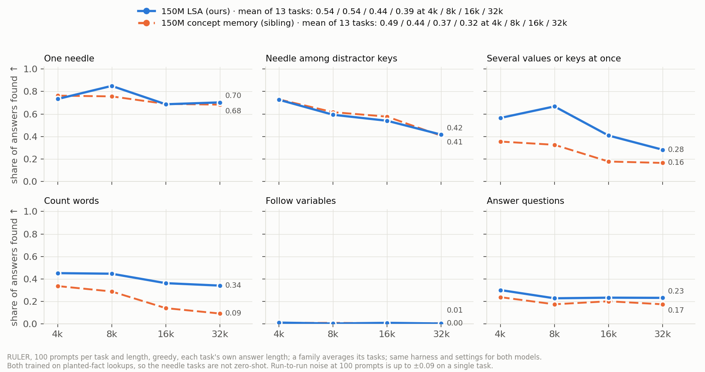
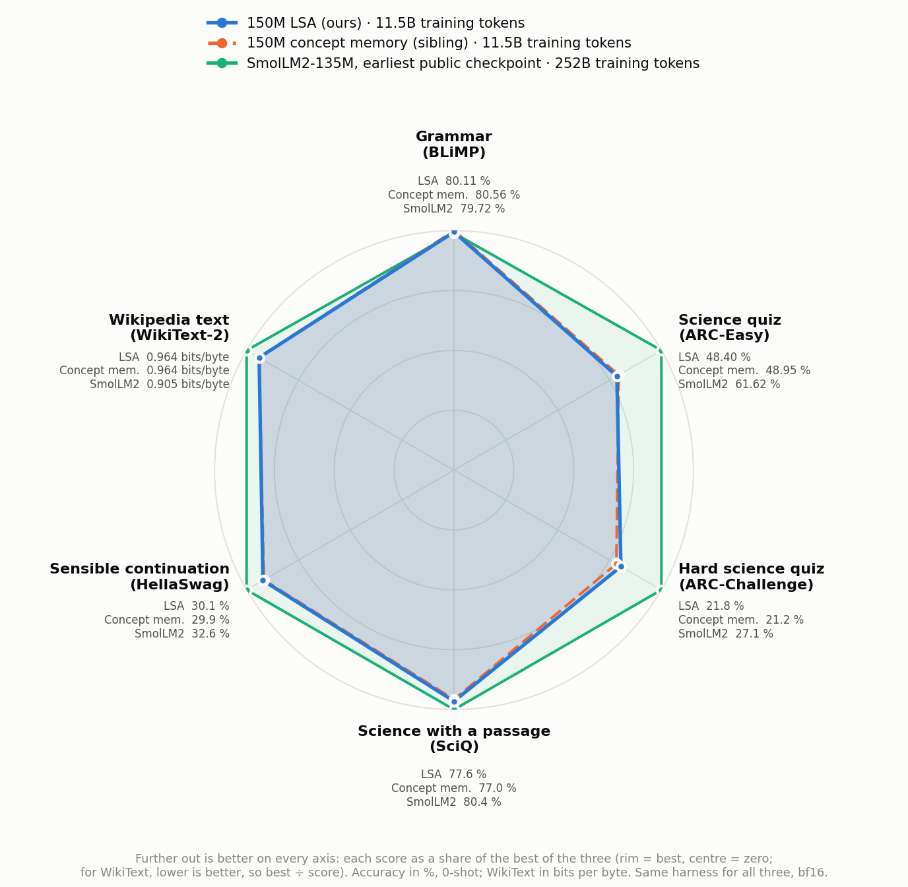
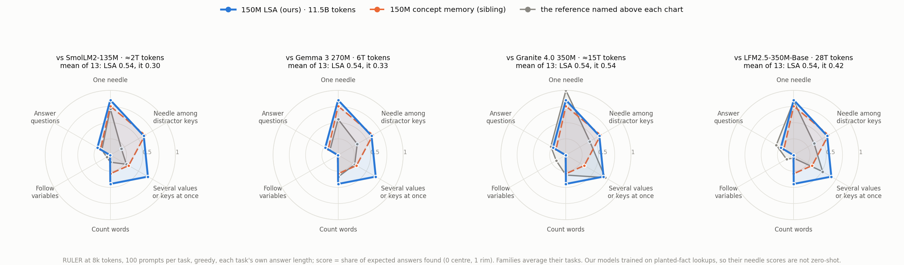
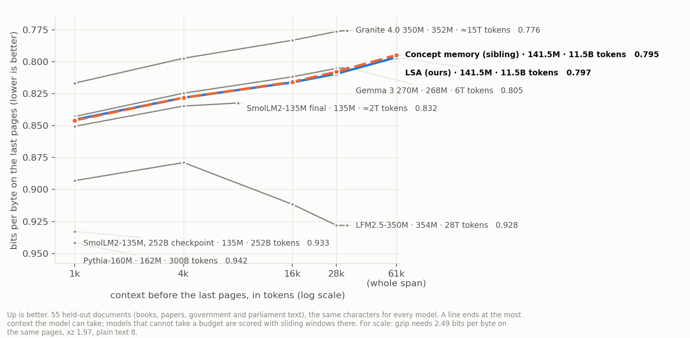
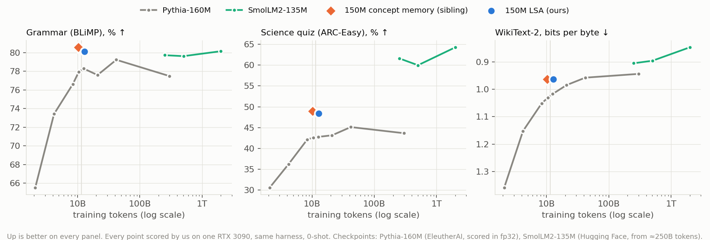

---
language:
  - en
license: apache-2.0
pipeline_tag: text-generation
library_name: transformers
tags:
  - mrcogito
  - meridian21
  - custom_code
  - latent-sparse-attention
  - lsa
  - size-140m
  - budget-11.5bt
  - long-context
  - base-model
  - research
  - pytorch
  - e38                        # internal experiment code (secondary label)
datasets:
  - nvidia/Nemotron-CC-v2
  - nvidia/Nemotron-CC-Math-v1
  - nvidia/Nemotron-Pretraining-Specialized-v1
  - HuggingFaceTB/dclm-edu
  - common-pile/stackv2_edu_filtered
  - common-pile/project_gutenberg_filtered
  - common-pile/arxiv_papers_filtered
  - common-pile/doab_filtered
  - common-pile/usgpo_filtered
  - common-pile/uk_hansard_filtered
  - allenai/dolma3_longmino_pool
  - HuggingFaceTB/smol-smoltalk
model-index:
  - name: lsa-140m-11.5bt
    results:
      - task: {type: text-generation, name: Grammar (BLiMP, 67 sets, 0-shot)}
        dataset: {type: blimp, name: BLiMP}
        metrics: [{type: accuracy, value: 80.11, name: accuracy (%)}]
      - task: {type: text-generation, name: Science quiz (ARC-Easy, 0-shot)}
        dataset: {type: allenai/ai2_arc, name: ARC-Easy, config: ARC-Easy, split: test}
        metrics: [{type: accuracy, value: 48.40, name: accuracy (%)}]
      - task: {type: text-generation, name: Language modelling (WikiText-2)}
        dataset: {type: wikitext, name: WikiText-2}
        metrics: [{type: perplexity, value: 1.950, name: byte perplexity (lower is better)}]
---

# 150M LSA: a small base model that reads 64k tokens with Latent Sparse Attention

**`Meridian21Lab/lsa-140m-11.5bt`** · [Project page](https://ai.ksopyla.com/projects/concept-reasoning/) ·
[Code](https://github.com/ksopyla/MrCogito/tree/1fddc505) · [Evaluation details](EVALUATION.md) ·
[Training on W&B](https://wandb.ai/ksopyla/MrCogito/runs/perceiver_ar_perceiver_H896L3g1s9N128_20261118_083324_lsa_m120t_long) ·
Sibling: [150M concept memory](https://huggingface.co/Meridian21Lab/concept-memory-140m-11.5bt)

A 141.5M-parameter English base language model, trained from scratch on 11.5B tokens of public data for about
$290. Its long-range read is **Latent Sparse Attention (LSA)**, the method of Kubicek et al. (Prefrontal AI and
ETH Zürich, [arXiv 2610.42147](https://arxiv.org/abs/2610.42147),
[code](https://github.com/Prefrontal-AI/latent-sparse-attention)): it sorts the text it has already read into small
groups of tokens with related content, and for every next word it looks up the groups that match best and rereads
those tokens word for word. This model is our port of their released read, trained from scratch in our own
architecture; it is not a model from the LSA authors.

It has a **sibling**: the [150M concept memory](https://huggingface.co/Meridian21Lab/concept-memory-140m-11.5bt),
trained on the same data, in the same order, for the same budget, with the same layers. Only the reading layer
differs, so the two models are a fair test of the two ways to read a long past. Both are the first public models of
[MrCogito](https://ai.ksopyla.com/projects/concept-reasoning/), a project building models that compress long text into
concepts and reason over them. A research release: base model, one training seed, not instruction-tuned.

## Highlights

- **Finds facts far back as well as a 350M model trained on 1,300 times more text.** RULER, 13 tasks that hide
  facts in a long text and ask for them (score = share of expected answers found, 1 = all), at 8k tokens: **0.54**,
  level with Granite 4.0 350M (0.54; ≈15T training tokens; it leads at 4k, 0.62 against 0.54) and ahead of
  LFM2.5-350M-Base (0.42; 28T), Gemma 3 270M (0.33; 6T) and SmolLM2-135M (0.30; ≈2T), all scored by us with the same
  harness.
- **Ahead of its sibling at every length.** 0.54 / 0.54 / 0.44 / 0.39 at 4k / 8k / 16k / 32k
  tokens against the concept memory's 0.49 / 0.44 / 0.37 / 0.32: +0.05 to +0.10, with 95 % intervals above zero
  at every length. The gain is where several facts are asked at once (+0.12 to +0.34) and in counting words across
  the text (+0.11 to +0.25); on single hidden facts the two tie.
- **Reads long documents as well as its sibling, and holds up better past them.** On the last pages of 55 held-out
  64k-token documents it needs **0.797 bits per byte** (lower is better; scale below): level with the concept memory
  (0.795) and Gemma 3 270M (0.805, twice our size), ahead of every same-size model (SmolLM2-135M 0.832, Pythia-160M
  0.942). At 128k tokens, twice its training length, it beats the concept memory by 0.025 nats per token on 13 of 15
  documents.
- **The new read costs nothing on short text.** Mean of seven standard tasks 46.5 % (sibling 46.2 %), WikiText byte
  perplexity 1.950 (sibling 1.950), grammar (BLiMP) 80.11 % (sibling 80.56 %); against Pythia-160M at our training
  budget it is ahead on every test.
- **Cheap, open, and one line to load.** ≈36 hours on one 4-GPU node (≈ $290). It loads with
  `AutoModelForCausalLM.from_pretrained(..., trust_remote_code=True)`, scores a whole 64k document in one pass on a
  single 24 GB RTX 3090, and every number on this card has its raw result file in this repository.

<p align="center"></p>

*RULER by task family, 4k to 32k tokens: this model (blue) and its sibling, the concept memory (orange, dashed), same harness and settings, 100 prompts per task and length (the same prompts for both models from 4k to 16k). Both trained on planted-fact lookups, so the needle tasks are not zero-shot for either.*

## Results at a glance

All numbers in this table come from **one harness**, run by us on RTX 3090 cards on 2026-11-17/18: EleutherAI's
lm-evaluation-harness 0.4.11, 0-shot, all test items, max length 2,048; each model in its training precision (ours,
the concept memory, SmolLM2 and LFM2.5 in bf16, Pythia in fp32). Long documents: our cross-model test (below).
Accuracy in %, higher is better; best in each row in **bold**.

<p align="center"></p>

| Measure | Chance | **150M LSA** · 11.5B tokens | 150M concept memory ¹ · 11.5B | SmolLM2-135M · 252B ² | Pythia-160M · 300B ³ | LFM2.5-350M-Base · 28T ⁴ |
|---|---:|---:|---:|---:|---:|---:|
| Grammar (BLiMP, 67 sets) | 50 | 80.11 ± 0.14 | **80.56** | 79.72 | 77.48 | 80.17 |
| Science quiz (ARC-Easy) | 25 | 48.40 ± 1.03 | 48.95 | 61.62 | 43.64 (43.52) | **70.03** |
| Hard science quiz (ARC-Challenge) | 25 | 21.8 | 21.2 | 27.1 | 19.5 (18.8) | **38.2** |
| Sensible continuation (HellaSwag) | 25 | 30.1 | 29.9 | 32.6 | 28.4 | **37.1** |
| Science with a passage (SciQ) | 25 | 77.6 | 77.0 | 80.4 | 75.4 (74.1) | **90.1** |
| Last word of a passage (LAMBADA) | ≈0 | 33.3 | 33.2 | 35.0 | 35.4 (32.8) | **35.8** |
| Physical common sense (PIQA) | 50 | 63.4 | 62.8 | 65.9 | 62.3 (62.7) | **66.6** |
| Pronoun resolution (WinoGrande) | 50 | 50.7 | 50.4 | 50.9 | 51.2 (53.1) | **55.6** |
| **Mean of the 7 tasks above** | 28.6 | 46.5 | 46.2 | 50.5 | 45.1 | **56.2** |
| Wikipedia text (WikiText-2), bits per byte ↓ | — | 0.964 | 0.964 | **0.905** | 0.944 | 1.078 |
| **Long documents**, bits per byte ↓ (most context the model reads) | — | 0.797 (61k) | **0.795** (61k) | 0.933 (2k) | 0.942 (2k) | 0.879 (4k, its best) |
| **Gain from far context**, 1k → most, bits per byte ↑ | 0 | 0.049 | **0.051** | 0 (reads 2k) | 0 (reads 2k) | −0.035 (worse with more) |
| **Finding facts far back** (RULER at 8k, mean of 13) ↑ | ≈0 | **0.54** | 0.44 | — (reads 2k) | — (reads 2k) | 0.42 |
| Tiny-ML Leaderboard place (of 101) ⁵ | | 26th | 24th | 9th | 44th (over the 150M cap) | 12th (over the 150M cap) |

¹ Our sibling: same data, order, budget and layers; its reading layer is a concept memory instead of LSA.
² SmolLM2-135M's **earliest public training checkpoint** (step 240,000, ≈252B tokens, 22× ours), the closest to our
budget a reader can check; its final ≈2T-token model is in the leaderboard table. These early checkpoints read 2,048
tokens.
³ Pythia-160M's final checkpoint, scored by us in fp32 (it loses ≈6 ARC-Easy points in bf16). In brackets: EleutherAI's
own published zero-shot results (`evals/pythia-v1/pythia-160m` in their GitHub repository, quoted).
⁴ LFM2.5-350M-Base (Liquid AI, March 2026), 2.5× our size; training tokens as its card reports (quoted). It predicts
these documents best with 4k of context and worse with more (checked in fp32 and bf16, two attention kernels,
Transformers 4.57 and 5.23).
⁵ The [Tiny-ML Leaderboard](https://huggingface.co/spaces/Glint-Research/Tiny-ML-Leaderboard) formula reproduced
from its page (snapshot of 2026-11-14), each of our runs placed on its own. WikiText-2 is reported there as byte
perplexity: 1.950 for both of our models (bits per byte = log₂ of it).

**What "bits per byte" means.** The number of bits a model needs, on average, to store each byte (about one
character) of text it has not seen, using its own predictions: 0 would be perfect prediction, 8 is plain text with no
prediction at all, and lower is better. On the same pages, gzip needs 2.49 bits per byte, xz 1.97 and bzip2 1.77;
our model needs 0.797, so it could store those pages in about a tenth of their size. It counts bytes rather than
tokens, so models with different tokenizers compare fairly. At these values a difference of 0.01 is about 1.2 %.

## Finding facts far back (RULER)

<p align="center"></p>

The standard long-context suite: 13 tasks, 100 prompts per task and length, greedy decoding, each task's own answer
length; score = share of the expected answers found in the reply (higher is better). RTX 3090 cards, 2026-11-18.
The reference models ran through lm-eval's stock `hf` model with the same tasks, each prompt sized with its own
tokenizer. Not zero-shot for our two models: their training included planted-fact lookups of a similar shape.

| RULER, this model / its sibling | 4k | 8k | 16k | 32k |
|---|---:|---:|---:|---:|
| One needle (3 tasks) | 0.73 / 0.76 | 0.85 / 0.76 | 0.69 / 0.69 | 0.70 / 0.68 |
| Needle among distractor keys (3 tasks) | 0.73 / 0.73 | 0.59 / 0.62 | 0.54 / 0.58 | 0.42 / 0.41 |
| Several values or keys at once (2 tasks) | 0.56 / 0.35 | 0.67 / 0.33 | 0.41 / 0.18 | 0.28 / 0.16 |
| Count words (2 tasks) | 0.45 / 0.34 | 0.45 / 0.29 | 0.36 / 0.14 | 0.34 / 0.09 |
| Follow variables (1 task) | 0.01 / 0.01 | 0.00 / 0.01 | 0.01 / 0.01 | 0.00 / 0.01 |
| Answer questions (2 tasks) | 0.30 / 0.24 | 0.23 / 0.17 | 0.23 / 0.20 | 0.23 / 0.17 |
| **Mean of 13** | **0.54** / 0.49 | **0.54** / 0.44 | **0.44** / 0.37 | **0.39** / 0.32 |

- **Against references at 8k** (mean of 13): this model 0.54, Granite 4.0 350M 0.54, LFM2.5-350M-Base 0.42, Gemma 3
  270M 0.33, SmolLM2-135M 0.30. At 4k: Granite 0.62, this model 0.54, Gemma 0.48, LFM2.5 0.47, SmolLM2 0.40.
  Granite leads on the UUID needle, multi-value and multi-query; this model leads on distractor keys and word counts.
- **Against its sibling:** +0.05 [0.03, 0.07], +0.10 [0.08, 0.12], +0.07 [0.05, 0.08] and +0.07 [0.05, 0.09] at 4k,
  8k, 16k and 32k (95 % bootstrap over prompts; paired from 4k to 16k, where both models saw the same prompts; at 32k eight of the 13
  tasks are two separate 100-prompt draws, compared unpaired). Every task, against every
  reference: [EVALUATION.md](EVALUATION.md#ruler).

## Long documents

<p align="center"></p>

Every model reads the same characters: the last ≈16 KB of each 64k-token span is the target, and the context before
it is cut to the budget on the x-axis (sliding windows past a model's maximum length). Held-out documents from five
public sources (Gutenberg books, arXiv papers, open-access academic books, US government publications, UK
parliamentary debates); our two models trained on other documents of these sources, the others may have seen these
very documents. One RTX 3090, 2026-11-18.

| Model | Size | Training tokens | Reads at most | Bits per byte ↓ | Gain, 1k → most ↑ | Another document's far past ↓ |
|---|---:|---:|---:|---:|---:|---:|
| **150M LSA** | 141.5M | 11.5B | 64k | 0.797 | 0.049 [0.035, 0.065] | 0.834 |
| 150M concept memory (sibling) | 141.5M | 11.5B | 64k | **0.795** | **0.051** [0.037, 0.067] | 0.832 |
| SmolLM2-135M, 252B checkpoint | 134.5M | 252B | 2k | 0.933 | — | 0.932 |
| SmolLM2-135M, final | 134.5M | ≈2T | 8k | 0.832 | 0.018 [0.014, 0.024] | 0.836 |
| Pythia-160M | 162.3M | 300B | 2k | 0.942 | — | 0.941 |
| Gemma 3 270M | 268.1M | 6T | 32k | 0.805 | 0.038 [0.029, 0.049] | 0.827 |
| Granite 4.0 350M base | 352.4M | ≈15T | 32k | **0.776** | 0.041 [0.033, 0.051] | **0.798** |
| LFM2.5-350M-Base | 354.5M | 28T | 32k | 0.879 at 4k; 0.928 at 28k | −0.035 [−0.051, −0.020] | 0.933 |

Training tokens as each card reports them (quoted); 95 % bootstrap intervals over documents. "Another document's
far past": the own last 4k tokens kept, everything older taken from a different document of the same source. The
reference rows are the sibling card's runs on the same spans.

- **Level with its sibling:** 0.002 bits per byte apart (0.797 against 0.795; the concept memory is better on 62 %
  of documents), about 0.2 %. Both gain the same from far context: 0.036 bits per byte from 1k to 28k tokens, then
  0.013 more from 28k to 61k.
- **Ahead of every same-size model,** on 75 % (SmolLM2-135M final, +0.036) to 98 % (SmolLM2-135M at 252B, +0.136)
  of documents, because it reads 8–30 times further back; level with Gemma 3 270M (+0.008 [−0.007, +0.023]) and
  ahead of LFM2.5-350M-Base at its best (+0.082 [0.059, 0.105]).
- **It reads the content.** With another document's far past it scores like a 4k cut, worse than the real past on 54
  of 55 documents.

Our own tests of the read ([EVALUATION.md](EVALUATION.md#our-own-long-context-tests)): switching the far read off
costs 0.31 nats per token at 64k; at 128k the whole-document read beats the sibling's by 0.025 (13 of 15 documents).

## Tiny-ML Leaderboard

The board ranks models up to 150M parameters on grammar (BLiMP), the easy science quiz (ARC-Easy) and Wikipedia text
(WikiText-2 byte perplexity, lower is better), with a bonus of up to 50 % for small size. Board entries are the
board's own runs (quoted, snapshot 2026-11-14); rows in *italics* are our runs of other models, each placed on its own.

| Place | Model | Size | Training tokens | BLiMP % ↑ | ARC-Easy % ↑ | WikiText-2 byte ppl ↓ | Quality ⁷ | Board score |
|---:|---|---:|---:|---:|---:|---:|---:|---:|
| 1 | Tiny Chick 10M V3 | 9.6M | 24.6B | 77.76 | 59.60 | 2.335 | 77.8 | 87.7 |
| 2 | Tiny Chick 10M V2.1 | 9.6M | 16.3B | 76.79 | 53.79 | 2.342 | 75.5 | 85.2 |
| 3 | Tiny Chick 10M V2 | 9.6M | 16.3B | 76.99 | 50.21 | 2.364 | 74.3 | 83.8 |
| 4 | Slayer139 1.02 | 139.3M | 24.0B | 79.22 | 65.91 | 1.862 | 81.7 | 83.4 |
| *(4)* | *SmolLM2-135M, final* | *134.5M* | *≈2T* | *80.15* | *64.27* | *1.799* | *81.5* | *83.2* |
| 5 | Boris-2-Think | 143.7M | 200B | 82.09 | 63.93 | 1.967 | 81.7 | 83.2 |
| 6 | Slayer149-ARC | 149.3M | 31B | 78.38 | 66.58 | 1.907 | 81.5 | 82.9 |
| 7 | Tiny Chick 10M | 9.6M | 8.3B | 75.12 | 48.53 | 2.287 | 73.3 | 82.7 |
| 8 | Slayer139 1.01 | 139.3M | 23.7B | 79.13 | 63.09 | 1.878 | 80.7 | 82.3 |
| *(9)* | *SmolLM2-135M, 252B checkpoint* | *134.5M* | *252B* | *79.72* | *61.62* | *1.873* | *80.4* | *82.1* |
| 9 | Glint-2 | 1.1M | ≈300B | 74.54 | 36.20 | 3.127 | 67.2 | 81.7 |
| 10 | Boris-2 | 143.7M | 200B | 81.13 | 59.76 | 1.895 | 80.2 | 81.7 |
| … | | | | | | | | |
| 23 | GPT-S-5M | 5.2M | 25B | 72.27 | 35.69 | 2.570 | 67.4 | 77.7 |
| *(24)* | *150M concept memory (sibling)* | *141.5M* | *11.5B* | *80.56* | *48.95* | *1.950* | *76.2* | *77.7* |
| 24 | Glint-2.3 | 1.7M | 10B | 67.30 | 36.00 | 3.051 | 64.8 | 77.6 |
| 25 | Zedev-134M-Fudas | 134M | 20.7B | 81.69 | 46.38 | 1.880 | 76.0 | 77.6 |
| **26** | **150M LSA** | **141.5M** | **11.5B** | **80.11** | **48.40** | **1.950** | **75.9** | **77.4** |
| 27 | Hydrion-v1-Base | 114.1M | ≈2.5B | 80.08 | 47.26 | 2.040 | 75.2 | 77.4 |
| … | | | | | | | | |
| *(44)* | *Pythia-160M (over the 150M cap)* | *162.3M* | *300B* | *77.48* | *43.64* | *1.924* | *73.5* | *74.5* |

⁷ Quality: the mean of BLiMP, ARC-Easy and the board's WikiText score, before the size bonus. By quality alone the
model is 16th of 101; on grammar alone, 11th. Of the 55 board entries that report 15B training tokens or fewer, four
place above it. The same tests run through the `from_pretrained` release (lm-eval's stock `hf` model) give the same
three numbers. Full board with our rows: [EVALUATION.md](EVALUATION.md#tiny-ml-leaderboard).

## Data efficiency

<p align="center"></p>

"Data-efficient" here means a better score from the same number of training tokens, measured against the published
training checkpoints of Pythia-160M (one every 2.1B tokens) and SmolLM2-135M (from 252B tokens), all scored by us
with the same harness.

- **Same budget:** against Pythia-160M at 10.5B and 12.6B tokens, this model is ahead on every test: +1.8 to +2.2
  points of grammar, +5.6 to +5.8 on the science quiz, +3.3 to +4.4 on the 7-task mean, and 0.07–0.09 lower
  WikiText byte perplexity.
- **Tokens to match:** Pythia-160M does not reach its grammar or science-quiz score at any checkpoint up to 300B
  tokens (26× ours); it reaches its WikiText score after ≈36B tokens (3.2×). SmolLM2-135M stays below its grammar
  score at 252B and 503B tokens and is level at ≈2T; it is ahead on the knowledge tests from its first checkpoint.
- **What it does not separate:** architecture from data. The sibling, on the same data, scores the same; a standard
  transformer of the same size on our data and budget (training) will measure the architecture's share.

## What its text looks like

Nucleus sampling (temperature 0.7, top-p 0.9, repetition penalty 1.1), 60 new tokens, seed 0, not picked; prompt in
bold, unedited, cut at a sentence end (…). More seeds and beam-search outputs: `samples/samples_ours.json`.

> **The capital of France is** Paris, and the capital of France is also the capital of the French Republic. As a
> result of the international treaty with Germany, France's capital was renamed to Paris in 1914. …
>
> **In 1905, Albert Einstein published** his famous work on the theory of relativity. His paper provides a new
> understanding of the relationship between matter and energy in a massive universe and the theory of general
> relativity. …
>
> **def fibonacci(n):**
> ```python
>  return (n + 1) // 2
>
> def fibonacci(n):
> return n + 1
> ```

Fluent, on-topic English and code-shaped output; the facts are often wrong (Paris was never renamed; the 1905 papers
were special, not general, relativity) and the code is wrong, as expected from a 140M base model at 11.5B tokens. The
sibling's samples read the same.

## How LSA works

Think of a student reading a long book for an exam. Rereading every page for every answer is what full attention
does: exact, but the cost grows with the square of the book's length. LSA gives the student a **library index by
topic**: every finished chapter is sorted into small piles of passages about the same thing, each pile gets a label,
and for each new question the student reads the labels, pulls the few best piles and rereads those passages word for
word.

```
 tokens ─► 3 local layers ─► ┌──── looped 4 times, shared weights ────┐ ─► 8 local layers ─► next token
          (last 128 tokens)  │ LSA reading layer ─► 1 local layer      │    (last 128 tokens)
                             └────────────────────────────────────────┘
 LSA reading layer, for each new token, one softmax over:
   the document's first 4 tokens + its last 512 tokens, word for word
   + up to 512 earlier tokens from the best-matching buckets, word for word
 buckets: each closed 512-token block's keys are summed in fours and merged, most similar pair first,
          into 64 buckets of at most 16 tokens; a bucket's label is the direction of its summed keys
```

A query compares itself with the label of every bucket in the blocks before its own, keeps the 128 best buckets and
takes their tokens, best bucket first, until it holds 512. The buckets are built without gradients and add no
parameters: the model learns what to look up only through its next-token loss. Our port keeps the authors' bucket
construction and selection and changes two things: a token reads only its own document (we pack several documents
into one training row), and the selected tokens become a mask for PyTorch's flex attention instead of the authors'
Triton kernel (a third, a runtime check moved to configuration time, changes nothing the model computes). The design
difference from the sibling: the concept memory also reads a one-line summary of every group it did not open; LSA
ignores them.

## Training

| | |
|---|---|
| **Parameters** | 141,506,208 (input and output share one token table, counted once); 122.6M without the 49,152 × 384 table |
| **Shape** | width 896; 13 distinct layers; one LSA reading layer; local layers see the last 128 tokens |
| **Tokenizer** | SmolLM2's (`HuggingFaceTB/SmolLM2-135M`), 49,152 tokens; every document starts with `<|endoftext|>` |
| **Budget** | 11.5B tokens in three length stages: 8.0B at 4k-token rows → 3.0B at 16k → 0.5B at 64k |
| **Optimizer** | Muon (peak 0.01) for the weight matrices, AdamW for the rest; bf16; seed 42 |
| **Machine** | AWS spot nodes with 4 × NVIDIA L40S (48 GB); one replacement after a spot interruption |
| **Time and cost** | ≈36 hours of node time (≈145 GPU-hours) including ≈0.6 h of tests and ≈40 min lost to the interruption; ≈ $290 at ≈ $8/h spot; energy not measured |
| **Finished** | 2026-11-18 13:06 UTC |

**Data (`m21mix_v2`), all public Hugging Face datasets**, the same shards in the same order as the sibling. Shares are
of each stage's tokens.

| Stage | Tokens | What it reads |
|---|---:|---|
| 1. Main, 4k rows, documents packed | 8.0B | [Nemotron-CC v2](https://huggingface.co/datasets/nvidia/Nemotron-CC-v2) high-quality web 30 % and its Diverse-QA rewrites 22 %, [DCLM-Edu](https://huggingface.co/datasets/HuggingFaceTB/dclm-edu) (score ≥ 3) 12 %, educational code ([Stack v2 Edu](https://huggingface.co/datasets/common-pile/stackv2_edu_filtered)) 10 %, [Nemotron](https://huggingface.co/datasets/nvidia/Nemotron-Pretraining-Specialized-v1) Wikipedia rewrites 8 %, [Nemotron-CC-Math](https://huggingface.co/datasets/nvidia/Nemotron-CC-Math-v1) (4+) 8 %, Nemotron reading-comprehension QA 6 %, Nemotron math textbooks 4 % |
| 2. Decay, 16k rows, one document each | 3.0B | **long documents 60 %**: science PDFs ([Dolma 3 Longmino](https://huggingface.co/datasets/allenai/dolma3_longmino_pool)) 22 %, [Gutenberg](https://huggingface.co/datasets/common-pile/project_gutenberg_filtered) books 12 %, code packed per repository 12 %, [arXiv](https://huggingface.co/datasets/common-pile/arxiv_papers_filtered) 5 %, open-access books ([DOAB](https://huggingface.co/datasets/common-pile/doab_filtered)) 3 %, [US government documents](https://huggingface.co/datasets/common-pile/usgpo_filtered) 3 %, [UK Hansard](https://huggingface.co/datasets/common-pile/uk_hansard_filtered) 3 %; web replay 20 %; Nemotron InfiniByte reasoning 7 %; multi-hop "libraries" 6 %; planted-fact lookups 3 %; chat ([smol-smoltalk](https://huggingface.co/datasets/HuggingFaceTB/smol-smoltalk)) 4 % |
| 3. Long, 64k rows, one document each | 0.5B | science PDFs 30 %, books 25 %, code repositories 15 %, multi-hop libraries 10 %, lookups 5 %, web replay 5 %, arXiv 4 %, DOAB 3 %, US GPO 3 % |

The two constructed row types (about 3 % of all tokens): *multi-hop libraries*, the paragraphs of 20–160
2WikiMultihopQA training questions shuffled, with the questions and answers at the end; and *lookups*, 4–24 invented
facts planted in a real book passage and asked at the end. The test sets on this card (BLiMP, ARC, WikiText,
HotpotQA, SQuAD, the held-out long documents) are not in the training data. Stage-by-stage settings and losses:
[EVALUATION.md](EVALUATION.md#training-procedure).

## Scope and trade-offs

- **Base model.** No instruction or preference tuning; about 1 % of training text was chat transcripts rendered as
  plain text (the tokenizer folder carries a ChatML template for that reason). English, plus code.
- **Knowledge tests** (ARC, SciQ, HellaSwag, LAMBADA) are below SmolLM2-135M, which trained on 22× (at 252B) to
  ≈170× (final) more text, and LFM2.5-350M-Base (2.5× our size, ≈2,400× our text); at this size these tests track
  training tokens closely.
- **Next to its sibling:** grammar 0.45 points lower (80.11 % against 80.56 %, about two standard errors), long-document
  prediction 0.002 bits per byte (0.2 %) behind with the whole 61k past, and level or slightly behind on the RULER
  tasks with distractor keys and UUIDs.
- **Context:** trained and tested to 64k tokens. Past 64k, the last ≈61k tokens predict better than the whole
  document (by 0.031 nats per token, on 14 of 15 documents at 128k); feed the last ≈64k.
- **Hard RULER tasks stay hard:** variable tracking 0.00–0.01 at every length, the UUID tasks 0.02–0.55; most tasks
  fall with length.
- **Controls not run yet:** one seed; no full-attention model of the same size on the same data, so the share of
  the architecture in any result is not separated from the data.
- **Facts and safety:** it makes things up, and has no safety tuning or output filtering; not for high-stakes or
  user-facing use.

## What's next

- **A standard transformer of the same size on the same data and budget** (training since 2026-11-18), to measure
  how much of the long-context gain belongs to the read; and a third reading layer, the catalogue, on the same data
  (training).
- **A second seed** for both 150M models, so that differences of a point or two can be called.
- **Longer budgets and larger models** with the better read, and reasoning over concepts (built, switched off in
  both releases).

## How to use

Needs `torch` and `transformers` (tested with 4.57.6 and 5.23.0). The modeling code ships in this repository, so
loading takes `trust_remote_code=True`. Runs on one CUDA GPU in bf16.

```python
import torch
from transformers import AutoModelForCausalLM, AutoTokenizer

repo = "Meridian21Lab/lsa-140m-11.5bt"
tok = AutoTokenizer.from_pretrained(repo, trust_remote_code=True)
model = AutoModelForCausalLM.from_pretrained(repo, trust_remote_code=True, dtype=torch.bfloat16).to("cuda")

inputs = tok("The capital of France is", return_tensors="pt").to("cuda")
out = model.generate(**inputs, max_new_tokens=40, do_sample=True, temperature=0.7, top_p=0.9,
                     repetition_penalty=1.1)
print(tok.decode(out[0], skip_special_tokens=True))

# scoring: mean next-token loss in nats per token
loss = model(**inputs, labels=inputs["input_ids"]).loss
```

- `generate` is 🤗 Transformers' own (sampling, greedy, beam search), running over the model's cached decoder. This
  is a base model, not a chat model.
- **Long documents** (up to the 64k training length): add `attn_backend="flex"` to `from_pretrained` (PyTorch flex
  attention on CUDA). The default, `sdpa`, builds a dense attention mask and suits short inputs.
- For exact scores, batch prompts of one length or score them one at a time: left padding moves the reading layer's
  block edges and changes scores slightly.
- `modeling_perceiver_ar.py` is generated from the MrCogito source (`export_manifest.json` names the commit) and
  includes the LSA authors' bucket code with its licence notice. Evaluation code:
  [`832f4eeb`](https://github.com/ksopyla/MrCogito/tree/832f4eeb); training: [`1fddc505`](https://github.com/ksopyla/MrCogito/tree/1fddc505).

## Citation

```bibtex
@misc{sopyla2026lsa150m,
  author       = {Sopyła, Krzysztof},
  title        = {150M LSA: a small base language model with Latent Sparse Attention for long context},
  year         = {2026},
  publisher    = {Hugging Face},
  howpublished = {\url{https://huggingface.co/Meridian21Lab/lsa-140m-11.5bt}},
  note         = {Meridian21 Lab, MrCogito project. Code: \url{https://github.com/ksopyla/MrCogito}}
}

@misc{kubicek2026lsa,
  author        = {Kubicek, Ales and Caciolai, Andrea and Peng, Liangzu and Sumant, Sukrit and Hoover, Benjamin and
                   Greenlee, Fraser and Battleday, Ruairidh M. and Urban, Radim and Hoefler, Torsten and
                   Whittington, James C. R.},
  title         = {Latent Sparse Attention: Towards Subquadratic Ultra-Long Context Attention},
  year          = {2026},
  eprint        = {2610.42147},
  archivePrefix = {arXiv},
  primaryClass  = {cs.AI}
}

@online{sopyla2026mrcogito,
  author  = {Sopyła, Krzysztof},
  title   = {MrCogito: Concept Reasoning Model},
  year    = {2026},
  url     = {https://ai.ksopyla.com/projects/concept-reasoning/},
  urldate = {2026-11-18}
}
```

## Licence

Weights, card and code: **Apache License 2.0** (text in `LICENSE`). `modeling_perceiver_ar.py` contains Prefrontal
AI's LSA bucket code (Apache-2.0, copyright 2026 Prefrontal AI), ported with the changes listed in its header. The
training data come from public Hub datasets under their own licences: DCLM-Edu (CC BY 4.0), Dolma 3 Longmino (ODC-By),
smol-smoltalk (Apache-2.0), the openly licensed Common Pile sources, Nemotron-Pretraining-Specialized (CC BY 4.0, CC
BY-SA 4.0, GFDL and NVIDIA terms per subset), and NVIDIA's Nemotron-CC-v2 and Nemotron-CC-Math-v1 (gated on the Hub
under NVIDIA's terms; about 45 % of the training tokens). See each dataset's card for its terms.

## Changelog and contact

- 2026-11-18: first release (weights, modeling code, card, evaluation page, raw results, figures).

Krzysztof Sopyła · [ai.ksopyla.com](https://ai.ksopyla.com) · [Meridian21 Lab](https://huggingface.co/Meridian21Lab)
· questions and errors: open a discussion on this page.
